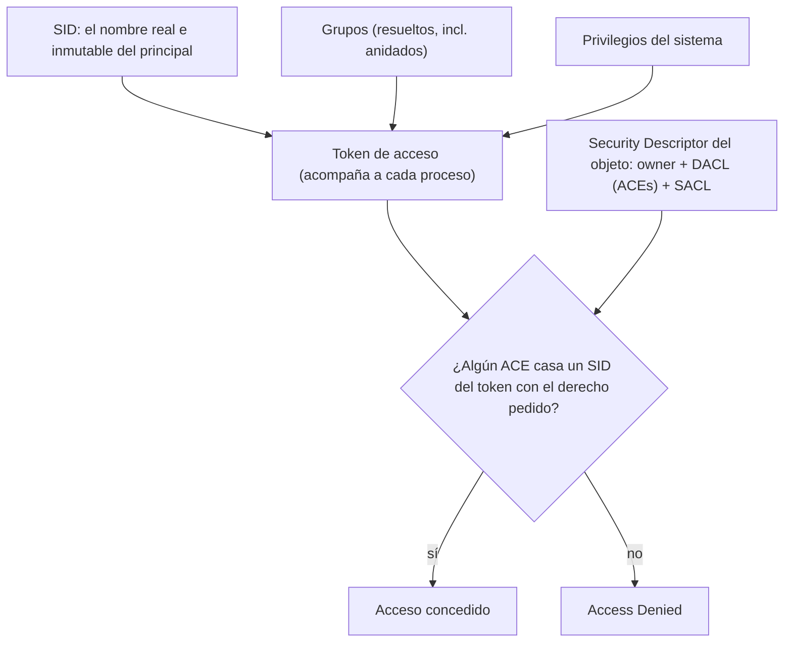

---
tags:
  - Active-Directory
  - Windows
  - Introduccion
  - Tipo/Introduccion
Descripción: "Cómo identifica Windows a cada principal (SID/RID), cómo decide qué puede hacer (token de acceso) y cómo protege cada objeto (security descriptor, DACL/ACE)"
Fecha de actualización: 2026-11-20
Nota previa: ""
Nota siguiente: "[[01 - Dónde viven las credenciales en Windows]]"
Area: "[[Fundamentos AD.base|Fundamentos AD]]"
---
---

Casi todo lo que se ataca en AD —abuso de ACLs, escalada por grupos, `adminCount`, delegación, suplantación— es, por debajo, el mismo mecanismo: **quién eres** (tu identidad), **qué llevas encima** (tu token) y **quién puede tocar qué** (el descriptor de seguridad de cada objeto). Esta nota construye ese mecanismo desde cero, sin asumir nada, porque sin él las notas de ataque parecen magia y con él se vuelven obvias.

# El SID: el verdadero nombre de un principal

Windows **no** identifica a usuarios, grupos ni equipos por su nombre. El nombre (`jsmith`, `Domain Admins`) es una etiqueta para humanos. Internamente usa el **SID** (`Security Identifier`), un identificador único e inmutable. <mark style="background: #ADCCFFA6;">Cambiar el nombre de una cuenta no cambia su SID; borrarla y recrearla con el mismo nombre genera un SID **distinto**</mark> — y por eso la cuenta recreada pierde todos sus accesos, aunque se llame igual.

Un SID tiene esta forma:

```text
S-1-5-21-2974783224-3764228556-2640795941-1104
│ │ │  └──────────── identificador de dominio ───────────┘ └─RID─┘
│ │ └─ autoridad (5 = NT Authority)
│ └─ versión (siempre 1)
└─ es un SID
```

Las dos piezas que importan al atacante:

- El **identificador de dominio** (`21-2974783224-3764228556-2640795941`) es común a **todos** los principales de un mismo dominio. Lo ves una vez y reconoces a qué dominio pertenece cualquier objeto.
- El **RID** (`Relative Identifier`, el último número) distingue al principal dentro del dominio. <mark style="background: #FFB8EBA6;">Algunos RID son fijos y universales</mark>, y conviene memorizarlos porque aparecen constantemente:

| RID | Principal | Por qué importa |
| --- | --- | --- |
| `500` | Administrator del dominio | La cuenta de admin integrada; su RID es 500 aunque la renombren |
| `502` | `krbtgt` | La cuenta cuyo hash firma todos los tickets Kerberos → Golden Ticket |
| `512` | Domain Admins | — |
| `519` | Enterprise Admins | El objetivo del abuso de trust hijo→padre ([[33 - Ataque a trust hijo a padre]]) |
| `520` | Group Policy Creator Owners | — |

<mark style="background: #FF5582A6;">Reconocer que un SID acaba en `-500` o `-519` te dice al instante que estás ante una cuenta crítica</mark>, sin resolver el nombre. Y los SID que **no** empiezan por `S-1-5-21-<dominio>` son *well-known*: `S-1-1-0` es `Everyone`, `S-1-5-18` es `SYSTEM`, `S-1-5-11` es `Authenticated Users`. Los ataques de SID History ([[33 - Ataque a trust hijo a padre]]) consisten precisamente en **inyectar** el SID `-519` del dominio padre en un ticket forjado.

# El token de acceso: lo que llevas encima

Cuando inicias sesión, el `LSA` (Local Security Authority) construye un **token de acceso**: una estructura en memoria que acompaña a cada proceso que lanzas y que responde, cada vez que tocas algo, a la pregunta "¿quién eres y qué puedes hacer?". El token contiene:

- Tu **SID de usuario**.
- Los **SID de todos los grupos** a los que perteneces, directa **e indirectamente** (la pertenencia anidada se resuelve al construir el token). Por eso, tras meterte en un grupo, <mark style="background: #FFB86CA6;">necesitas una sesión nueva para que el cambio surta efecto</mark>: el token ya construido no se actualiza solo.
- Tus **privilegios** (`SeDebugPrivilege`, `SeImpersonatePrivilege`…), que son distintos de los permisos sobre objetos — ver abajo.
- Un campo de **integridad** (Low/Medium/High/System) que es la base de UAC.

> [!important]+ Permiso ≠ privilegio (confusión nº1)
> Windows tiene **dos** sistemas de autorización que conviene no mezclar. Un **permiso** es el derecho a tocar **un objeto concreto** (leer este fichero, modificar esta cuenta de AD) y vive en el descriptor de seguridad del objeto. Un **privilegio** es una capacidad **a nivel de sistema** que no apunta a ningún objeto (`SeDebugPrivilege` = depurar cualquier proceso; `SeImpersonatePrivilege` = suplantar un token; `SeBackupPrivilege` = leer cualquier fichero saltándose las ACL) y vive en el token. La mayoría de las escaladas locales de Windows abusan de un **privilegio**, no de un permiso — por eso `whoami /priv` es de lo primero que se mira.

Que los grupos se resuelvan **dentro del token** es la razón de ser de BloodHound: la pertenencia efectiva (incluida la anidada) determina lo que puedes hacer, y es invisible mirando una cuenta de una en una.

# El descriptor de seguridad: cómo se protege cada objeto

Cada objeto con el que Windows trata —un fichero, una clave de registro, un proceso y, en AD, **cada usuario, grupo, equipo, OU y el propio dominio**— lleva adosado un **security descriptor**. Sus dos partes:

- El **owner** (un SID): quien posee el objeto puede siempre reescribir sus permisos, tenga o no acceso explícito. De ahí que `WriteOwner` sea una vía de escalada ([[26 - Tácticas de abuso de ACLs]]).
- La **DACL** (`Discretionary Access Control List`): la lista de quién puede hacer qué sobre el objeto.

La DACL es una lista de **ACE** (`Access Control Entry`). Cada ACE es una terna:

```text
ACE = [ SID del principal ] + [ derecho concedido/denegado ] + [ sobre qué atributo/objeto ]
```

Por ejemplo: *«el SID del grupo Help Desk — `ForceChangePassword` — sobre el usuario adunn»*. Cuando `adunn` quiere ser tocado, el sistema recorre su DACL comparando los SID del ACE con los SID del **token** del que intenta el acceso. <mark style="background: #8000E1A6;">Aquí se cierra el círculo: identidad (SID) → token (SID + grupos + privilegios) → DACL del objeto (ACE que casan SID con derechos)</mark>. Todo el abuso de ACLs ([[24 - Primer de abuso de ACLs]]) es encontrar ACE mal puestos que dan a un principal que controlas un derecho peligroso sobre un objetivo valioso.

Hay un segundo tipo de ACE, los **derechos extendidos**, identificados por un GUID en vez de por un bit genérico (`ForceChangePassword`, `DS-Replication-Get-Changes` para [[27 - DCSync|DCSync]], la lectura de LAPS). Por eso al enumerar ACLs con PowerView hace falta `-ResolveGUIDs`: sin él esos derechos aparecen como un GUID ilegible ([[25 - Enumeración de ACLs]]).

La otra lista del descriptor, la **SACL** (`System ACL`), no concede acceso: define **qué accesos se auditan**, y es la que genera los eventos `4662`. Para el defensor es la palanca de detección (ver [[37 - Detección y evasión en AD]]); para el atacante, saber que un objeto tiene SACL de lectura significa que tocarlo deja rastro.

# Cómo encaja todo



Con este modelo en la cabeza, las notas de ataque dejan de ser recetas sueltas: `AddMember` cambia los SID de grupo que acabarán en el token de la víctima; `ForceChangePassword` es un derecho de la DACL de una cuenta; DCSync es un derecho extendido sobre el dominio; SID History inyecta un SID de grupo privilegiado en un token forjado. La siguiente pieza es **qué secretos** sostienen estas identidades y dónde se guardan.

> [!info]+ Fuentes
> [Microsoft Learn — Security Identifiers](https://learn.microsoft.com/en-us/windows-server/identity/ad-ds/manage/understand-security-identifiers), [well-known SIDs](https://learn.microsoft.com/en-us/windows-server/identity/ad-ds/manage/understand-security-identifiers#well-known-sids), [Access Tokens](https://learn.microsoft.com/en-us/windows/win32/secauthz/access-tokens) y [Access Control Lists](https://learn.microsoft.com/en-us/windows/win32/secauthz/access-control-lists). Nota de fundamentos net-new; sostiene el abuso de ACLs, privilegios y SID History del área.
