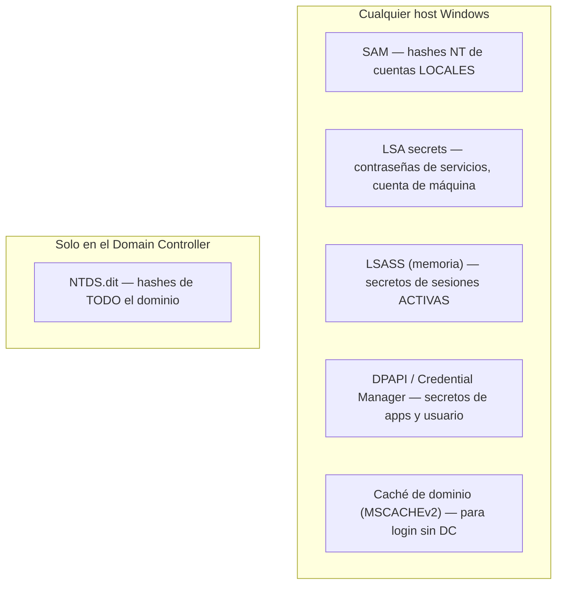

---
tags:
  - Active-Directory
  - Windows
  - Introduccion
  - Tipo/Introduccion
Descripción: "El mapa de todos los almacenes de secretos de Windows (SAM, LSASS, LSA secrets, NTDS.dit, DPAPI, caché) y en qué formato guardan cada cosa y qué es reutilizable"
Fecha de actualización: 2026-11-20
Nota previa: "[[00 - El modelo de identidad de Windows y AD]]"
Nota siguiente: "[[02 - NTLM por dentro]]"
Area: "[[Fundamentos AD.base|Fundamentos AD]]"
---
---

Todo el *credential access* parte de una pregunta: **qué secreto hay, dónde se guarda y en qué forma**. De ahí se deduce lo demás — si hace falta `SYSTEM` para leerlo, si se crackea o se reutiliza tal cual, si sirve para Pass-the-Hash o solo para crackear. Esta nota es el mapa; las notas de extracción concreta (SAM, LSASS, NTDS.dit, DPAPI) viven en `Pentesting/05` y se enlazan desde aquí, pero el *qué y por qué* se explica a fondo aquí para no repetirlo en cada una.

# Los formatos: qué es cada "hash"

Antes de los almacenes, los formatos, porque la confusión entre ellos es la causa nº1 de ataques que no funcionan:

| Formato | Qué es | ¿Reutilizable tal cual? |
| --- | --- | --- |
| `NT hash` | `MD4(contraseña_UTF16LE)`. El "hash NTLM" de la cuenta | **Sí** → Pass-the-Hash ([[13 - Pass the Hash (PtH)]]) |
| `LM hash` | Hash legado (DES, débil), deshabilitado desde Vista | Sí, pero casi extinto |
| `NetNTLMv1/v2` | Respuesta *challenge-response* del protocolo NTLM sobre la red | **No** — solo crackear o *relayar* ([[02 - NTLM por dentro]]) |
| Ticket Kerberos (TGT/TGS) | Credencial temporal emitida por el KDC | **Sí** → Pass-the-Ticket ([[14 - Pass the Ticket (PtT)]]) |
| Clave Kerberos AES | `AES128/256` derivada de la contraseña | Sí → *overpass-the-hash* con AES, más sigiloso |
| Contraseña en claro | — | Sí, todo |

<mark style="background: #FF5582A6;">La distinción que más cuesta y más importa: el **NT hash** se reutiliza directamente (PtH), pero la **respuesta NetNTLMv2** capturada en red **no** — comparten la palabra "NTLM" y no son lo mismo</mark>. El NT hash es el secreto en reposo; el NetNTLMv2 es un cálculo *derivado* de él que viaja por la red y del que no se puede recuperar el NT hash salvo crackeando. El porqué criptográfico está en [[02 - NTLM por dentro]].

# Los almacenes: dónde vive cada secreto

**SAM** (`Security Account Manager`) guarda los hashes NT de las cuentas **locales** del equipo (incluido el `Administrator` local). Está cifrado con una clave (la *SysKey* / *bootkey*) que vive en la *hive* `SYSTEM`. Por eso para volcar SAM hace falta leer `SAM` **y** `SYSTEM`, y eso exige `SYSTEM` o `SeBackupPrivilege`. Extracción: [[06 - Ataque a SAM, SYSTEM y SECURITY]]. <mark style="background: #FFB86CA6;">El botín de SAM es admin **local**, no de dominio</mark> — su valor está en la reutilización entre equipos con la misma imagen (de ahí LAPS como defensa).

**LSASS** (`Local Security Authority Subsystem Service`) es el proceso que mantiene en **memoria** los secretos de las sesiones **activas**: NT hashes, tickets Kerberos, y —en sistemas viejos o con WDigest activo— contraseñas en claro. Es el objetivo más jugoso porque <mark style="background: #8000E1A6;">contiene las credenciales de **cualquiera que haya iniciado sesión** en ese host, incluido un admin de dominio que pasó por ahí</mark>. Volcarlo (mimikatz `sekurlsa::`, `comsvcs.dll`, etc.) requiere `SeDebugPrivilege`. Extracción y sus defensas (PPL, Credential Guard) en [[07 - Ataque a LSASS]]. Esto es lo que hace del movimiento lateral un problema: una sesión de DA en un servidor cualquiera expone al DA entero.

**LSA secrets** (en la *hive* `SECURITY`) guarda secretos de servicios, tareas programadas y —clave— la contraseña de la **cuenta de máquina** (`EQUIPO$`), que es una credencial de dominio válida. También en [[06 - Ataque a SAM, SYSTEM y SECURITY]].

**NTDS.dit** es la base de datos de AD, y **solo existe en los DC**. Contiene los hashes NT (y claves Kerberos) de **todas** las cuentas del dominio. Es el premio final: quien lo lee tiene el dominio entero, incluido `krbtgt`. Se obtiene copiándolo (con VSS, por `SeBackupPrivilege`) o, en caliente y sin tocar el disco, por replicación — que es [[27 - DCSync|DCSync]]. Extracción offline en [[09 - Ataque a Active Directory y NTDS.dit]].

**DPAPI** (`Data Protection API`) es el sistema con el que Windows cifra los secretos "de usuario": contraseñas guardadas del navegador, credenciales del `Credential Manager`, claves wifi, certificados. La clave de cifrado deriva de la contraseña del usuario (o de una *backup key* del dominio que solo el DC tiene). Es una mina frecuentemente ignorada; detalle en [[08 - Ataque a Credential Manager y DPAPI]].

**Caché de dominio** (`MSCACHEv2`, *DCC2*): cuando inicias sesión con una cuenta de dominio en un portátil, Windows guarda un verificador en caché para dejarte entrar sin el DC (viajas, el DC no está). <mark style="background: #FFB8EBA6;">No es reutilizable (no es el NT hash ni PtH-able): solo se puede crackear offline</mark>, y es lento (`-m 2100` en Hashcat). Aun así, en un portátil es a veces la única credencial de dominio a mano.

# Por qué este mapa ordena el ataque

El *credential access* no es "corre mimikatz": es elegir el almacén según dónde estás y qué privilegio tienes.

- ¿Admin local de un host? → SAM (reutilizar entre equipos clonados), LSASS (robar la sesión de alguien más privilegiado).
- ¿`SeBackupPrivilege` sin ser admin pleno? → copiar SAM/SYSTEM o NTDS.dit saltándote las ACL.
- ¿Admin de dominio o derechos de replicación? → DCSync, el dominio entero sin tocar ningún disco.
- ¿Un portátil sin más? → caché de dominio, DPAPI.

Y cada secreto desemboca en un formato de la primera tabla, que decide el siguiente movimiento: NT hash → PtH; ticket → PtT; NetNTLMv2 → crackear/relay; clave AES → overpass-the-hash sigiloso. El porqué de que unos se reutilicen y otros no lo explican las dos notas siguientes: el protocolo [[02 - NTLM por dentro|NTLM]] y, sobre todo, [[03 - Kerberos por dentro|Kerberos]].

> [!info]+ Fuentes
> [Microsoft — Credentials Processes in Windows Authentication](https://learn.microsoft.com/en-us/windows-server/security/windows-authentication/credentials-processes-in-windows-authentication), [Cached and stored credentials](https://learn.microsoft.com/en-us/previous-versions/windows/it-pro/windows-server-2012-r2-and-2012/hh994565(v=ws.11)) y [DPAPI](https://learn.microsoft.com/en-us/windows/win32/seccng/cng-dpapi). Nota de fundamentos net-new; el *qué/dónde/formato* que las notas de extracción de `Pentesting/05` dan por sabido.
