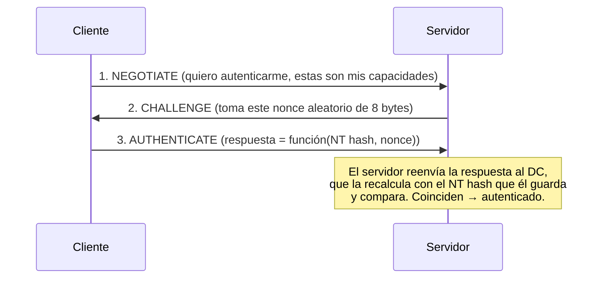
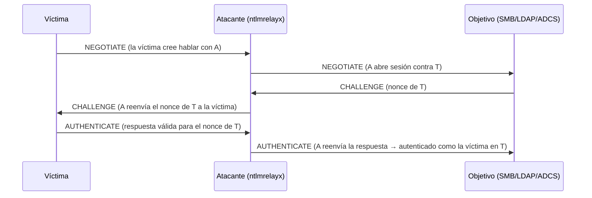

---
tags:
  - Active-Directory
  - Windows
  - Introduccion
  - Tipo/Introduccion
Descripción: "El protocolo NTLM paso a paso: challenge-response, por qué el NT hash no viaja, por qué el NetNTLMv2 capturado no es PtH-able y cómo funciona el relay a bajo nivel"
Fecha de actualización: 2026-11-20
Nota previa: "[[01 - Dónde viven las credenciales en Windows]]"
Nota siguiente: "[[03 - Kerberos por dentro]]"
Area: "[[Fundamentos AD.base|Fundamentos AD]]"
---
---

NTLM es el protocolo de autenticación **heredado** de Windows: anterior a Kerberos, todavía activo por defecto, y el que entra en juego cuando Kerberos no puede (autenticación por IP en vez de por nombre, host fuera del dominio, protocolos antiguos). Entenderlo byte a byte aclara de golpe tres cosas que confunden a todo el mundo: por qué Pass-the-Hash funciona, por qué lo que captura `Responder` **no** es Pass-the-Hash, y por qué el *relay* es tan potente.

# Challenge-response: el baile de tres mensajes

NTLM nunca manda la contraseña ni el hash por la red. Usa un esquema **challenge-response** de tres mensajes entre el cliente y el servidor:

La clave está en el paso 3. El cliente coge el `nonce` que le mandó el servidor, lo combina criptográficamente con su **NT hash** y devuelve el resultado. <mark style="background: #ADCCFFA6;">Esa respuesta es el `NetNTLM`</mark>. El servidor (o el DC, que es quien tiene el NT hash guardado) hace el mismo cálculo y compara: si cuadra, el cliente demostró **poseer el NT hash** sin haberlo enviado.

<mark style="background: #8000E1A6;">De ahí sale, de forma inevitable, Pass-the-Hash</mark>: el protocolo nunca pide la contraseña, solo demuestra posesión del NT hash. Si robas el NT hash (de SAM, LSASS, NTDS.dit → [[01 - Dónde viven las credenciales en Windows]]), puedes completar el paso 3 **sin conocer la contraseña**. El protocolo no distingue entre "sé la contraseña y derivé el hash" y "tengo el hash robado". Por eso PtH no es un exploit de un bug: es el funcionamiento normal de NTLM usado con un hash que no deberías tener.

# v1 vs v2

Hay dos versiones de la respuesta, y la diferencia es puramente la calidad criptográfica:

- **NetNTLMv1**: usa DES sobre el `nonce` del servidor. Débil: si capturas una respuesta v1, se puede "crackear" casi instantáneamente contra *rainbow tables* (crack.sh) para recuperar el NT hash — <mark style="background: #FF5582A6;">y ahí sí recuperas un hash PtH-able</mark>. Forzar a un objetivo a hablar v1 (*downgrade*, p. ej. con el truco de `mic`/LLMNR) es un ataque en sí.
- **NetNTLMv2**: usa HMAC-MD5 e incluye un `nonce` también del cliente y una marca de tiempo. Mucho más robusto: no hay *rainbow tables* útiles; solo se puede atacar por **diccionario/fuerza bruta** offline (Hashcat `-m 5600`), que solo funciona si la contraseña es débil.

# Por qué el NetNTLMv2 capturado NO es Pass-the-Hash

Esta es la confusión que esta nota existe para matar. Cuando `Responder` envenena LLMNR ([[18 - Envenenamiento LLMNR y NBT-NS]]) y "captura un hash", lo que captura es el **mensaje 3**, la respuesta `NetNTLMv2`. Y esa respuesta:

1. Es el resultado de `HMAC-MD5(NT_hash, nonce_servidor + nonce_cliente + timestamp + ...)`. Es una **función de un solo sentido** del NT hash combinado con nonces **irrepetibles**.
2. <mark style="background: #FFB86CA6;">No contiene el NT hash y no se puede invertir para obtenerlo</mark> (salvo adivinando la contraseña por fuerza bruta).
3. Está atada a **ese** challenge concreto. No se puede reenviar a otro servidor que mandará un `nonce` distinto.

Por eso con un `NetNTLMv2` solo tienes **dos** caminos, y ninguno es PtH:

- **Crackearlo** offline (depende de contraseña débil).
- **Relayarlo** (reenviarlo en vivo a otro servicio) — la vía que no depende de la contraseña.

Mientras que con un **NT hash** (robado de un almacén) sí haces PtH directo. Misma palabra "NTLM", dos objetos criptográficamente distintos: uno es el secreto en reposo (reutilizable), el otro un cálculo derivado y efímero (no reutilizable).

# El relay: por qué es la vía reina

Si no puedes invertir el `NetNTLMv2` ni crackearlo, ¿por qué es tan temido? Porque no hace falta romperlo: basta **reenviarlo en tiempo real** antes de que caduque. El atacante se pone **en medio**:

<mark style="background: #FF5582A6;">El truco: el atacante no genera el challenge, lo **reenvía** desde el objetivo real</mark>. Así la respuesta que da la víctima es válida para el objetivo, y el atacante acaba autenticado en el objetivo **como la víctima**, sin su contraseña ni su hash. Con eso vuelca la SAM del objetivo, escribe `msDS-AllowedToActOnBehalfOfOtherIdentity` (RBCD) vía LDAP, o pide un certificado en ADCS (ESC8).

Lo único que lo para es la **firma** (`signing`): si el objetivo exige que la sesión vaya firmada con una clave derivada de la credencial real, el atacante —que no la tiene— no puede firmar los mensajes siguientes y el relay muere. Por eso "SMB signing / LDAP signing + channel binding" es la mitigación, y por eso el *downgrade* o los *bugs* que saltan la firma (como `CVE-2026-70229`, [[30 - Vulnerabilidades bleeding-edge]]) son tan valiosos. El detalle operativo del combo coacción→relay está en [[18 - Envenenamiento LLMNR y NBT-NS]] y [[30 - Vulnerabilidades bleeding-edge]].

# Dónde encaja NTLM hoy

Kerberos ([[03 - Kerberos por dentro]]) es el protocolo por defecto en un dominio, pero NTLM sigue vivo y es imposible de apagar del todo sin romper cosas: se usa en autenticación por IP, con hosts no unidos al dominio, y en protocolos heredados. Microsoft trabaja en su retirada (auditoría de uso de NTLM, "NTLM deprecation" anunciada), pero en 2026 sigue presente en prácticamente todos los dominios — por eso LLMNR+relay sigue siendo el combo de acceso inicial más fiable.

> [!info]+ Fuentes
> [Microsoft — NTLM](https://learn.microsoft.com/en-us/windows-server/security/kerberos/ntlm-overview) y [MS-NLMP (protocolo NTLM)](https://learn.microsoft.com/en-us/openspecs/windows_protocols/ms-nlmp/b38c36ed-2804-4868-a9ff-8dd3182128e4). Ataque a NetNTLMv1: [crack.sh](https://crack.sh/). Nota de fundamentos net-new; el porqué criptográfico que las notas de LLMNR/relay dan por sabido.
