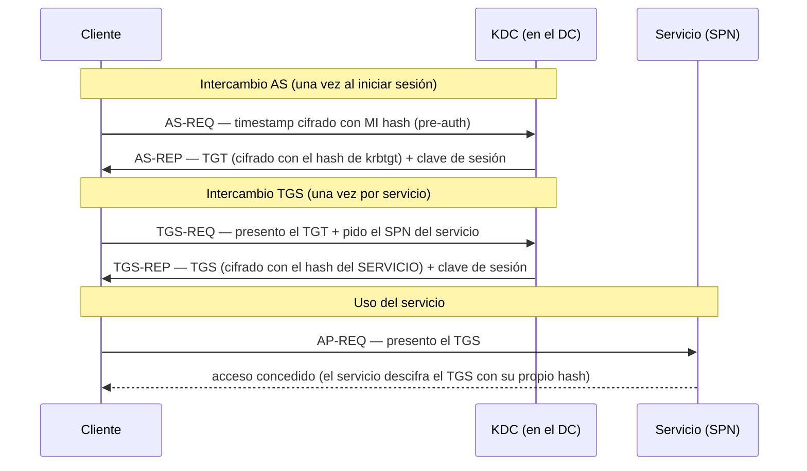

---
tags:
  - Active-Directory
  - Windows
  - Introduccion
  - Tipo/Introduccion
Descripción: "Kerberos de punta a punta: AS-REQ/TGT, TGS/SPN, claves de sesión, y el PAC — la pieza que explica kerberoasting, golden/silver/diamond tickets y la delegación"
Fecha de actualización: 2026-11-20
Nota previa: "[[02 - NTLM por dentro]]"
Nota siguiente: "[[04 - Introducción a la enumeración y ataques en AD]]"
Area: "[[Fundamentos AD.base|Fundamentos AD]]"
---
---

Kerberos es el protocolo de autenticación **por defecto** en un dominio, y la base de casi todos los ataques de AD de alto impacto: kerberoasting, AS-REP roasting, golden/silver/diamond tickets, delegación, Pass-the-Ticket. Casi nadie lo explica con calma, y por eso esos ataques se memorizan como recetas. Esta nota lo construye entero —incluido el **PAC**, la pieza que casi ninguna fuente desarrolla y que es la que de verdad lo explica todo—.

# La idea central: tickets, no contraseñas

NTLM demuestra posesión del hash en cada autenticación ([[02 - NTLM por dentro]]). Kerberos cambia el modelo: te autenticas **una vez** ante una autoridad central —el `KDC` (Key Distribution Center), que corre en el DC— y recibes a cambio un **ticket** que presentas a los servicios. El servicio **no habla con el DC** para validarte: confía en el ticket porque está cifrado con una clave que solo el DC y el servicio conocen. Esta confianza descentralizada es lo potente y, a la vez, lo explotable.

Regla de oro que hay que fijar antes de nada: <mark style="background: #ADCCFFA6;">en Kerberos, la "clave" de un principal es su hash — el NT hash (para cifrado RC4) o la clave AES derivada de su contraseña</mark>. Cuando una nota dice "cifrado con la clave de la cuenta de servicio", quiere decir "con su hash". Ahí está la raíz del kerberoasting.

# El baile completo: AS y TGS

Kerberos tiene dos intercambios. El primero (**AS**, Authentication Service) te da un **TGT**; el segundo (**TGS**, Ticket Granting Service) canjea el TGT por un ticket para un servicio concreto.

Paso a paso, con el porqué de cada pieza:

1. **AS-REQ (pre-autenticación).** El cliente manda un `timestamp` cifrado con **su propio hash**. El KDC lo descifra con el hash que él guarda de esa cuenta: si el timestamp sale coherente, el cliente demostró conocer su clave. <mark style="background: #FFB8EBA6;">Si una cuenta tiene la pre-autenticación **desactivada**, el KDC responde sin exigir ese timestamp cifrado</mark> — y ahí nace el **AS-REP roasting**: pides un AS-REP de esa cuenta y obtienes material cifrado con su hash para crackear offline, sin credenciales ([[18 - Envenenamiento LLMNR y NBT-NS]] y las notas de credenciales).

2. **AS-REP → TGT.** El KDC devuelve el **TGT**, cifrado con el **hash de la cuenta `krbtgt`** (la cuenta RID 502, ver [[00 - El modelo de identidad de Windows y AD]]). El cliente **no puede leer** el TGT (no tiene el hash de krbtgt); solo lo guarda y lo reutiliza. <mark style="background: #8000E1A6;">Que el TGT lo cifre krbtgt es la razón del Golden Ticket</mark>: quien roba el hash de krbtgt (vía [[27 - DCSync|DCSync]]) puede **forjar TGT arbitrarios** —para cualquier usuario, con cualquier grupo— y el KDC los aceptará como legítimos.

3. **TGS-REQ.** Para usar un servicio, el cliente presenta el TGT y pide el **SPN** (`Service Principal Name`) del servicio, p. ej. `MSSQLSvc/sql01.dominio.local:1433`. El SPN es el identificador del servicio en Kerberos y está asociado a la cuenta que lo ejecuta.

4. **TGS-REP → TGS.** El KDC devuelve el **TGS**, cifrado con el **hash de la cuenta que posee el SPN**. Aquí está el kerberoasting: <mark style="background: #FF5582A6;">cualquier usuario autenticado puede pedir un TGS de cualquier SPN, y el TGS viene cifrado con el hash de la cuenta de servicio</mark> → lo pides, te lo llevas y lo crackeas offline para recuperar la contraseña del servicio ([[23 - Kerberoasting]]). El KDC no comprueba si tienes permiso de *usar* el servicio — eso lo decide el servicio después.

5. **AP-REQ.** El cliente presenta el TGS al servicio, que lo descifra **con su propio hash** (que sí conoce) y confía en su contenido. Si el servicio es `krbtgt`… no; si un atacante conoce el hash del servicio puede forjar un **Silver Ticket**: un TGS falso para ese servicio concreto, sin pasar por el KDC.

# El PAC: la pieza que lo explica todo

Aquí está lo que casi ninguna fuente desarrolla. Un ticket no solo dice "este es el usuario X": lleva dentro el **PAC** (`Privilege Attribute Certificate`), una estructura con <mark style="background: #ADCCFFA6;">los SID del usuario y de **todos sus grupos**</mark> — es decir, su autorización. El servicio lee el PAC del ticket para construir el token de acceso del usuario ([[00 - El modelo de identidad de Windows y AD]]) sin volver a preguntar al DC.

El PAC va **firmado** con la clave de krbtgt (y la del servicio). De aquí se deduce todo:

- **Golden Ticket**: con el hash de krbtgt forjas un TGT con un PAC que dice lo que quieras —"soy Administrator, miembro de Domain Admins y Enterprise Admins"—, y la firma cuadra porque tienes la clave de krbtgt. Control total y persistente.
- **Por qué el PAC es el talón de Aquiles de las defensas**: Microsoft ha ido endureciendo la **validación del PAC** (parches de 2021-2022, el *PAC validation* obligatorio) precisamente porque un PAC forjado o manipulado es el núcleo de golden/diamond. Ataques como NoPac/Certifried ([[30 - Vulnerabilidades bleeding-edge]]) juegan con cómo el KDC rellena el PAC.
- **Diamond Ticket vs Golden Ticket**: un Golden Ticket se forja **de cero** (no hay AS-REQ real → heurística de detección "TGT sin AS-REQ previo"). Un **Diamond Ticket** pide un TGT legítimo (hay AS-REQ real) y solo **modifica su PAC** antes de reusarlo → evade esa heurística. Esa diferencia, que parece un detalle, es pura OPSEC de CRTO ([[37 - Detección y evasión en AD]]).

# Tipos de cifrado: RC4 vs AES

La "clave" del principal puede ser su NT hash (para cifrado **RC4**, tipo `0x17`) o una clave **AES** (tipo `0x12` para AES-256) derivada de la contraseña. Importa por dos motivos operativos:

- **Velocidad de crackeo**: un ticket RC4 se crackea mucho más rápido que uno AES (Hashcat `13100` vs `19700`). De ahí que los atacantes forzaran el *downgrade* a RC4.
- **Sigilo**: pedir tickets en RC4 en un dominio que usa AES por defecto es una **anomalía detectable** (evento `4769` con `Ticket Encryption Type 0x17`). Forjar con AES (`/aes256`) en vez de con el NT hash (`/rc4`) es más silencioso. Esto reaparece en kerberoasting, golden tickets y el ataque hijo→padre ([[33 - Ataque a trust hijo a padre]]).

# Delegación, en una frase cada una

La delegación es "deja que un servicio actúe **en tu nombre** contra otro servicio". Tres sabores, todos abusables:

- **No restringida (unconstrained)**: el servicio recibe una copia de **tu TGT** → si comprometes ese servicio, robas los TGT de todos los que pasan por él (incluido un DA).
- **Restringida (constrained, KCD)**: el servicio puede actuar en tu nombre solo contra una lista de SPN (`msDS-AllowedToDelegateTo`).
- **Basada en recursos (RBCD)**: el **objetivo** define quién puede delegar hacia él (`msDS-AllowedToActOnBehalfOfOtherIdentity`) → si puedes escribir ese atributo, te concedes delegación.

El mecanismo fino (S4U2Self/S4U2Proxy) y la explotación están en las notas de escalada; aquí basta saber que los tres manipulan el flujo de tickets que acabas de ver, y que sus atributos se cazan por LDAP ([[12 - Filtros de alto valor para el atacante]]).

Con el modelo de identidad, los almacenes de credenciales, NTLM y Kerberos claros, las notas de ataque del área dejan de ser recetas: cada una manipula una pieza concreta de este andamiaje. El recorrido ofensivo arranca en [[04 - Introducción a la enumeración y ataques en AD]].

> [!info]+ Fuentes
> [RFC 4120 — The Kerberos Network Authentication Service (V5)](https://www.rfc-editor.org/info/rfc4120), [MS-KILE (Kerberos de Microsoft)](https://learn.microsoft.com/en-us/openspecs/windows_protocols/ms-kile/2a32282e-dd48-4ad9-a542-609804b02cc9) y [MS-PAC (estructura del PAC)](https://learn.microsoft.com/en-us/openspecs/windows_protocols/ms-pac/166d8064-c863-41e1-9c23-edaaa5f36962). Nota de fundamentos net-new; la base criptográfica que kerberoasting, golden/diamond y delegación dan por sabida.
