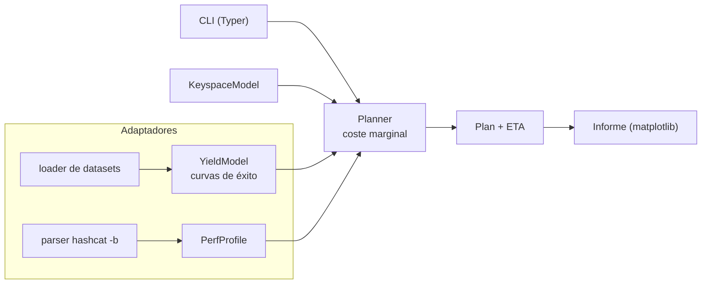

---
tags:
  - Proyectos
  - Python
  - Seguridad/Contraseñas
  - Tipo/Proyecto
Descripción: "Decide qué ataque de cracking lanzar dado un presupuesto de horas, modelando keyspace × velocidad × probabilidad de acierto en vez de tirar rockyou y esperar"
Fecha de actualización: 2026-09-21
Nota previa: "[[15 - Implante C2 con OPSEC medible]]"
Nota siguiente: "[[17 - Discriminador de oráculos temporales]]"
Area: "[[Proyectos ofensivos.base|Proyectos ofensivos]]"
Estado: Idea
Dificultad: 1
Esfuerzo: 1-2 semanas
Lenguaje: Python
---
---

**Nombre propuesto**: `crackbudget`

Abre el catálogo de Python. Es el proyecto más sencillo de los diez y, como el `scopeguard` en el catálogo de Go, el que más veces te va a ahorrar horas muertas: el cracking se hace casi siempre a ojo —`hashcat -m 22000 hash rockyou.txt`, esperar, probar `best64`, esperar más— cuando es un problema de **asignación de recursos** que se puede planificar con aritmética antes de tocar la GPU.

# El problema que resuelve

En un engagement tienes N hashes de un tipo concreto, una GPU con un rendimiento medible y una ventana de tiempo. La pregunta real no es "¿lanzo `rockyou`?", es <mark style="background: #ADCCFFA6;">qué secuencia de ataques maximiza contraseñas recuperadas por hora invertida</mark>. Un `bcrypt` a 200 kH/s y un `NTLM` a 288 GH/s son universos distintos: la máscara de 8 caracteres que en NTLM revientas en minutos, en bcrypt no la terminas ni dejándola el fin de semana. El operador experto lo intuye; la intuición falla justo cuando el hash es raro (`-m` que no tocas a menudo) o cuando hay que justificarle al cliente por qué no se sacaron más credenciales.

`crackbudget` convierte esa intuición en un plan: le das el modo de hashcat, el número de hashes, el rendimiento de tu equipo y las horas disponibles, y te devuelve una **secuencia ordenada de ataques con su ETA y su rendimiento esperado**, de más barato a más caro por contraseña.

# Alcance del proyecto

Una herramienta CLI + librería con tres piezas:

1. **Modelo de keyspace.** Calcula el tamaño del espacio de cada ataque: diccionario (líneas), diccionario × reglas (líneas × reglas, con el conteo real de los `.rule`), máscara (producto de charsets), combinator e híbridos. Reproduce la aritmética que hashcat imprime en `--keyspace`, pero *antes* de lanzarlo y para comparar varios de una vez.
2. **Modelo de rendimiento.** Lee un perfil de benchmark (`hashcat -b -m <modo>` parseado, o una tabla calibrada) para tu hardware. La velocidad depende del modo, no del ataque; el ETA es `keyspace / velocidad`.
3. **Modelo de rendimiento esperado (*yield*).** Aquí está el valor real y lo que nadie automatiza: estimar <mark style="background: #FFB86CA6;">qué fracción de los hashes cae con cada ataque</mark>, a partir de curvas de éxito publicadas (Weir/PCFG, análisis de brechas reales) y de la política de contraseñas del objetivo si se conoce. Ordena el plan por *coste marginal por contraseña*, no por ETA absoluto.

# Funcionalidades principales

| Funcionalidad                  | Por qué importa                                                                                                                                                     |
| ------------------------------ | ------------------------------------------------------------------------------------------------------------------------------------------------------------------- |
| Plan de ataque escalonado      | Emite la secuencia `wordlist → best64 → OneRule → híbrido → máscara`, cada paso con ETA y rendimiento esperado acumulado, para saber cuándo parar                   |
| Comparador de modos            | El mismo plan sobre NTLM vs bcrypt vs WPA2 deja ver de un vistazo qué es tratable y qué es fantasía dentro del presupuesto                                          |
| Punto de corte por presupuesto | Dado "tengo 12 horas", marca hasta qué ataque llegas y descarta lo que no cabe, en vez de dejarte una máscara de 10 días a medias                                   |
| Incorporación de la política   | Si conoces la `password policy` (longitud mínima, complejidad), poda el keyspace de las máscaras a lo que la política permite — reduce el espacio de forma legítima |
| Coste marginal                 | Ordena por contraseñas nuevas esperadas por hora, no por ETA: un ataque lento que saca el 40% va antes que uno rápido que saca el 2%                                |

# Funcionalidades secundarias

- **Reparto multi-GPU / multi-nodo**: escalar el ETA por el número de dispositivos y avisar del punto en que el `bcrypt` sigue sin ser tratable ni con un rig.
- **Estimación de coste en nube**: traducir el ETA a horas de instancia GPU y a euros, para decidir si compensa alquilar (con el aviso de que los rangos y precios caducan — no hardcodear catálogos como hace HTB con las Tesla K80 muertas).
- **Post-mortem**: tras el crack real, comparar rendimiento esperado vs. obtenido y recalibrar las curvas de éxito. Cada engagement mejora el modelo.
- **Export a informe**: tabla lista para pegar en el reporte justificando la estrategia de cracking y su cobertura.

# Casos de uso y actores

- **Pentester / red teamer** con un volcado de NTDS o un `-m 22000` de Wi-Fi y poco tiempo: planifica antes de quemar la ventana.
- **Bug hunter** con hashes filtrados en un dump: decide si vale la pena el cómputo.
- **Formación**: enseña de forma tangible por qué el `work factor` de bcrypt/argon2 importa — se ve en el ETA, no en la teoría.

# Qué existe ya y dónde se queda corto

- **hashcat** imprime `--keyspace` y un ETA *por ataque ya lanzado*, para un solo comando. No planifica una secuencia, no compara modos, no modela rendimiento esperado ni ordena por coste marginal.
- Guías como la de [Synacktiv "Unleash the dino"](https://www.synacktiv.com/en/publications/unleash-the-dino-time-based-strategies-to-improve-password-cracking) formalizan la estrategia *fast-to-thorough* como conocimiento humano, pero no hay herramienta que la ejecute sobre tus números.
- Los generadores tipo **PCFG / OMEN** modelan probabilidad de contraseñas para *generar* candidatas, no para *presupuestar* una campaña. `crackbudget` los usaría como fuente de las curvas de éxito, no compite con ellos.

El hueco real: **planificación de campaña**, no generación ni cracking. Nadie lo cubre.

# Por qué Python

Es un problema de modelado numérico y datos, el terreno natural de Python: `numpy`/`pandas` para la aritmética de keyspace y las curvas de éxito, `matplotlib` para las gráficas coste-beneficio del informe, y parseo trivial de la salida de `hashcat -b`. En Go escribirías a mano lo que aquí es una línea de `pandas`, y el output visual (curvas de cobertura) es donde Python brilla y Go sufre.

# Arquitectura

Arquitectura **hexagonal** (puertos y adaptadores): el valor está en el modelo de decisión, y ese modelo no debe saber nada de hashcat ni de ficheros. El núcleo es puro y determinista —recibe números, devuelve un plan—, y los detalles sucios (parsear `hashcat -b`, leer datasets) viven en adaptadores intercambiables. Así el planificador se testea sin GPU ni ficheros, solo con datos en memoria.

- **Dominio** (`keyspace`, `yield`, `planner`): funciones puras, sin efectos. `KeyspaceModel` y `YieldModel` son estrategias intercambiables (un ataque diccionario, uno por máscara, uno híbrido implementan la misma interfaz `Attack`).
- **Adaptadores**: `PerfProfile` (parsea `hashcat -b` o una tabla calibrada), `DatasetLoader` (curvas de éxito). Aislados tras interfaces → mockeables en test.
- **Presentación**: CLI y generador de informe. Nunca contienen lógica de decisión.

Decisión de ingeniería clave: el *coste marginal* se calcula con **programación dinámica** sobre la secuencia de ataques (cada paso descuenta los hashes ya recuperados por los anteriores), no ataque a ataque de forma independiente — es lo que evita recomendar dos ataques que cubren lo mismo.

# Stack de implementación (Python)

| Capa | Librería | Por qué (fundamento senior) | Alternativa descartada |
| --- | --- | --- | --- |
| Núcleo numérico | `numpy` + `pandas` | Las curvas de éxito y el keyspace son series; vectorizar evita bucles Python y hace el modelo legible como un `DataFrame` | Cálculo a mano en listas — lento e ilegible |
| Modelo de datos | `pydantic` v2 | Valida el perfil de hardware, los modos y el fichero de presupuesto con tipos y fail-fast; frozen para inmutabilidad del dominio | `dict` crudos — errores silenciosos en runtime |
| CLI | `Typer` | Subcomandos tipados, `--help` autogenerado y testeable con `CliRunner` sin lanzar procesos | `argparse` (boilerplate), `click` (menos integración con tipos) |
| Gráficas | `matplotlib` | Exporta PNG/SVG estático para el informe, sin servidor | `plotly` — interactividad que un informe offline no usa |
| Test | `pytest` + `Hypothesis` | *Property-based*: verificar invariantes del keyspace (monotonía respecto a longitud, cota superior) con casos generados, no tres ejemplos | Solo unit tests — no cubre el espacio |

> **Transversal a todo el catálogo**: `uv` para entorno y lock reproducibles, `ruff` (lint+formato), `mypy --strict`, y distribución como herramienta aislada con `uv tool`/`pipx`. Salida legible con `rich`, logs estructurados (JSON) con `structlog` para dejar evidencia.

# Plan de implementación por fases

1. **Walking skeleton (semana 1)**: CLI mínima que, para un solo modo y un solo ataque diccionario, calcula keyspace → ETA con un `PerfProfile` hardcodeado. Atraviesa las tres capas de punta a punta; nada de yield todavía.
2. **Modelo de rendimiento real**: adaptador que parsea `hashcat -b`; añadir máscaras, reglas (conteo real de `.rule`) e híbridos al `KeyspaceModel`.
3. **Modelo de yield y coste marginal**: cargar curvas de éxito, implementar la programación dinámica del plan escalonado. Aquí aparece el valor diferenciador.
4. **Comparador de modos + informe**: la vista multi-modo, la poda por política de contraseñas, y el export gráfico. Post-mortem de recalibración como cierre.

# Cosas a tener en cuenta

> [!warning]+ El rendimiento esperado es una estimación, no una promesa
> La fracción de hashes que cae depende de la población de usuarios, que no conoces del todo. Presenta el *yield* como un rango con su fuente, nunca como un número exacto — es la diferencia entre un plan honesto y un adorno que se desmiente en cuanto arranca el crack.

- **La velocidad es del modo, no del ataque.** Un error clásico es asumir la velocidad de NTLM para todo. El benchmark hay que tenerlo por `-m`, y bcrypt/argon2/scrypt son órdenes de magnitud más lentos por diseño (ese *es* su propósito).
- **Las reglas no multiplican linealmente el rendimiento.** Dos ficheros de 100 reglas dan 10.000 combinaciones por palabra en keyspace, pero muchas colisionan o generan candidatas absurdas. El *yield* marginal cae rápido; modelar eso es parte de la gracia.
- **No hardcodear catálogos de nube.** Precios e instancias GPU caducan (la receta de HTB con `8× Tesla K80` en GCP es literalmente irreproducible desde 2024). Si se estima coste cloud, que sea con datos consultados en el momento.
- **Sal e iteraciones.** En `-m 22000` la sal es el ESSID y hashcat la amortiza; en bcrypt cada hash tiene su sal y su coste. El modelo tiene que distinguir hashes con sal única de los que la comparten.

# Fuera de alcance

No crackea nada — no envuelve a hashcat para ejecutarlo, solo planifica. No genera wordlists ni reglas (eso ya lo hacen PCFG/OMEN/maskprocessor). Mantener ese límite es lo que lo hace terminable en una o dos semanas y evita reimplementar medio ecosistema.

# Criterio de terminado

Presentable en el portfolio cuando: dado un `-m`, un recuento de hashes y un presupuesto de horas, emite un plan escalonado con ETA y cobertura esperada por paso; compara al menos tres modos dejando claro cuál es tratable; y un post-mortem sobre un crack real recalibra la curva y mejora la siguiente estimación.

# Conexiones en el vault

El modelo de ataques sale directamente de [[00 - Introducción a los ataques a contraseñas]] y de [[01 - Wordlists y reglas personalizadas]]; el detalle de modos, máscaras y benchmark vive en el arsenal de [[00 - Introducción a Hashcat]], [[03 - Máscaras y charsets personalizados]] y [[04 - Backends, dispositivos y tuning]]. Alimenta la fase de [[09 - Ataque a Active Directory y NTDS.dit]] (qué hacer con el volcado) y complementa al planificador [[04 - Planificador de spraying con modelo de bloqueo]] del catálogo de Go: aquel modela el riesgo de bloqueo *online*, este el presupuesto de cracking *offline*.

> [!info]+ Fuentes
> - hashcat wiki, [mask_attack](https://hashcat.net/wiki/doku.php?id=mask_attack) — cálculo de keyspace de máscaras (consultado 2026-09-21).
> - Synacktiv, [Unleash the dino: time-based strategies to improve password cracking](https://www.synacktiv.com/en/publications/unleash-the-dino-time-based-strategies-to-improve-password-cracking) — la estrategia fast-to-thorough como método (2026).
> - Weir, Aggarwal et al., *Password Cracking Using Probabilistic Context-Free Grammars* (IEEE S&P) — base teórica de las curvas de éxito.
