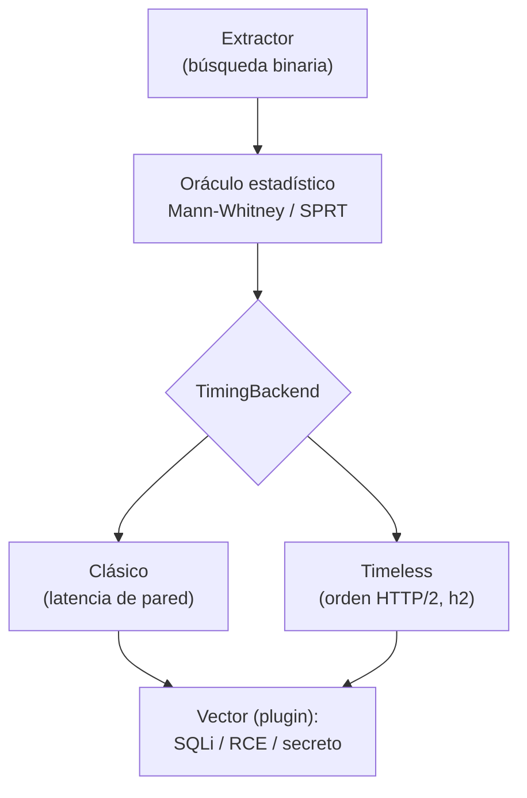

---
tags:
  - Proyectos
  - Python
  - Web/Red-Team
  - SQLi
  - Tipo/Proyecto
Descripción: "Convierte un oráculo booleano ciego y ruidoso en una decisión estadística fiable: mide con tests de hipótesis y añade timeless timing sobre HTTP/2 para anular el jitter de red"
Fecha de actualización: 2026-09-21
Nota previa: "[[16 - Planificador de presupuesto de cracking]]"
Nota siguiente: "[[18 - Constructor de escapes de plantillas]]"
Area: "[[Proyectos ofensivos.base|Proyectos ofensivos]]"
Estado: Idea
Dificultad: 2
Esfuerzo: 2 semanas
Lenguaje: Python
---
---

**Nombre propuesto**: `oráculo` (`timing-oracle`)

Toda extracción a ciegas —blind SQLi basada en tiempo, RCE ciega con `sleep`, timing side-channels de comparación de credenciales— se reduce a leer un bit por respuesta: verdadero o falso. El método estándar, y el de HTB, es <mark style="background: #FFB8EBA6;">un `SLEEP(5)` y un `if response_time > 2.5`</mark>. Ese umbral fijo es frágil: sobre una red con jitter, un pico de latencia da un falso positivo, un servidor cargado da un falso negativo, y la extracción de 200 caracteres acumula errores hasta corromper el resultado sin avisar.

# El problema que resuelve

El oráculo temporal ingenuo trata una medida ruidosa como si fuera limpia. `oráculo` lo trata como lo que es: <mark style="background: #ADCCFFA6;">un problema de decisión estadística</mark>. En vez de un umbral, calibra la distribución de latencia de la línea base y decide cada bit con un test de hipótesis, reportando su **confianza** en vez de un sí/no ciego. Y cuando el objetivo habla HTTP/2, incorpora el *timeless timing attack*: dos peticiones multiplexadas en el mismo paquete llegan juntas y el servidor las procesa concurrentemente, así que el **orden de respuesta** codifica la comparación de tiempos con el camino de red cancelado — se pueden resolver diferencias de ~100 ns que un umbral de pared jamás vería.

# Alcance del proyecto

Una librería de oráculo pluggable y un CLI de extracción:

1. **Motor de decisión estadística.** Calibra la línea base (histograma de latencia de peticiones de control), y para cada bit ejecuta la prueba y aplica un test —Mann-Whitney U para comparar dos muestras sin asumir normalidad, o un *sequential probability ratio test* (SPRT) que sigue muestreando solo hasta alcanzar la confianza deseada—. Devuelve `(bit, confianza)`.
2. **Backend timeless (HTTP/2).** Sobre `h2`/`httpx`, empareja la petición-sonda con una petición de referencia en un único frame y lee el orden de llegada como oráculo, inmune al jitter. Fallback automático a timing clásico si el objetivo no soporta multiplexado.
3. **Capa de extracción.** Búsqueda binaria sobre el charset, reintento adaptativo cuando la confianza no alcanza el umbral, y presupuesto de peticiones (avisar cuándo la extracción es demasiado cara).

# Funcionalidades principales

| Funcionalidad | Por qué importa |
| --- | --- |
| Decisión por test de hipótesis | Sustituye el umbral fijo por Mann-Whitney/SPRT: cada bit lleva su confianza, y los ambiguos se remuestrean en vez de adivinarse |
| Calibración de línea base | Mide el jitter real del objetivo antes de empezar y adapta los parámetros; una red lenta no rompe la extracción, solo la encarece |
| Timeless timing sobre HTTP/2 | Anula el camino de red: convierte un side-channel de nanosegundos en explotable de forma remota, imposible con timing de pared |
| Presupuesto de peticiones adaptativo | Remuestrea solo lo necesario (SPRT): los bits fáciles cuestan pocas peticiones, los difíciles más, en vez de un número fijo derrochador |
| Oráculo agnóstico al vector | La misma capa sirve para blind SQLi, RCE con `sleep`, y timing de comparación de secretos: el vector es un plugin |

# Funcionalidades secundarias

- **Detección de contramedidas**: si la latencia deja de correlacionar con la sonda (respuestas constantes, rate-limiting, jitter inyectado a propósito), avisar de que hay una defensa activa en vez de seguir sacando basura.
- **Modo "confirmar, no extraer"**: para triage rápido, decidir con alta confianza si el punto es inyectable antes de comprometerse a una extracción completa.
- **Reproducibilidad**: registrar semilla, muestras y decisiones para poder rehacer y auditar cada bit — clave si el hallazgo va a un informe.
- **Curvas diagnósticas**: histogramas de las dos poblaciones (verdadero/falso) para el informe, que hacen visible por qué el canal funciona.

# Casos de uso y actores

- **Pentester web / bug hunter** frente a un blind SQLi o RCE ciega sobre una red con latencia real (no el lab local donde todo va a 1 ms).
- **Investigador** midiendo un side-channel de timing en comparación de contraseñas/tokens, donde la diferencia es de microsegundos.
- **Extracción de gran volumen** donde el coste en peticiones importa y ser ruidoso dispara defensas.

# Qué existe ya y dónde se queda corto

- **sqlmap** tiene `--time-sec` (umbral por defecto 5 s) y algo de comparación estadística interna, pero está atado a SQLi, no expone el oráculo, y su modelo de decisión no es configurable ni reporta confianza por bit.
- **h2time.py** (DistriNet, el PoC del paper original de *Timeless Timing Attacks*) demuestra la técnica sobre HTTP/2, pero es un PoC de investigación: no es una capa de extracción reutilizable ni combina timing clásico y timeless bajo un mismo oráculo.
- El resto son one-liners de `curl` con umbral fijo.

El hueco: **un oráculo de propósito general, estadísticamente sólido, que unifique timing clásico y timeless** y se enchufe a cualquier vector ciego.

# Por qué Python

Es estadística aplicada más manipulación fina de HTTP/2, y ambas cosas son de Python: `scipy.stats` da Mann-Whitney, bootstrap y los ingredientes del SPRT sin implementar nada a mano, y `h2`/`httpx` dan control de bajo nivel sobre streams multiplexados. El PoC de referencia (`h2time.py`) ya es Python — reescribir esto en Go sería reimplementar `scipy.stats` para no ganar nada.

# Arquitectura

Dos abstracciones ortogonales que no deben conocerse: el **oráculo** (decide un bit) y el **transporte** (mide un tiempo/orden). El oráculo estadístico trabaja sobre muestras numéricas; de dónde vienen —timing de pared o timeless HTTP/2— es un detalle detrás de una interfaz `TimingBackend`. Esa separación es lo que permite añadir un backend nuevo sin tocar la estadística, y testear la estadística con muestras sintéticas sin red.

- **Oráculo** (`Oracle`): recibe una función-sonda y un `TimingBackend`, devuelve `(bit, confianza)`. Contiene el SPRT y la calibración; puro y testeable con distribuciones conocidas.
- **`TimingBackend`** (Strategy): `ClassicBackend` mide latencia; `TimelessBackend` empareja peticiones en un frame HTTP/2 y lee el orden. Fallback automático negociado por capacidades.
- **Vector** (plugin): la sonda concreta (payload SQLi, `sleep` de RCE, comparación de secreto) es inyectada; el oráculo no la conoce.
- **Extractor**: orquesta búsqueda binaria + presupuesto adaptativo sobre el oráculo.

Decisión de ingeniería: modelar la calibración como un **estado que se actualiza online** (media/varianza incrementales, Welford) en vez de recalibrar de cero, porque la varianza del servidor deriva durante la extracción.

# Stack de implementación (Python)

| Capa | Librería | Por qué (fundamento senior) | Alternativa descartada |
| --- | --- | --- | --- |
| Decisión estadística | `scipy.stats` + `numpy` | Mann-Whitney U, bootstrap y los ingredientes del SPRT ya implementados y validados; reescribirlos es introducir bugs sutiles | Umbral fijo — el problema que el proyecto elimina |
| Transporte HTTP/2 | `httpx` + `h2` (hyper-h2) | Control de bajo nivel sobre streams multiplexados, imprescindible para emparejar peticiones en un frame | `requests` — no habla HTTP/2 ni expone streams |
| Concurrencia | `asyncio` / `anyio` | El timeless exige disparar el par de forma concurrente y controlada; `anyio` da estructura (task groups) sin fugas | Hilos crudos — coordinación frágil |
| Referencia | `h2time.py` (DistriNet) | PoC del paper; base a portar a una capa reutilizable, no a copiar | Reimplementar a ciegas el ataque |
| Test | `pytest` + `Hypothesis` + `pytest-httpx` | Property-based sobre el oráculo (con jitter sintético inyectado) y mock de HTTP para el extractor | Test contra un servidor real — no reproducible |

> **Transversal**: `uv`, `ruff`, `mypy --strict`, `rich`/`structlog`, distribución con `uv tool`/`pipx` (ver nota [[16 - Planificador de presupuesto de cracking]] para el detalle del stack común).

# Plan de implementación por fases

1. **Núcleo estadístico aislado (semana 1)**: `Oracle` con Mann-Whitney/SPRT, probado contra distribuciones sintéticas con separación y jitter controlados. Sin red aún — se valida que decide bien y reporta confianza.
2. **Backend clásico + extractor**: `ClassicBackend` sobre `httpx` y la búsqueda binaria con presupuesto adaptativo; extracción de una cadena conocida en laboratorio.
3. **Backend timeless (HTTP/2)**: portar la técnica de `h2time.py` a `TimelessBackend`, con negociación de capacidad y fallback. El hito técnico duro.
4. **Detección de contramedidas + diagnóstico**: aviso de rate-limiting/jitter inyectado, histogramas para el informe, reproducibilidad (semilla + trazas).

# Cosas a tener en cuenta

> [!warning]+ El timeless timing exige concurrencia real en el servidor
> La técnica depende de que el servidor procese las dos peticiones del frame en paralelo. Si hay serialización (un lock global, un solo worker), el orden deja de codificar la diferencia. Verificar que el canal existe antes de confiar en él — y ese propio chequeo es una feature.

- **Latencia ≠ jitter.** Una red lenta pero estable es fácil; una rápida pero errática es dura. El parámetro que manda es la varianza, no la media, y por eso el umbral fijo falla: no la mide.
- **El servidor puede ser el ruido.** Bajo carga, la varianza del propio backend domina. La calibración tiene que ser continua, no una sola vez al arrancar.
- **Ruidoso por naturaleza.** Muchas sondas temporales son detectables (picos de latencia, volumen de peticiones). El presupuesto adaptativo mitiga, pero conviene cruzarlo con la doctrina de evasión: a veces la extracción OOB por DNS es mejor idea que insistir por timing.
- **No inventar cifras.** El "100 ns con ~40.000 pares de peticiones" es del paper; no extrapolar a otros números sin medir.

# Fuera de alcance

No detecta el punto de inyección (eso es fuzzing, otro problema) ni construye el payload SQL/OS — recibe una función-sonda y devuelve bits. No es un reemplazo de sqlmap; es el motor de decisión que sqlmap no expone.

# Criterio de terminado

Presentable cuando: extrae una cadena conocida por blind SQLi sobre una red con jitter inyectado a propósito, sin errores, reportando confianza por bit; el backend timeless resuelve un side-channel que el timing de pared no distingue; y el presupuesto adaptativo gasta menos peticiones que el muestreo fijo para la misma fiabilidad.

# Conexiones en el vault

El diseño del oráculo booleano y temporal viene directo de [[03 - Diseño del oráculo booleano]], [[07 - Diseño del oráculo temporal]] y [[05 - Optimización de la extracción]]; la exfiltración alternativa cuando el timing no basta, de [[09 - Exfiltración Out-of-Band por DNS]]. El *timeless timing* enlaza con la concurrencia de [[02 - El single-packet attack (modernización 2023)]] (misma idea de multiplexar en un frame) y con [[13 - Introducción a HTTP2]]. La automatización de blind SQLi se apoya en [[13 - Herramientas para Blind SQLi]].

> [!info]+ Fuentes
> - Van Goethem, Pöpper, Joosen, Vanhoef, [*Timeless Timing Attacks*](https://www.usenix.org/system/files/sec20-van_goethem.pdf) (USENIX Security 2020) — el ataque y sus condiciones (consultado 2026-09-21).
> - DistriNet, [timeless-timing-attacks / h2time.py](https://github.com/DistriNet/timeless-timing-attacks) — implementación de referencia en Python.
> - sqlmap wiki, [Usage](https://github.com/sqlmapproject/sqlmap/wiki/usage) — `--time-sec` y el modelo de decisión temporal actual.
