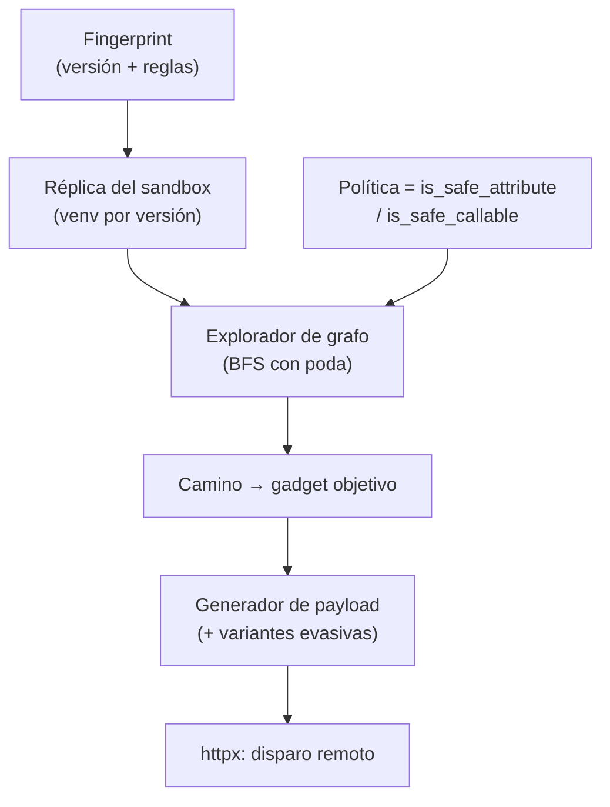

---
tags:
  - Proyectos
  - Python
  - Web/Red-Team
  - SSTI
  - Tipo/Proyecto
Descripción: "Introspecciona en vivo el SandboxedEnvironment de Jinja2 real del objetivo para derivar el escape que funciona contra esa configuración, en vez de probar la lista fija de tplmap"
Fecha de actualización: 2026-09-21
Nota previa: "[[17 - Discriminador de oráculos temporales]]"
Nota siguiente: "[[19 - Auditor de predicción de tokens de sesión]]"
Area: "[[Proyectos ofensivos.base|Proyectos ofensivos]]"
Estado: Idea
Dificultad: 2
Esfuerzo: 2 semanas
Lenguaje: Python
---
---

**Nombre propuesto**: `sandbreak`

Explotar SSTI en Jinja2 sin sandbox es un `{{cycler.__init__.__globals__.os}}` de manual. El problema empieza cuando la aplicación usa `SandboxedEnvironment`, que bloquea el acceso a atributos `__dunder__` y corta la cadena clásica. Ahí las herramientas actuales (`tplmap`, `PayloadsAllTheThings`) tiran de **lista fija de payloads conocidos**: si uno funciona, suerte; si la config bloquea justo ese, te quedas sin saber si el sandbox es infranqueable o si simplemente no probaste el gadget correcto.

# El problema que resuelve

El sandbox de Jinja2 no es binario: es un conjunto de reglas (`is_safe_attribute`, `is_safe_callable`, atributos y builtins prohibidos) que **cada aplicación configura distinto**, a veces subclaseando el entorno para añadir o quitar restricciones. `sandbreak` no adivina: <mark style="background: #ADCCFFA6;">reconstruye el grafo de objetos alcanzables bajo esa política concreta</mark> y busca en él un camino hasta una primitiva peligrosa (ejecución, lectura de fichero, SSRF). En vez de "prueba estos 30 payloads", responde "bajo *esta* configuración, el objeto `X` es alcanzable, expone el atributo `Y`, y esta es la cadena".

La clave: si tienes acceso local a la versión de Jinja2 y a la configuración del entorno (whitebox, o porque replicas la versión), puedes hacer la búsqueda **offline y exhaustiva** contra el sandbox real, y solo disparar contra el objetivo el payload que ya sabes que resuelve.

# Alcance del proyecto

Una herramienta con dos modos:

1. **Introspección local (whitebox / réplica).** Dada una versión de Jinja2 y un `SandboxedEnvironment` (por defecto o subclaseado), instancia el sandbox y **recorre el grafo de atributos y llamables** partiendo de los objetos expuestos en el contexto de plantilla (`cycler`, `joiner`, `namespace`, lo que haya), aplicando en cada arista las reglas reales del sandbox (`is_safe_attribute`/`is_safe_callable`). Encuentra caminos hasta gadgets objetivo.
2. **Sondeo remoto (blackbox).** Envía sondas mínimas para fingerprintear versión y qué restricciones están activas (qué atributos devuelven error vs. valor), estrecha las hipótesis y, con la versión inferida, corre la búsqueda local contra esa réplica.

Emite la cadena de escape, o un veredicto honesto de que bajo esa política no hay camino a las primitivas buscadas.

# Funcionalidades principales

| Funcionalidad | Por qué importa |
| --- | --- |
| Búsqueda de caminos en el grafo de objetos | Deriva el escape para *esta* config en vez de probar una lista; encuentra gadgets que no están en ningún payload público |
| Evaluación de la política real del sandbox | Aplica `is_safe_attribute`/`is_safe_callable` en cada arista: distingue lo prohibido de lo alcanzable, no adivina |
| Fingerprint de versión y restricciones | Sondas mínimas identifican qué Jinja2 y qué reglas hay activas, para elegir la réplica correcta |
| Veredicto de "no explotable" con prueba | Si no hay camino, lo dice y muestra qué aristas cortan — un negativo fundamentado vale para el informe tanto como un positivo |
| Cadena mínima | Entre varios caminos, elige el más corto y sigiloso (menos llamadas, menos ruido en logs de sandbox-escape) |

# Funcionalidades secundarias

- **Objetivos configurables**: no solo RCE — lectura de fichero, SSRF vía `urlopen` alcanzable, o solo fuga de config. Muchas veces basta con leer un secreto.
- **Cobertura de otros motores**: la arquitectura (grafo de objetos + política) generaliza a `Twig` (PHP), `Freemarker`/`Pebble` (Java); Jinja2 es el primer backend por ser el terreno natural de Python.
- **Generación de variantes evasivas**: una vez hallado el camino, ofrecer codificaciones alternativas del payload para esquivar un WAF que filtre `{{`/`__`.
- **Modo educativo**: dibujar el grafo de por qué la cadena funciona — excelente material didáctico sobre por qué los sandboxes de lenguaje son frágiles.

# Casos de uso y actores

- **Pentester web / bug hunter** frente a un SSTI donde el payload de `tplmap` rebota y no sabe si rendirse.
- **Whitebox / revisor de código** que tiene la config del entorno y quiere saber si su `SandboxedEnvironment` custom es realmente seguro.
- **Blue team / desarrollador** validando que su hardening del sandbox no deja un gadget alcanzable.

# Qué existe ya y dónde se queda corto

- **tplmap** automatiza detección y explotación, pero con cadenas fijas por motor. Ante un sandbox no estándar, no razona: reintenta payloads.
- **PayloadsAllTheThings / HackTricks** son catálogos excelentes de gadgets *conocidos*. No descubren gadgets nuevos para una config concreta.
- La investigación de escapes de sandbox de Jinja2 es artesanal y manual (posts de research puntuales). Nadie ha automatizado la **búsqueda de caminos sobre la política real**.

El hueco: pasar de "lista de payloads" a "resolver el sandbox de este objetivo como un problema de alcanzabilidad en un grafo".

# Por qué Python

Jinja2 *es* Python, y su sandbox es introspección de objetos Python en tiempo de ejecución. Puedes importar la misma versión que corre el objetivo, instanciar el mismo `SandboxedEnvironment`, y recorrer `dir()`/`getattr` aplicando literalmente las funciones del sandbox — el motor de análisis y el objeto analizado son el mismo lenguaje. En cualquier otro lenguaje esto sería reimplementar el intérprete de Jinja2; en Python es usarlo.

# Arquitectura

El corazón es un **problema de búsqueda en grafo**, y conviene tratarlo como tal: un explorador que expande nodos (objetos) por aristas (atributos/llamables) aplicando una *política de poda* que es, literalmente, el sandbox. Separar el **motor de búsqueda** de la **política del sandbox** permite enchufar tanto el `SandboxedEnvironment` estándar como una subclase endurecida del cliente sin tocar el explorador.

- **Fingerprinter**: sondas remotas → hipótesis de versión/reglas; selecciona la réplica local (un venv por versión de Jinja2).
- **Motor de búsqueda** (`GadgetSearch`): BFS/IDDFS sobre el grafo de objetos con poda por profundidad, revisitas y priorización hacia builtins peligrosos. Agnóstico de la política.
- **Política** (`SandboxPolicy`): envuelve las funciones reales del sandbox; se inyecta. El estándar y la subclase del cliente son dos implementaciones.
- **Generador**: del camino a un payload minimal, con codificaciones alternativas para WAF.

Decisión de ingeniería: la introspección **ejecuta código** (descriptores, `property`), así que el explorador corre en un **subproceso aislado y desechable** con límites de tiempo/recursos; el proceso principal solo recibe el grafo serializado. Aislar el análisis del analizador es requisito de seguridad, no un extra.

# Stack de implementación (Python)

| Capa | Librería | Por qué (fundamento senior) | Alternativa descartada |
| --- | --- | --- | --- |
| Sujeto | `jinja2` (multi-versión) | El sandbox real es el oráculo de verdad; instanciar la misma versión que el objetivo elimina toda conjetura | Lista fija de payloads (`tplmap`) — no razona |
| Introspección | `inspect` + `gc` | Descubren atributos, llamables y referencias vivas del grafo de objetos con la semántica exacta de Python | Parseo de fuente estático — pierde lo dinámico |
| Grafo | `networkx` | Modelar objetos/aristas y buscar caminos (shortest path a un gadget) con algoritmos ya probados | Estructura ad-hoc — reinventar BFS/ciclos |
| Aislamiento | `subprocess` + `resource`/`multiprocessing` | Ejecutar la introspección en un sandbox de proceso con límites; contener efectos de descriptores | Introspeccionar en el proceso principal — riesgo real |
| Remoto | `httpx` | Fingerprint y disparo del payload; control de codificación de la petición | `requests` — menos control fino |

> **Transversal**: `uv`, `ruff`, `mypy --strict`, `rich`/`structlog`, `uv tool`/`pipx` (detalle en [[16 - Planificador de presupuesto de cracking]]).

# Plan de implementación por fases

1. **Motor de búsqueda sobre el sandbox estándar (semana 1)**: dado un `SandboxedEnvironment` local por defecto, encontrar el camino clásico a RCE. Valida el explorador y la poda con un caso conocido.
2. **Política inyectable + veredicto negativo**: soportar subclases endurecidas; sobre una config que corta la cadena, emitir "no explotable" con las aristas responsables.
3. **Fingerprint remoto**: sondas mínimas → versión/reglas → selección de réplica. Cierra el flujo blackbox.
4. **Generador de payload + variantes evasivas + aislamiento robusto**: minimización del camino, codificaciones anti-WAF, y el subproceso con límites bien acotado.

# Cosas a tener en cuenta

> [!warning]+ La versión importa, y mucho
> Los objetos expuestos, los atributos y las reglas del sandbox cambian entre versiones de Jinja2. Un camino válido en una versión no lo es en otra. El fingerprint de versión no es opcional: es lo que hace que la búsqueda local sea representativa del objetivo.

- **El grafo de objetos es cíclico y enorme.** Sin poda (profundidad máxima, evitar revisitas, priorizar aristas hacia builtins peligrosos) la búsqueda explota. Es el reto técnico central del proyecto.
- **Introspeccionar ejecuta código.** Recorrer atributos puede invocar `property` y descriptores con efectos. Hazlo en un entorno aislado y desechable, nunca contra objetos vivos con estado sensible.
- **El sandbox puede estar subclaseado.** Muchas apps añaden/quitan reglas. El modo whitebox debe aceptar la subclase real; el blackbox, inferir divergencias respecto al entorno estándar.
- **El escape sigue siendo válido en 2026.** La cadena clásica no está muerta, pero las apps endurecen. Un buen `sandbreak` distingue el sandbox roto del bien configurado — y eso es exactamente lo que aporta sobre una lista de payloads.

# Fuera de alcance

No detecta el SSTI (eso es la fase previa, cubierta por fuzzing/`{{7*7}}`). No cubre inyección en plantillas cliente ni XSS derivado. Se centra en el escape de sandbox server-side; ampliar a otros motores es trabajo posterior, no del primer entregable.

# Criterio de terminado

Presentable cuando: dado un `SandboxedEnvironment` local (estándar y una subclase endurecida), encuentra un camino a RCE en el primero y emite un "no explotable" fundamentado en el segundo; el fingerprint remoto identifica la versión con sondas mínimas; y la cadena emitida se ejecuta contra una app Jinja2 real de laboratorio.

# Conexiones en el vault

El fundamento de la técnica está en [[00 - Motores de plantillas e introducción a SSTI]], [[02 - Explotación de SSTI - Jinja2]] y sobre todo [[04 - Evasión de filtros y sandbox en SSTI]], que este proyecto automatiza y lleva al caso de config no estándar. La primitiva final (RCE) conecta con la familia de [[00 - Introducción a los ataques server-side]] y con el whitebox de revisión de código. La generación de variantes evasivas se apoya en las herramientas de [[06 - Arsenal de herramientas SSTI]].

> [!info]+ Fuentes
> - Jinja2, [documentación de `SandboxedEnvironment`](https://jinja.palletsprojects.com/en/stable/sandbox/) — `is_safe_attribute`/`is_safe_callable`, la política real (consultado 2026-09-21).
> - HackTricks, [Jinja2 SSTI](https://hacktricks.wiki/en/pentesting-web/ssti-server-side-template-injection/jinja2-ssti.html) — catálogo de gadgets conocidos como línea base.
> - AppSec Brief, [SSTI: Exploiting and Defending Jinja2, Freemarker, and Pebble](https://appsecbrief.com/articles/server-side-template-injection-ssti-jinja2-freemarker-pebble-guide/) — estado del arte de sandbox escapes 2026.
