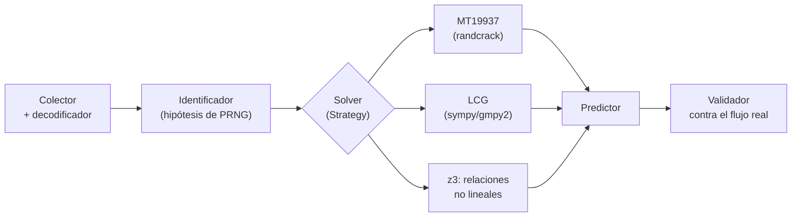

---
tags:
  - Proyectos
  - Python
  - Web/Red-Team
  - Authentication
  - Tipo/Proyecto
Descripción: "Va más allá de medir entropía como Burp Sequencer: recupera el estado del PRNG débil (MT19937, LCG, time-seeded) tras un token y predice el siguiente para demostrar el account takeover"
Fecha de actualización: 2026-09-21
Nota previa: "[[18 - Constructor de escapes de plantillas]]"
Nota siguiente: "[[20 - Diferenciador de autorización multi-identidad]]"
Area: "[[Proyectos ofensivos.base|Proyectos ofensivos]]"
Estado: Idea
Dificultad: 3
Esfuerzo: 2-3 semanas
Lenguaje: Python
---
---

**Nombre propuesto**: `tokenseer`

Burp Sequencer contesta *"¿tiene este token suficiente entropía?"* con estadística (FIPS 140-2, chi-cuadrado, compresión). Es un buen detector de humo, pero se queda a mitad de camino: un token puede pasar los tests de aleatoriedad estadística y aun así ser **totalmente predecible** si viene de un PRNG no criptográfico cuya salida parece aleatoria pero es determinista. `tokenseer` da el paso que falta: recupera el **estado interno** del generador a partir de tokens observados y <mark style="background: #FFB86CA6;">predice el siguiente token de otro usuario</mark> — la diferencia entre "esto huele mal" y un account takeover demostrado.

# El problema que resuelve

Muchos backends generan tokens, IDs de reset de contraseña, códigos OTP o nonces con `random` (Mersenne Twister), `rand()` de PHP/glibc (LCG), o sembrando con `time()`. Todos son reversibles: <mark style="background: #ADCCFFA6;">con suficientes salidas consecutivas se reconstruye el estado y se predice el resto</mark>. Burp no lo hace; los PoC que sí existen (`randcrack`, `php_mt_seed`) están sueltos, cada uno para un generador, sin integración con la captura del token ni con la fase de explotación. `tokenseer` unifica: captura → identificación del generador → recuperación de estado → predicción → prueba contra el objetivo.

# Alcance del proyecto

Tres módulos encadenados:

1. **Colector y normalizador.** Recoge una muestra de tokens (vía proxy/replay), detecta y deshace la codificación (hex, base64, base62), separa la parte variable de la fija, y estima cuántos bits varían realmente.
2. **Identificador y solver de PRNG.** Prueba hipótesis: MT19937 (necesita 624 salidas de 32 bits → recuperar estado), LCG (glibc/PHP → resolver módulo y multiplicador), o time-seeded (fuerza bruta de la semilla en una ventana temporal). Aquí entra `z3`: para relaciones no triviales entre el estado y el token expuesto (truncamiento, transformaciones), plantear la recuperación como **restricciones y dejar que el SMT solver despeje el estado**.
3. **Predictor y validador.** Con el estado recuperado, genera el token pasado/futuro objetivo y lo prueba contra el flujo real (p. ej. el enlace de reset de la víctima), reportando confianza.

# Funcionalidades principales

| Funcionalidad | Por qué importa |
| --- | --- |
| Recuperación de estado de MT19937 | Con 624 salidas se clona el generador entero: predice todos los tokens siguientes, no una probabilidad |
| Solver SMT (`z3`) para relaciones no lineales | Cuando el token es una transformación del estado (truncado, XOR, mezcla), z3 despeja lo que a mano es intratable |
| Fuerza bruta de semilla temporal | Muchos backends siembran con `time()`; acotar la ventana y probar segundos reduce el espacio a miles, no millones |
| Detección de codificación automática | El token casi nunca es la salida cruda del PRNG; deshacer hex/base64/base62 antes de resolver es lo que hace que funcione |
| Prueba de explotación end-to-end | No se queda en "predecible": genera el token de la víctima y lo valida contra el flujo real — evidencia irrefutable para el informe |

# Funcionalidades secundarias

- **Cobertura de generadores**: MT19937 (Python/Ruby), `rand()` glibc, `mt_rand()`/`rand()` de PHP, Java `Random` (LCG de 48 bits, trivial), `Math.random()` de V8 (xorshift128+, recuperable con z3).
- **Veredicto negativo sólido**: si tras los tests el generador parece CSPRNG (no hay estado recuperable), decirlo con confianza — es tan útil para el informe como el positivo.
- **Estimación de muestras necesarias**: antes de capturar 624 tokens, decir cuántos hacen falta para cada hipótesis, para no recolectar de más (ni de menos).
- **Integración con captura**: importar tokens desde un export de Burp/mitmproxy en vez de recolectar a mano.

# Casos de uso y actores

- **Pentester web / bug hunter** ante tokens de sesión, IDs de reset de contraseña o códigos OTP que sospecha débiles.
- **Whitebox / revisor**: confirmar que un `random.token_hex()` mal elegido (o un `random` en vez de `secrets`) es explotable, no solo "mala práctica".
- **CTF**: la recuperación de PRNG es un clásico; el proyecto sirve de arsenal reutilizable.

# Qué existe ya y dónde se queda corto

- **Burp Sequencer** mide entropía estadística. No recupera estado ni predice; un token de MT19937 le parece aleatorio.
- **randcrack** (MT19937), **php_mt_seed** (semilla de PHP), **RandCrack**-likes: cada uno resuelve un generador aislado, sin capa de captura, sin detección de codificación, sin validación contra el objetivo.
- No hay una herramienta que **identifique el generador automáticamente, use z3 para las transformaciones, y cierre el bucle hasta la prueba de takeover**.

# Por qué Python

Es la lengua franca de este ataque: `z3-solver` tiene su binding de referencia en Python, `randcrack`/`php_mt_seed` son Python, y `sympy`/`gmpy2` resuelven la aritmética modular de los LCG. Modelar un PRNG como restricciones y despejar el estado con un SMT solver es idiomático aquí; en un lenguaje compilado sería atarse a la FFI de z3 para no ganar nada.

# Arquitectura

Un **pipeline de fases con contrato explícito** entre ellas, donde el paso central (recuperar estado) es una **familia de solvers intercambiables** (Strategy) que se prueban por hipótesis: MT19937, LCG glibc/PHP, time-seed, xorshift128+. Cada solver declara cuántas muestras necesita y devuelve un `RecoveredState` o "no aplica". El resto del sistema (colección, predicción, validación) no sabe qué generador es.

- **Colector/decodificador**: normaliza tokens, deshace hex/base64/base62, aísla la parte variable. Sin esto, el solver trabaja sobre ruido.
- **Identificador**: estima muestras necesarias y ordena hipótesis por coste.
- **Solvers** (`PRNGSolver`): cada uno encapsula su matemática. `z3` no es un solver más sino el *back-end* al que recurren cuando la relación estado→token es no trivial (truncado, mezcla): se modela como restricciones y se despeja.
- **Predictor/Validador**: genera el token objetivo y lo prueba contra el flujo (bajo alcance).

Decisión de ingeniería: el contrato entre fases son **objetos `pydantic` inmutables** (`TokenSample`, `RecoveredState`, `Prediction`); cada fase es una función pura testeable con fixtures grabados, y la única fase con efectos (el validador) queda aislada tras un adaptador.

# Stack de implementación (Python)

| Capa               | Librería                        | Por qué (fundamento senior)                                                                                                                                             | Alternativa descartada                          |
| ------------------ | ------------------------------- | ----------------------------------------------------------------------------------------------------------------------------------------------------------------------- | ----------------------------------------------- |
| Restricciones      | `z3-solver`                     | El binding de referencia del SMT solver es Python; modelar el estado como restricciones y despejar transformaciones no lineales es lo que ninguna otra herramienta hace | Álgebra a mano — intratable con truncado/mezcla |
| MT19937            | `randcrack`                     | Recuperación de estado ya implementada y probada; base a extender, no a reescribir                                                                                      | Reimplementar el twister — bugs sutiles         |
| Aritmética modular | `gmpy2` + `sympy`               | Enteros grandes rápidos (`gmpy2`) y despeje simbólico de LCG (`sympy`); la combinación cubre glibc/PHP/Java                                                             | `int` puro — lento en fuerza bruta de semilla   |
| Captura/validación | `httpx` + import de `mitmproxy` | Recolectar consecutivos y validar contra el flujo; importar capturas evita recolección manual                                                                           | Copiar/pegar tokens — frágil, no reproducible   |
| Test               | `pytest`                        | Fixtures con secuencias de PRNG conocidas → verificar que cada solver recupera el estado exacto                                                                         | —                                               |

> **Transversal**: `uv`, `ruff`, `mypy --strict`, `rich`/`structlog`, `uv tool`/`pipx` (detalle en [[16 - Planificador de presupuesto de cracking]]).

# Plan de implementación por fases

1. **Solver MT19937 end-to-end (semana 1)**: colector → decodificador básico → `randcrack` → predictor, sobre un servicio de laboratorio con `random`. El walking skeleton que prueba el contrato entre fases.
2. **Decodificación robusta + LCG**: deshacer base62/hex/truncado; añadir el solver LCG (glibc/PHP) con `sympy`/`gmpy2`.
3. **Back-end z3**: modelar como restricciones al menos un caso con transformación no trivial (truncado + mezcla) y despejarlo. El diferenciador.
4. **Validador + veredicto negativo**: cierre end-to-end contra el flujo real (bajo alcance) y el "es un CSPRNG, no recuperable" bien fundamentado; estimación de muestras necesarias.

# Cosas a tener en cuenta

> [!warning]+ Necesitas salidas *consecutivas* del mismo generador
> MT19937 requiere 624 salidas seguidas y sin huecos para clonar el estado. Si el servidor intercala tokens de varios hilos/procesos con generadores distintos, la secuencia se contamina. Parte del trabajo es detectar y separar flujos — o reconocer cuándo es imposible.

- **z3 es potente pero no mágico.** Con demasiadas incógnitas o transformaciones criptográficas reales, no converge. Hay que acotar el modelo y saber cuándo el generador simplemente no es recuperable.
- **La codificación oculta la estructura.** Un token base62 de 22 caracteres puede ser 128 bits de MT19937 troncados. Si no deshaces la codificación primero, el solver trabaja sobre ruido.
- **Predecir el token de otro es acceso no autorizado.** Solo dentro del alcance firmado (cruza con el guardián de alcance del catálogo de Go). Fuera de un engagement autorizado, generar el enlace de reset de otro usuario es un delito, no una PoC.
- **`secrets` mata el proyecto — y ese es el punto.** Contra un CSPRNG bien usado no hay nada que hacer; el valor de la herramienta es demostrar cuántos backends *no* lo usan.

# Fuera de alcance

No ataca CSPRNGs ni criptografía real (no es un side-channel de claves). No cubre la fijación ni el robo de sesión por otros medios (XSS, sniffing) — solo la **predicción** por PRNG débil. No genera los tokens del servidor; los observa y modela.

# Criterio de terminado

Presentable cuando: dado un servicio de laboratorio que emite tokens con `random`/`mt_rand`/`time()`, recupera el estado y predice el siguiente token con éxito; z3 resuelve al menos un caso con transformación no trivial (truncado/mezcla); y frente a un servicio que usa `secrets` emite un negativo fundamentado.

# Conexiones en el vault

Es la automatización profunda de [[10 - Ataques a tokens de sesión]] y de [[13 - Session IDs débiles]] (session puzzling). El veredicto de generador débil conecta con [[07 - Reset de contraseña vulnerable]] (predecir el token de reset es el vector estrella) y con la familia JWT de [[03 - Ataque al secreto de firma JWT]] (mismo espíritu: romper la aleatoriedad/secreto asumido). La restricción de alcance la impone [[00 - Guardián de alcance para engagements]].

> [!info]+ Fuentes
> - PortSwigger, [Analyzing session token generation](https://portswigger.net/burp/documentation/desktop/testing-workflow/vulnerabilities/session-management/analyzing-session-token-generation) — qué mide (y qué no) el análisis de entropía (consultado 2026-09-21).
> - Microsoft Research, [Z3](https://github.com/Z3Prover/z3) — el SMT solver y su binding de Python.
> - Documentación de Python, [`random` vs `secrets`](https://docs.python.org/3/library/secrets.html) — por qué `random` no es apto para tokens de seguridad.
