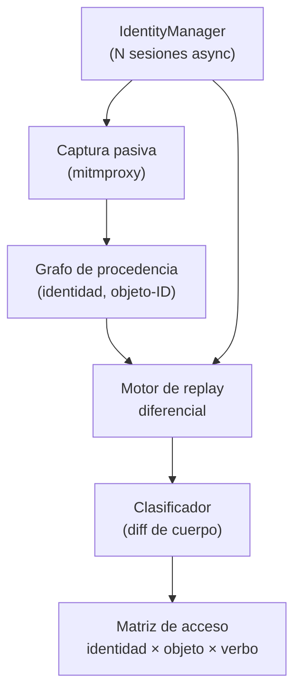

---
tags:
  - Proyectos
  - Python
  - Web/Red-Team
  - API
  - IDOR
  - Tipo/Proyecto
Descripción: "Conduce una app bajo varias identidades a la vez, siembra y rastrea los IDs de objeto que cada una crea, y replaya cross-identidad para cazar BOLA/IDOR sin necesitar OpenAPI"
Fecha de actualización: 2026-09-21
Nota previa: "[[19 - Auditor de predicción de tokens de sesión]]"
Nota siguiente: "[[21 - Pre-mortem de detección]]"
Area: "[[Proyectos ofensivos.base|Proyectos ofensivos]]"
Estado: Idea
Dificultad: 3
Esfuerzo: 3 semanas
Lenguaje: Python
---
---

**Nombre propuesto**: `authdiff`

BOLA/IDOR es, año tras año, el bug nº1 del OWASP API Top 10, y sigue siendo el que **los scanners no ven**: requiere dos sesiones autenticadas a la vez y entender qué objeto pertenece a quién. Un DAST clásico escanea con una identidad y no tiene con qué comparar. `authdiff` ataca justo eso: <mark style="background: #ADCCFFA6;">opera la aplicación bajo N identidades simultáneas, aprende qué IDs de objeto genera cada una, y prueba sistemáticamente si la identidad A puede tocar los objetos de B</mark>.

# El problema que resuelve

La autorización a nivel de objeto solo se prueba de verdad con **acceso diferencial**: crear un recurso como Alice, intentar leerlo/modificarlo/borrarlo como Bob (horizontal) y como usuario sin privilegio (vertical), y comprobar property-level (¿puede Bob escribir un campo que no le corresponde?). Hacerlo a mano no escala; hacerlo con un scanner de una sola identidad es imposible. Las soluciones comerciales (Invicti, StackHawk) y la académica open-source (AuthProbe) resuelven parte, pero **dependen de una spec OpenAPI** para saber qué endpoints y qué IDs existen. En el mundo real —bug bounty, apps sin spec, GraphQL, endpoints no documentados— esa spec no está.

`authdiff` no la necesita: **descubre los IDs observando el tráfico**. Cada respuesta que devuelve un objeto con identificador se marca con la identidad que lo obtuvo; esos IDs se convierten en el material de los intentos cross-identidad.

# Alcance del proyecto

Cuatro piezas:

1. **Gestor de identidades.** Mantiene N sesiones vivas en paralelo (login, refresh de token, cookies), cada una etiquetada por rol/tenant. Soporta niveles: admin, dos usuarios estándar del mismo tenant, un usuario de otro tenant.
2. **Grafo de procedencia de objetos.** Con `networkx`, un nodo por (identidad, objeto-ID) y aristas "esta identidad vio/creó este ID". Se llena pasivamente observando el tráfico de una sesión de navegación/crawling normal.
3. **Motor de replay diferencial.** Toma cada petición que referenció un ID y la **reejecuta bajo las otras identidades**, sustituyendo el ID por los de otros dueños. Clasifica el resultado: acceso concedido (BOLA), denegado (correcto), o ambiguo (mismo status pero contenido distinto — hay que mirar el cuerpo).
4. **Clasificador de respuesta.** Distingue "acceso concedido" de "denegado disfrazado de 200" comparando cuerpos entre la respuesta legítima del dueño y la del atacante.

# Funcionalidades principales

| Funcionalidad | Por qué importa |
| --- | --- |
| N identidades concurrentes | La condición sine qua non de BOLA/BFLA: sin dos sesiones simultáneas no hay diferencial que medir |
| Descubrimiento de IDs sin spec | Aprende los identificadores del tráfico observado; funciona donde AuthProbe/Invicti no llegan por falta de OpenAPI |
| Replay cross-identidad sistemático | Prueba horizontal (peer), vertical (privilegio) y cross-tenant de forma exhaustiva, no a mano |
| Clasificación por diferencia de cuerpo | Caza el "200 pero es tu propio objeto vacío" vs. "200 con los datos de la víctima" — el falso negativo típico de los scanners |
| Detección de property-level (BOPLA) | Prueba escribir campos ajenos (rol, precio, owner_id) y verifica si persisten — el BOLA de escritura que casi nadie testea |

# Funcionalidades secundarias

- **GraphQL nativo**: los IDs viajan en variables y en el cuerpo de queries/mutations; el mismo grafo de procedencia aplica, y GraphQL es terreno fértil de IDOR.
- **Mutación de referencias codificadas**: si el ID va en base64/hash/UUID, intentar decodificar y predecir vecinos (enlaza con el auditor de tokens del proyecto anterior).
- **Modo pasivo-primero**: aprender el grafo sin atacar, y solo lanzar el diferencial cuando el operador lo autoriza — reduce ruido y riesgo.
- **Informe con matriz de acceso**: tabla identidad × objeto × verbo con el veredicto, directamente pegable al reporte.

# Casos de uso y actores

- **Pentester de API / bug hunter** con dos cuentas de prueba y una app sin documentación: el escenario más común y peor cubierto.
- **Equipo de AppSec** integrándolo en CI con credenciales de test multi-rol, al estilo del multi-profile de StackHawk pero sin exigir spec.
- **GraphQL / multi-tenant SaaS**: donde el aislamiento entre tenants es el control crítico y más frágil.

# Qué existe ya y dónde se queda corto

- **Invicti / StackHawk** hacen multi-identidad, pero comerciales y guiados por spec/config; el descubrimiento de IDs no es autónomo.
- **AuthProbe** (open-source, académico) es lo más cercano en espíritu, pero **conduce sus tests desde una OpenAPI**: sin spec, no funciona.
- **Autorize / AutoRepeater** (extensiones de Burp) hacen replay con una segunda identidad, pero no construyen grafo de procedencia, no manejan N>2 identidades limpiamente, ni clasifican por diferencia de cuerpo de forma sistemática.

El hueco: **multi-identidad (N>2), sin spec, con grafo de procedencia y clasificación por contenido**. Nadie junta las cuatro.

# Por qué Python

Es orquestación de HTTP concurrente + modelado de grafos + comparación de estructuras, todo cómodo en Python: `httpx.AsyncClient` mantiene N sesiones asíncronas, `networkx` da el grafo de procedencia y sus consultas gratis, y comparar cuerpos JSON/HTML es trivial con `deepdiff`/`jsondiff`. El ecosistema de proxies programables (mitmproxy es Python) permite además el modo pasivo sin reinventar la captura.

# Arquitectura

Tres subsistemas con estado bien delimitado: **sesiones** (N identidades vivas), **grafo de procedencia** (qué identidad vio qué ID) y **motor de replay** (reejecuta cross-identidad). El grafo es la fuente de verdad; el replay lo consulta y el clasificador interpreta el resultado. Modelar el grafo como pieza central —no como efecto secundario del tráfico— es lo que hace el proyecto escalable a N identidades y a GraphQL.

- **`IdentityManager`**: mantiene N `AsyncClient` con su login/refresh; cada uno etiquetado por rol/tenant. Encapsula la fragilidad de las sesiones que caducan.
- **Grafo de procedencia** (`networkx`): nodos `(identidad, objeto-ID)`, aristas de observación. Se puebla pasivamente; es consultable ("dame los IDs que solo Alice vio").
- **Motor de replay**: para cada petición con ID, la reejecuta bajo las otras identidades. **Dry-run por defecto para verbos mutantes** — decisión de diseño, no opción.
- **Clasificador**: `deepdiff` entre la respuesta legítima del dueño y la del atacante → concedido / denegado / recurso compartido.

Decisión de ingeniería: la concurrencia es `asyncio` estructurado (`anyio` task groups) con un **límite de concurrencia y rate-limit configurables** por sesión; sin ellos, N identidades martilleando la API generan ruido y falsos negativos por throttling del servidor.

# Stack de implementación (Python)

| Capa | Librería | Por qué (fundamento senior) | Alternativa descartada |
| --- | --- | --- | --- |
| Sesiones | `httpx.AsyncClient` | N sesiones concurrentes con cookie jar y estado independientes; HTTP/2 y reintentos | `requests` — síncrono, una sesión cómoda a la vez |
| Concurrencia | `anyio` | Task groups estructurados con límite de concurrencia → sin fugas ni martilleo | `asyncio` crudo — cancelación y límites a mano |
| Grafo | `networkx` | Procedencia como grafo consultable; escala a N identidades y a GraphQL sin rediseño | Tablas ad-hoc — consultas cross-identidad tediosas |
| Diff de cuerpo | `deepdiff` / `jsondiff` | Distinguir "200 con tus datos" de "200 con los de la víctima" es comparación estructural, no de status | Comparar strings — falsos positivos por orden/campos |
| Captura pasiva | `mitmproxy` (addon) | Poblar el grafo desde navegación real sin reimplementar el proxy | Escribir un proxy propio |
| Modelo/CLI | `pydantic` + `Typer` | Perfiles de identidad validados; CLI testeable | `dict`/`argparse` |

> **Transversal**: `uv`, `ruff`, `mypy --strict`, `rich`/`structlog`, `uv tool`/`pipx` (detalle en [[16 - Planificador de presupuesto de cracking]]).

# Plan de implementación por fases

1. **Dos identidades + replay manual (semana 1)**: `IdentityManager` con dos sesiones, replay de una lista dada de IDs, clasificación por diff. El BOLA horizontal más simple, end-to-end.
2. **Grafo de procedencia + descubrimiento de IDs**: captura pasiva que puebla el grafo; el replay pasa a consultar el grafo en vez de una lista. Elimina la dependencia de spec.
3. **N identidades + vertical/cross-tenant + BOPLA**: escalar a admin + peers + otro tenant; property-level writes; etiquetado de tenant para priorizar.
4. **GraphQL + salvaguardas + matriz**: soporte de variables/mutations, dry-run robusto en verbos mutantes, modelado de recurso compartido, y la matriz de acceso para el informe.

# Cosas a tener en cuenta

> [!warning]+ El estado compartido genera falsos positivos
> Si dos identidades comparten un recurso legítimamente (un documento colaborativo, un objeto público), el acceso cruzado *no* es un bug. El clasificador debe modelar la expectativa: distinguir "acceso a objeto ajeno privado" de "acceso a recurso compartido". Sin esto, el informe se llena de ruido y pierde credibilidad.

- **Los efectos secundarios son reales.** Replayar un `DELETE` o un `POST` cross-identidad puede borrar o crear datos de verdad. Modo dry-run por defecto para verbos mutantes, y confirmación explícita antes de tocar estado.
- **Sesiones que caducan.** Mantener N sesiones vivas durante una campaña larga exige refresco de token robusto; una sesión muerta a mitad convierte todos los resultados posteriores en falsos negativos.
- **Cross-tenant es el hallazgo caro.** Un IDOR intra-tenant es malo; uno cross-tenant (acceso a datos de otro cliente) es crítico. El grafo debe etiquetar el tenant para priorizar.
- **No confundir 401/403 con seguridad.** Un `403` puede convivir con una ruta alternativa que sí concede acceso (mass assignment, endpoint hermano). Probar el objeto por todos los verbos y rutas que lo referencian.

# Fuera de alcance

No descubre endpoints por fuzzing (eso es recon, cubierto por ffuf/nuclei) — parte del tráfico observado. No prueba authn (login bypass, MFA) — solo authz a nivel de objeto/función/propiedad. No explota más allá de demostrar el acceso: no exfiltra masivamente.

# Criterio de terminado

Presentable cuando: sobre una API de laboratorio multi-tenant, descubre los IDs navegando y detecta un BOLA horizontal, uno vertical y un BOPLA de escritura, sin recibir ninguna spec; clasifica correctamente un recurso compartido como *no* vulnerable; y emite la matriz de acceso identidad × objeto × verbo.

# Conexiones en el vault

Es la industrialización de [[07 - Identificación de IDORs]], [[08 - Enumeración masiva de IDOR]] y [[11 - Encadenamiento de IDOR]], y del BOLA de API en [[01 - Broken Object Level Authorization (API1)]] y [[03 - Broken Object Property Level Authorization (API3)]]. El caso GraphQL conecta con [[02 - IDOR en GraphQL]]; el second-order (IDs que solo emergen tras un flujo) con [[08 - Second-Order IDOR (blackbox)]]. La predicción de referencias codificadas se apoya en el proyecto vecino [[19 - Auditor de predicción de tokens de sesión]] y en [[09 - Bypass de referencias codificadas]].

> [!info]+ Fuentes
> - OWASP, [API Security Top 10 2023 — API1:2023 BOLA](https://owasp.org/API-Security/editions/2023/en/0xa1-broken-object-level-authorization/) — definición y metodología de prueba (consultado 2026-09-21).
> - Chen et al., [AuthProbe: Specification-Driven, Multi-Identity Detection of BOLA](https://arxiv.org/html/2607.20574v1) — el enfoque multi-identidad y su dependencia de spec, que este proyecto elimina (2026).
> - StackHawk, [Understanding and protecting against API1 BOLA](https://www.stackhawk.com/blog/understanding-and-protecting-against-api1-broken-object-level-authorization/) — por qué los scanners de una identidad fallan.
