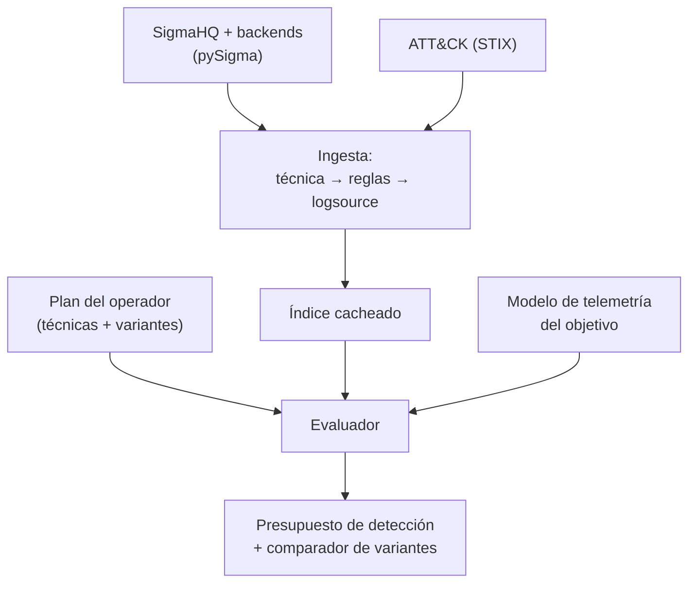

---
tags:
  - Proyectos
  - Python
  - Evasion
  - Tipo/Proyecto
Descripción: "Antes de ejecutar, traduce tu plan de ataque (técnicas ATT&CK) a las reglas Sigma públicas que lo encenderían y estima qué telemetría dejas, para elegir la variante más silenciosa"
Fecha de actualización: 2026-09-21
Nota previa: "[[20 - Diferenciador de autorización multi-identidad]]"
Nota siguiente: "[[22 - Envenenador de caché por confusión de clave]]"
Area: "[[Proyectos ofensivos.base|Proyectos ofensivos]]"
Estado: Idea
Dificultad: 3
Esfuerzo: 2-3 semanas
Lenguaje: Python
---
---

**Nombre propuesto**: `premortem`

La evasión suele decidirse *después* de que salte la alarma: ejecutas, te detectan, cambias de técnica. `premortem` invierte el orden. Antes de tocar el objetivo, tomas tu plan —las técnicas ATT&CK que vas a usar— y la herramienta te dice <mark style="background: #FFB86CA6;">qué reglas de detección públicas se encenderían y qué telemetría dejarías</mark>, para que elijas la variante más silenciosa mientras todavía es barato cambiar. Es la Pyramid of Pain aplicada a ti mismo: subir por la pirámide (comportamiento, no IOCs) requiere saber qué comportamiento están observando.

# El problema que resuelve

El defensor moderno detecta con reglas: SigmaHQ tiene miles, públicas, versionadas, mapeadas a ATT&CK. Son el mejor proxy disponible de "qué mira un SOC medio". El atacante casi nunca las consulta antes de operar, así que descubre la detección por las malas. `premortem` cruza tu **plan** contra ese corpus: para cada técnica que piensas ejecutar, encuentra las reglas Sigma que la cubren, señala qué fuente de logs (`logsource`) las alimenta, y estima si tu forma concreta de hacerla las dispara o las esquiva. El resultado es un **presupuesto de detección** del engagement, no una carrera reactiva.

# Alcance del proyecto

Tres piezas sobre el ecosistema pySigma:

1. **Ingesta y mapeo del corpus.** Carga las reglas de SigmaHQ, extrae sus tags ATT&CK y su `logsource`, y construye un índice técnica → {reglas, fuentes de log}. Reutiliza el patrón de proyectos como SIGIL para la cobertura por matriz.
2. **Modelo del plan.** El operador declara su plan como una secuencia de técnicas (IDs de ATT&CK) con parámetros (p. ej. "Kerberoasting con NetExec", "dump LSASS con comsvcs"). Para cada una, `premortem` recupera las reglas relevantes y evalúa —con reglas heurísticas y las condiciones de la propia regla Sigma— si la variante elegida encaja en el patrón detectado.
3. **Comparador de variantes.** Dada una técnica con varias implementaciones (LOLbin vs herramienta conocida, con/sin ofuscación), ordena por número y severidad de reglas que activaría, y por qué telemetría requiere (¿hay un `logsource` que el objetivo probablemente no recoge?).

# Funcionalidades principales

| Funcionalidad | Por qué importa |
| --- | --- |
| Plan → reglas Sigma que lo detectan | Convierte "creo que esto es sigiloso" en "estas 4 reglas públicas lo cazan", con nombre y enlace |
| Mapa de telemetría requerida | Cada regla necesita una fuente de log (Sysmon EID, 4688, ETW…); si el objetivo no la recoge, la regla es inofensiva — saberlo cambia el plan |
| Comparador de variantes por ruido | Ordena las formas de hacer una técnica por detectabilidad: elige la que activa menos y más débiles reglas |
| Cobertura ATT&CK del plan | Pinta tu recorrido sobre la matriz y marca los pasos "calientes" (muy cubiertos) frente a los huecos |
| Conversión a la query del SIEM objetivo | Si sabes el SIEM (Elastic, Splunk, Sentinel), pySigma traduce la regla a su lenguaje — útil para el purple team y para el reporte |

# Funcionalidades secundarias

- **Contra un ruleset propio del cliente**: en whitebox/purple, ingerir las reglas reales del cliente en vez de SigmaHQ y evaluar el plan contra su detección concreta.
- **Post-mortem inverso**: tras la operación, cruzar lo que *realmente* saltó (si el cliente comparte alertas) con lo predicho, y recalibrar las heurísticas.
- **Sugerencia de evasión**: para un paso caliente, apuntar a la nota del vault con la variante más sigilosa (living-off-the-land, timing, blending) — no la ejecuta, la recomienda.
- **Export purple team**: informe de cobertura de detección por técnica, el entregable que un ejercicio purple valora tanto como los hallazgos ofensivos.

# Casos de uso y actores

- **Red teamer** planificando un engagement evasivo: decide la ruta por su presupuesto de detección, no a ciegas.
- **Purple team**: usa el mismo artefacto para medir la cobertura de detección del cliente y priorizar qué reglas escribir.
- **Blue team / detección**: al revés, ver qué técnicas de su plan de amenaza quedan sin cubrir por su ruleset actual.

# Qué existe ya y dónde se queda corto

- **pySigma / sigma-cli** convierten reglas a queries de SIEM. Es la tubería, no el análisis: no cruzan un *plan de ataque* contra el corpus.
- **SIGIL / proyectos de cobertura ATT&CK** miden qué técnicas cubre un ruleset (óptica defensiva). `premortem` usa la misma base pero desde la **óptica ofensiva**: dado mi plan, qué me detecta.
- **NoiseHound** hace algo análogo pero acotado a rutas de BloodHound en AD, con su propio corpus de telemetría. `premortem` es general (cualquier técnica ATT&CK) y se apoya en el corpus público de Sigma.

El hueco: **un pre-mortem de detección de propósito general, dirigido por el plan, sobre reglas públicas**.

# Por qué Python

pySigma *es* Python: parsear reglas Sigma, extraer tags ATT&CK y `logsource`, y convertir a queries de SIEM es literalmente llamar a la librería oficial. Todo el ecosistema de detección-como-código (pySigma, backends, pipelines) vive en Python. Reescribir el parser de Sigma en Go para esto sería absurdo.

# Arquitectura

El proyecto es esencialmente un **índice invertido** (técnica ATT&CK → reglas que la cubren → telemetría que las alimenta) más un **evaluador de variantes**. La ingesta del corpus se hace una vez y se cachea; la consulta del plan es rápida. Separar la **ingesta** (lenta, offline) de la **evaluación** (interactiva) es la decisión que mantiene la herramienta usable.

- **Ingesta** (`CorpusIndex`): parsea el corpus con `pySigma`, extrae tags ATT&CK y `logsource`, construye el índice. Cacheable (el corpus cambia despacio).
- **Modelo del plan** (`AttackPlan`): secuencia de técnicas con parámetros/variante. Validado con `pydantic`.
- **Evaluador**: cruza plan × índice; el matcher técnica→variante es **heurístico y explícito** (reglas declaradas, no magia), lo que permite auditar por qué algo se marca caliente.
- **Modelo de telemetría**: qué fuentes de log recoge el objetivo → una regla sin su `logsource` es inofensiva.

Decisión de ingeniería: el matcher variante↔regla se diseña como **plugins declarativos** (un catálogo de técnicas bien modeladas que crece), y la salida siempre lleva **nivel de confianza** — la honestidad sobre la incertidumbre es parte del contrato, no un adorno, porque presentar el pre-mortem como certeza sería peligroso.

# Stack de implementación (Python)

| Capa | Librería | Por qué (fundamento senior) | Alternativa descartada |
| --- | --- | --- | --- |
| Parseo de reglas | `pySigma` + backends | Es *la* librería oficial; parsear Sigma, extraer metadatos y convertir a query de SIEM es llamada directa | `sigmac` (deprecado) o parseo YAML propio — frágil |
| ATT&CK | `mitreattack-python` (STIX) | Matriz y relaciones técnica↔mitigación desde la fuente canónica | Scrapear la web de ATT&CK — quebradizo |
| Corpus | `SigmaHQ/sigma` (git submodule/pin) | Miles de reglas versionadas; fijar un commit hace el resultado reproducible | Copiar reglas sueltas — sin trazabilidad |
| Índice/datos | `pandas` | Cruces plan×reglas×telemetría y cobertura como tablas | Diccionarios anidados — consultas ilegibles |
| Informe | `matplotlib` | Cobertura sobre la matriz ATT&CK y presupuesto de detección para el entregable purple | — |

> **Transversal**: `uv`, `ruff`, `mypy --strict`, `rich`/`structlog`, `uv tool`/`pipx` (detalle en [[16 - Planificador de presupuesto de cracking]]).

# Plan de implementación por fases

1. **Índice + consulta simple (semana 1)**: ingesta de SigmaHQ con `pySigma`, índice técnica→reglas, y una consulta "dame las reglas de T1558.003". El esqueleto que prueba el parseo y el mapeo ATT&CK.
2. **Modelo de plan + telemetría**: `AttackPlan` validado y modelo de qué `logsource` recoge el objetivo; una regla sin su fuente se marca inofensiva.
3. **Evaluador de variantes**: catálogo de técnicas bien modeladas (Kerberoasting con NetExec vs LOLbin, dump LSASS por varias vías) con matcher heurístico y confianza; comparador que ordena por ruido.
4. **Conversión a SIEM + informe purple**: `sigma convert` al lenguaje del objetivo, cobertura sobre la matriz, y el modo "ruleset del cliente" para whitebox.

# Cosas a tener en cuenta

> [!warning]+ Sigma es un proxy de la detección, no la detección real
> El SOC del objetivo no corre SigmaHQ tal cual: tiene sus reglas, sus exclusiones, su nivel de madurez. `premortem` estima con lo público; el resultado es una hipótesis informada, no una garantía de sigilo. Presentarlo como certeza es el error que lo convierte en peligroso.

- **Ausencia de regla ≠ ausencia de detección.** El objetivo puede detectar por ML, por analista, o por una regla que no está en SigmaHQ. La herramienta reduce sorpresas, no las elimina.
- **El `logsource` es la clave infravalorada.** Una regla perfecta es inofensiva si el objetivo no recoge esa fuente (muchos entornos no tienen Sysmon ni auditoría de línea de comandos). Modelar qué telemetría existe es tan importante como qué reglas hay.
- **El mapeo técnica→variante es heurístico.** Decidir si "mi Kerberoasting concreto" encaja en una regla exige entender la condición de la regla; automatizarlo del todo es difícil. Empezar con un catálogo de variantes bien modeladas y ser honesto sobre la incertidumbre.
- **No ejecuta nada.** Es análisis y planificación pura; la ejecución la hace el operador. Eso lo mantiene del lado seguro y terminable.

# Fuera de alcance

No ejecuta técnicas ni las evade activamente — planifica. No es un C2 ni un launcher. No sustituye al juicio del operador: informa la decisión, no la toma. El *cómo* evadir cada técnica vive en las notas del vault, no en esta herramienta.

# Conexiones en el vault

Es la materialización operativa de la [[01 - Frameworks de threat intelligence y la Pyramid of Pain]] y del [[00 - El mindset del atacante persistente]]: subir por la pirámide exige saber qué comportamiento se observa. Enlaza fuerte con [[08 - Cómo te ve el defensor]] (la óptica del defensor en el perímetro) y con [[02 - Cómo se construye una detección]] y [[01 - Mapa de telemetría de Windows]] del bloque EDR. En AD, complementa a [[25 - Detección y evasión en AD]]. Desde la óptica azul, dialoga con [[01 - Sensores defensivos - tipos y colocación]].

> [!info]+ Fuentes
> - SigmaHQ, [pySigma](https://github.com/SigmaHQ/pySigma) y [sigma-cli](https://github.com/SigmaHQ/sigma-cli) — parseo y conversión de reglas (consultado 2026-09-21).
> - MITRE, [ATT&CK](https://attack.mitre.org/) — matriz y mapeo de técnicas.
> - SIGIL, [detection-as-code framework](https://github.com/fredzirbel/SIGIL) — patrón de extracción de tags ATT&CK y cobertura sobre la matriz.
