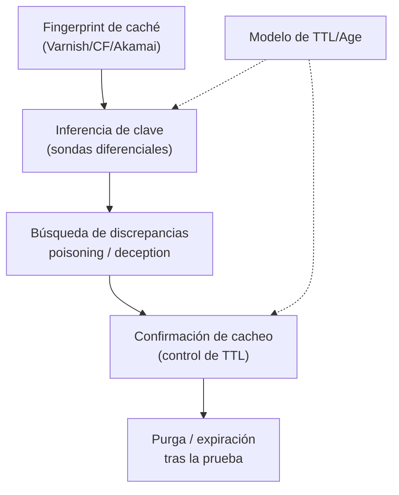

---
tags:
  - Proyectos
  - Python
  - Web/Red-Team
  - HTTP/Cache-Poisoning
  - Tipo/Proyecto
Descripción: "Mapea automáticamente qué entradas entran en la clave de caché y cuáles no, y descubre las discrepancias clave↔aplicación que habilitan cache poisoning y cache deception"
Fecha de actualización: 2026-09-21
Nota previa: "[[21 - Pre-mortem de detección]]"
Nota siguiente: "[[23 - Verificador de rutas de Active Directory]]"
Area: "[[Proyectos ofensivos.base|Proyectos ofensivos]]"
Estado: Idea
Dificultad: 3
Esfuerzo: 3 semanas
Lenguaje: Python
---
---

**Nombre propuesto**: `cacheconfusion`

El cache poisoning y la cache deception nacen del mismo malentendido: la **caché** y la **aplicación** no se ponen de acuerdo sobre qué identifica una petición. La caché guarda por una *clave* (normalmente método + host + path + algunos headers); la aplicación responde según *más* cosas (headers que la caché ignora, extensiones de fichero, normalización de path distinta). Cuando esos dos modelos divergen, un atacante mete su contenido en la respuesta que se le sirve a otros, o consigue que la caché guarde una respuesta con datos privados. `cacheconfusion` <mark style="background: #ADCCFFA6;">reconstruye ambos modelos y busca dónde discrepan</mark>.

# El problema que resuelve

Encontrar estos bugs a mano es tedioso y probabilístico: probar header por header a ver cuál es *unkeyed* pero *reflejado*, adivinar extensiones que engañan a la caché (`/account.css`, `/account/foo.js`), medir si algo se cacheó de verdad. Es exactamente el tipo de espacio de búsqueda estructurado que se automatiza bien. Param Miner (Burp) encuentra parámetros/headers unkeyed; `cacheconfusion` va más allá: modela la **clave de caché completa** y la **superficie de parseo de path** de forma diferencial, cubriendo tanto poisoning como deception, y confirmando la persistencia en caché con precisión temporal.

# Alcance del proyecto

Cuatro fases:

1. **Fingerprint de la caché.** Identifica si hay caché intermedia y de qué familia (Varnish, Cloudflare, Akamai, Fastly…) por sus cabeceras (`Age`, `X-Cache`, `CF-Cache-Status`, `Via`), y su comportamiento de TTL.
2. **Inferencia de la clave de caché.** Sondas diferenciales: variar un componente (un header, el caso del host, la query, el fragmento del path) y observar si dos peticiones comparten o no respuesta cacheada. Deduce qué entra en la clave y qué no.
3. **Búsqueda de discrepancias.** Con la clave inferida, busca **entradas unkeyed que la aplicación sí procesa** (candidatas a poisoning) y **transformaciones de path donde caché y app difieren** (candidatas a deception: la caché ve `.css` y cachea, la app ve la ruta dinámica y devuelve datos de sesión).
4. **Confirmación de persistencia.** Envía la sonda envenenada y, desde una identidad limpia, verifica que la respuesta maliciosa/privada se sirve cacheada — con control de la ventana de TTL para no dejar el envenenamiento activo más de lo necesario.

# Funcionalidades principales

| Funcionalidad | Por qué importa |
| --- | --- |
| Inferencia diferencial de la clave de caché | El núcleo: saber qué es keyed y qué no convierte la caza a ciegas en un mapa; todo lo demás se deriva de aquí |
| Detección de deception por confusión de path | Encuentra las extensiones/normalizaciones que hacen que la caché guarde una respuesta autenticada — el vector que más crece |
| Confirmación de cacheo con control de TTL | Distingue "reflejado" de "reflejado *y* cacheado para otros", que es la diferencia entre hallazgo y falso positivo |
| Fingerprint de la caché | Adaptar sondas y expectativas a Varnish/Cloudflare/Akamai; cada una normaliza y clavea distinto |
| Limpieza tras la prueba | Forzar la expiración/purga de la entrada envenenada al terminar — un poisoning que se queda activo daña a usuarios reales |

# Funcionalidades secundarias

- **Cache poisoning por Host header y por parámetros unkeyed** como casos concretos del modelo general.
- **Encadenamiento**: marcar cuándo una entrada unkeyed reflejada habilita XSS/redirect distribuido a toda la caché (el poisoning como multiplicador de otro bug).
- **Modo pasivo de fingerprint**: identificar la caché sin enviar sondas agresivas, para triage inicial de bajo riesgo.
- **Informe con la clave reconstruida**: mostrarle al cliente exactamente qué componentes clavea su caché y dónde está el desajuste — didáctico y accionable.

# Casos de uso y actores

- **Bug hunter / pentester web** ante cualquier app detrás de CDN o caché inversa (casi todas las modernas).
- **Equipo de plataforma / SRE**: validar que su configuración de CDN no crea deception con las rutas de su app.
- **Investigación**: mapear el comportamiento de clave de distintos CDNs es material de charla.

# Qué existe ya y dónde se queda corto

- **Param Miner** (Burp, James Kettle) es la referencia para hallar headers/params unkeyed y algo de poisoning. Excelente, pero centrado en poisoning y atado a Burp; la **cache deception por confusión de path** y la reconstrucción explícita de la clave completa quedan fuera o son manuales.
- **Web Cache Vulnerability Scanner (WCVS)** cubre parte, pero no razona sobre el modelo de clave ni el fingerprint de familia de forma profunda.
- La investigación reciente (WAFFLED y la línea de *parser differentials*) muestra que el filón está en las **discrepancias de parseo**; nadie las explota específicamente para caché de forma sistemática y portable fuera de Burp.

El hueco: **reconstruir la clave de caché y explotar la discrepancia clave↔app para poisoning *y* deception, como CLI/librería independiente**.

# Por qué Python

Es manipulación fina de HTTP + control de temporización (TTL, `Age`) + análisis diferencial, y Python lo hace cómodo con `httpx`. La confusión de path exige generar y comparar centenares de variantes de URL codificadas (`urllib.parse`, `codecs`), que es trivial en Python; y el fingerprint de caché es puro parseo de cabeceras. La independencia de Burp (no todo el mundo tiene Pro) es un plus.

# Arquitectura

Un **pipeline de sondas diferenciales** con un modelo de clave de caché como estado que se va refinando. La pieza delicada no es enviar peticiones sino **razonar sobre el TTL**: la caché tiene memoria, así que cada sonda debe usar un *cache-buster* para no leer una respuesta contaminada por la anterior. El "reloj" (TTL/`Age`) es un componente de primera clase, no un detalle.

- **Fingerprinter**: familia de caché por cabeceras; condiciona sondas y expectativas.
- **`CacheKeyModel`**: se construye por inferencia diferencial (variar un componente y ver si dos peticiones comparten respuesta). Es el estado central.
- **Buscador de discrepancias**: separado en dos estrategias (`poisoning` por entradas unkeyed reflejadas; `deception` por confusión de path/extensión), porque son bugs distintos con impacto distinto.
- **Confirmador + limpieza**: verifica persistencia desde identidad limpia y **purga la entrada al terminar** — obligación de diseño, no opción, porque envenenar afecta a usuarios reales.

Decisión de ingeniería: toda sonda pasa por un **cliente que envía bytes crudos** y verifica lo que sale por el cable; librerías que "arreglan" la petición (re-codifican la URL, reordenan headers) destruyen justo la malformación a probar. El cache-buster y el registro append-only de qué se envenenó (para poder purgar) son transversales.

# Stack de implementación (Python)

| Capa | Librería | Por qué (fundamento senior) | Alternativa descartada |
| --- | --- | --- | --- |
| HTTP | `httpx` | Control de headers, timing y sesiones; base para el cliente de bytes crudos | `requests` — normaliza más, menos control |
| Variantes de URL | `urllib.parse` + `codecs` | Generar cientos de variantes de path/encoding (`%2F`, doble encoding, trailing) es manipulación de strings, terreno nativo | Regex a mano — cobertura pobre |
| Captura de rutas | `mitmproxy` (opcional) | Descubrir rutas cacheables desde navegación real | Crawler propio |
| Modelo/CLI | `pydantic` + `Typer` | Modelar la clave inferida y el estado de TTL con tipos; CLI testeable | `dict`/`argparse` |
| Test | `pytest` + servidor de caché en Docker | Levantar Varnish/nginx en test → validar inferencia y confirmación de forma reproducible | Probar contra un CDN real — no reproducible, disruptivo |

> **Transversal**: `uv`, `ruff`, `mypy --strict`, `rich`/`structlog`, `uv tool`/`pipx` (detalle en [[16 - Planificador de presupuesto de cracking]]).

# Plan de implementación por fases

1. **Fingerprint + inferencia de clave (semana 1)**: contra un Varnish/nginx en Docker, detectar la caché y deducir qué componentes son keyed/unkeyed con sondas diferenciales y cache-buster. El núcleo del que sale todo.
2. **Poisoning por entrada unkeyed**: hallar un header/param unkeyed reflejado y confirmar que se cachea desde una identidad limpia, con control de TTL y purga.
3. **Cache deception por confusión de path**: generar variantes de extensión/normalización, detectar dónde caché y app discrepan, confirmar que una respuesta autenticada se cachea.
4. **Fingerprint multi-CDN + encadenamiento + informe**: adaptar el corpus a Varnish/CF/Akamai, marcar el encadenamiento con XSS/redirect, y el informe con la clave reconstruida.

# Cosas a tener en cuenta

> [!warning]+ Envenenar una caché afecta a usuarios reales
> Una entrada envenenada se sirve a todo el que la pida hasta que expira. En un objetivo vivo esto es disruptivo y potencialmente dañino. Trabajar sobre paths inocuos, TTLs cortos, purga inmediata tras confirmar, y solo dentro del alcance firmado. La confirmación de un hallazgo no justifica dejar caído un recurso compartido.

- **La caché tiene memoria: cuidado con contaminar el diagnóstico.** Una respuesta cacheada de una sonda anterior falsea la siguiente. Hay que variar la clave (cache-buster) entre pruebas para no leer basura.
- **TTL y `Age` son tu reloj.** Interpretar mal la ventana de cacheo lleva a falsos negativos ("no se cacheó" cuando sí, pero ya expiró) y a falsos positivos. Modelar el TTL es parte del núcleo, no un extra.
- **Cada CDN normaliza distinto.** El caso del host, el trailing slash, el orden de query, la decodificación de `%2F`: lo que confunde a Akamai no confunde a Cloudflare. El fingerprint condiciona todo el resto.
- **Deception ≠ poisoning.** Deception sirve *tu propia* respuesta autenticada a un tercero por un fallo de clave/path; poisoning inyecta contenido en la respuesta de otros. Son bugs distintos con impacto distinto; el informe debe separarlos.

# Fuera de alcance

No explota el bug subyacente que el poisoning distribuye (XSS, redirect) — lo detecta y marca el encadenamiento. No ataca la caché del navegador ni service workers (es caché de red/CDN). No hace DoS de caché (llenarla para desalojar) — eso es otro problema, ruidoso y de dudoso valor.

# Criterio de terminado

Presentable cuando: sobre un laboratorio con caché inversa, reconstruye la clave (qué es keyed/unkeyed), detecta un cache poisoning por header unkeyed y una cache deception por confusión de extensión, confirma la persistencia en caché desde una identidad limpia, y purga la entrada al terminar.

# Conexiones en el vault

Es la automatización de todo el sub-tema [[01 - Introducción a Web Cache Poisoning]], [[02 - Identificación de parámetros unkeyed]], [[03 - Ataques de Web Cache Poisoning]] y [[04 - Técnicas avanzadas de Cache Poisoning]], más el vector Host de [[09 - Web Cache Poisoning por Host Header]]. La confusión de parseo enlaza con la tesis del proyecto [[28 - Diferenciador de parseo WAF ↔ aplicación]] (misma raíz: dos parsers que no coinciden) y el encadenamiento con XSS con [[01 - XSS Almacenado]].

> [!info]+ Fuentes
> - James Kettle / PortSwigger, [Web Cache Poisoning research](https://portswigger.net/research/practical-web-cache-poisoning) y Param Miner — la base del modelo keyed/unkeyed (consultado 2026-09-21).
> - PortSwigger, [Web cache deception](https://portswigger.net/web-security/web-cache-deception) — el vector de confusión de path.
> - Akhavani et al., *WAFFLED* (ACSAC 2025) — parser differentials por fuzzing estructural, la línea de investigación que inspira la búsqueda de discrepancias.
