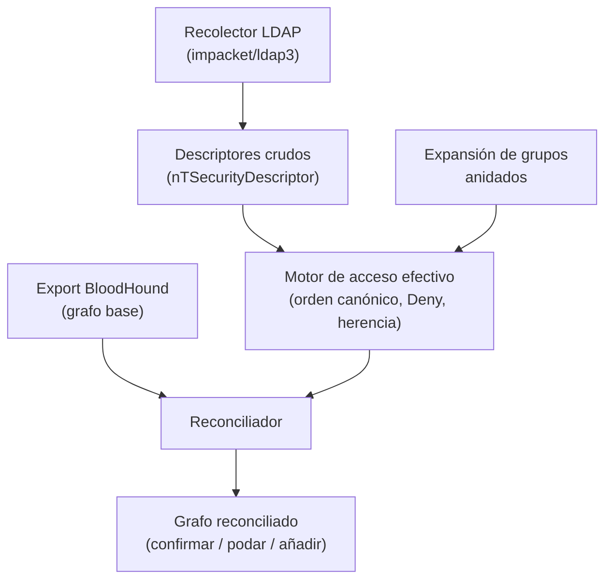

---
tags:
  - Proyectos
  - Python
  - Active-Directory
  - Tipo/Proyecto
Descripción: "Reevalúa cada arista de un grafo de BloodHound calculando el acceso efectivo real (deny ACE en orden canónico, herencia deshabilitada) para podar las rutas de ataque que son falsos positivos"
Fecha de actualización: 2026-09-21
Nota previa: "[[22 - Envenenador de caché por confusión de clave]]"
Nota siguiente: "[[24 - Banco de pruebas de inyección indirecta]]"
Area: "[[Proyectos ofensivos.base|Proyectos ofensivos]]"
Estado: Idea
Dificultad: 4
Esfuerzo: 3 semanas
Lenguaje: Python
---
---

**Nombre propuesto**: `pathcheck`

BloodHound es la herramienta que define el pentest de AD moderno, pero tiene un fallo de diseño conocido y documentado por SpecterOps: <mark style="background: #FF5582A6;">solo ingiere ACEs de tipo *Allow*</mark>. No calcula el acceso efectivo como lo hace el *security reference monitor* de Windows —que lee las ACEs en orden canónico y una *Deny* gana a una *Allow* posterior—, y trata la herencia de ACLs de forma que un objeto con la herencia deshabilitada genera un falso positivo. Resultado: rutas de ataque que BloodHound pinta como válidas y que en el dominio real **no funcionan**. `pathcheck` toma el grafo de BloodHound y reevalúa cada arista contra las reglas reales de acceso, marcando cuáles son rutas fantasma.

# El problema que resuelve

Perseguir una ruta de BloodHound que resulta ser un falso positivo cuesta tiempo y, peor, ruido: intentas un abuso de ACL que el sistema deniega, generas eventos, y a veces disparas una detección por un ataque que ni siquiera iba a funcionar. El operador experto lo sabe y verifica a mano las aristas críticas (`GenericAll`, `WriteDacl`, `GenericWrite`) leyendo el descriptor de seguridad real — pero eso no escala en un dominio con miles de objetos. `pathcheck` automatiza esa verificación: <mark style="background: #FFB86CA6;">recalcula el acceso efectivo de cada arista</mark> a partir del descriptor de seguridad crudo, teniendo en cuenta lo que BloodHound ignora.

# Alcance del proyecto

Tres piezas:

1. **Recolector de descriptores crudos.** Vía LDAP (con Impacket/`ldap3`), lee el `nTSecurityDescriptor` completo de los objetos del grafo — no solo las Allow que BloodHound conserva, sino las Deny, las flags de herencia (`SE_DACL_PROTECTED`), y el `ObjectType`/`InheritedObjectType` de cada ACE (que condiciona si el derecho aplica al objeto o a una clase hija concreta).
2. **Motor de acceso efectivo.** Reimplementa la evaluación canónica del DACL: ordena las ACEs, aplica precedencia Deny→Allow, resuelve herencia y `ObjectType`, y expande los grupos anidados del *principal* atacante. Para cada arista (origen, derecho, destino) responde: ¿el origen tiene *realmente* ese derecho efectivo sobre el destino?
3. **Reconciliador con el grafo.** Cruza el veredicto contra las aristas de BloodHound: confirma, **poda** (falso positivo por Deny/herencia) o **añade** (aristas que BloodHound se pierde, como ciertos Self ACEs o rutas por OU/GPO que ignora). Reexporta el grafo corregido.

# Funcionalidades principales

| Funcionalidad | Por qué importa |
| --- | --- |
| Evaluación de Deny ACE en orden canónico | Es exactamente lo que BloodHound no hace; una Deny bien colocada invalida la ruta, y saberlo evita perseguir fantasmas |
| Resolución de herencia deshabilitada | Un objeto con `SE_DACL_PROTECTED` no hereda: la arista que BloodHound asume por herencia no existe |
| Manejo de `ObjectType` en la ACE | Un `GenericWrite` acotado a una clase concreta no es el `GenericWrite` total que BloodHound pinta — precisión que cambia la explotabilidad |
| Expansión real de grupos anidados | El acceso efectivo depende de la membresía transitiva del principal; resolverla bien evita falsos negativos |
| Grafo reconciliado (podar/confirmar/añadir) | Devuelve un grafo *fiable*: menos rutas, pero las que quedan funcionan — el valor operativo entero |

# Funcionalidades secundarias

- **Cobertura de OU y GPO**: BloodHound tiene huecos conocidos en ataques por OU (`Manage Group Policy Links`) y GPO; modelar esas rutas es net-new de alto valor.
- **Priorización por explotabilidad real**: entre las aristas confirmadas, ordenar por facilidad y sigilo del abuso concreto (cruza con el catálogo de tácticas de ACL).
- **Modo offline**: trabajar sobre un export de descriptores ya recogido, sin volver a tocar el DC — menos ruido, repetible.
- **Diff temporal**: comparar dos recogidas y ver qué rutas aparecen/desaparecen tras un cambio de permisos (útil en purple/hardening).

# Casos de uso y actores

- **Red teamer / pentester de AD** que quiere validar una ruta antes de ejecutarla, especialmente las críticas hacia DA o hacia DCSync.
- **Consultor de hardening**: demostrar al cliente que una ruta que BloodHound alarma en realidad está mitigada por una Deny — o que una que cree segura no lo está.
- **Investigación de AD**: caracterizar cuánto se equivoca BloodHound en un dominio real (métrica de falsos positivos).

# Qué existe ya y dónde se queda corto

- **BloodHound / BloodHound CE**: la limitación de las Deny ACE y la herencia está reconocida en sus propios issues abiertos; no la resuelve por diseño (prioriza cobertura sobre precisión).
- **NoiseHound / GoodHound**: pesan las aristas por ruido o por dificultad, pero **asumen que las aristas de BloodHound son correctas**. `pathcheck` ataca justo esa premisa: primero verifica que la arista existe, luego ya se pondera.
- **Impacket / `dacledit`**: dan las primitivas para leer y editar descriptores, pero no evalúan acceso efectivo sobre un grafo entero.

El hueco: **nadie recalcula el acceso efectivo real sobre el grafo completo para podar los falsos positivos de BloodHound**.

# Por qué Python

Impacket es Python y es *la* librería que sabe hablar los protocolos de AD y parsear descriptores de seguridad (`impacket.ldap`, las estructuras de ACL/ACE). `ldap3` complementa la lectura, y `networkx` maneja el grafo y la expansión transitiva de grupos. Reimplementar el parseo de `nTSecurityDescriptor` fuera de Python sería reescribir medio Impacket; aquí es reutilizarlo.

# Arquitectura

El componente crítico es un **motor de evaluación de acceso efectivo** que reimplementa la lógica canónica de DACL de Windows. Ese motor debe estar **totalmente aislado y exhaustivamente testeado** con vectores conocidos, porque un error ahí produce exactamente los falsos veredictos que el proyecto existe para eliminar. Todo lo demás (recolección LDAP, reconciliación con el grafo) es I/O alrededor de ese núcleo puro.

- **Motor de acceso efectivo** (`EffectiveAccess`): función pura `(descriptor, principal, derecho) → bool`. Ordena ACEs, aplica Deny→Allow, resuelve herencia (`SE_DACL_PROTECTED`), `ObjectType`/`InheritedObjectType` y grupos anidados. **El corazón, y lo más test-driven del proyecto.**
- **Recolector LDAP**: lee `nTSecurityDescriptor` crudo; adaptador aislado (offline sobre export, u online).
- **Reconciliador**: cruza el veredicto con el grafo de BloodHound → confirma / poda / añade; reporta cobertura según permisos.

Decisión de ingeniería: el motor se valida con una **suite de vectores canónicos** (objeto con Deny explícita, herencia protegida, ACE con `ObjectType` acotado) *antes* de confiar en él sobre datos reales — TDD estricto en el núcleo. La entrada/salida usa el **JSON de BloodHound CE** para interoperar sin acoplarse a su motor.

# Stack de implementación (Python)

| Capa | Librería | Por qué (fundamento senior) | Alternativa descartada |
| --- | --- | --- | --- |
| LDAP + descriptores | `impacket` | *La* implementación que parsea `nTSecurityDescriptor` y estructuras de ACE fuera de .NET; reescribir eso sería reimplementar medio Impacket | Parsear el binario a mano — enorme y propenso a error |
| Lectura de atributos | `ldap3` | Complementa la lectura de UAC, SPNs y membresías con una API cómoda | Solo Impacket — más verboso para consultas simples |
| Grafo | `networkx` | Reconciliación, expansión transitiva de grupos y diff temporal como operaciones de grafo | Estructuras ad-hoc — la transitividad se complica |
| Interop | JSON de BloodHound CE | Entrada/salida estándar → se integra con el flujo existente sin acoplarse | Formato propio — aísla la herramienta |
| Test | `pytest` (vectores canónicos) | El motor de acceso efectivo se construye por TDD contra casos conocidos; es la garantía de corrección | Probar solo en un lab — no cubre las esquinas |

> **Transversal**: `uv`, `ruff`, `mypy --strict`, `rich`/`structlog`, `uv tool`/`pipx` (detalle en [[16 - Planificador de presupuesto de cracking]]).

# Plan de implementación por fases

1. **Motor de acceso efectivo aislado (semana 1)**: `EffectiveAccess` con orden canónico y precedencia Deny→Allow, probado con vectores sintéticos. Sin red — se valida la corrección primero, que es todo el punto.
2. **Herencia + ObjectType + grupos anidados**: completar la semántica (SE_DACL_PROTECTED, ACE acotadas por clase, expansión transitiva) con más vectores.
3. **Recolección LDAP + reconciliación**: leer descriptores crudos (offline sobre export primero), cruzar con el grafo de BloodHound, podar falsos positivos y confirmar reales.
4. **Cobertura OU/GPO + diff temporal + reporte de cobertura**: aristas que BloodHound omite, comparación entre recogidas, y el reporte honesto de qué se pudo verificar según permisos.

# Cosas a tener en cuenta

> [!warning]+ Reimplementar la evaluación canónica de DACL es sutil
> El orden de las ACEs, la precedencia Deny→Allow, las ACEs con `ObjectType`, la herencia y las flags son un conjunto de reglas con esquinas. Un error aquí produce lo mismo que quieres evitar: falsos veredictos. Validar el motor contra casos conocidos (un objeto con Deny explícita, uno con herencia protegida) antes de confiar en él.

- **Leer el `nTSecurityDescriptor` requiere permisos.** No todo principal puede leer todos los descriptores; con credenciales limitadas, parte del grafo queda sin verificar. Reportar la cobertura, no fingir que se verificó todo.
- **La foto envejece.** Los permisos cambian; una ruta verificada hoy puede alterarse. Marcar la fecha de recogida y ofrecer el diff temporal.
- **Ruido de la recolección.** Leer descriptores masivamente por LDAP es en sí una actividad enumerable (cruza con la detección de recon LDAP). Ofrecer modo lento/selectivo para las aristas que de verdad importan.
- **No sustituye a BloodHound, lo corrige.** Depende de su recogida (SharpHound/BloodHound.py) como entrada; el valor es la capa de verificación encima.

# Fuera de alcance

No recolecta el grafo desde cero (usa la salida de SharpHound/BloodHound.py). No ejecuta los abusos de ACL — verifica que son posibles, no los realiza. No hace pathfinding nuevo: reconcilia el existente. Ampliar a Azure AD / Entra es trabajo posterior.

# Criterio de terminado

Presentable cuando: dado un export de BloodHound de un laboratorio de AD con una Deny ACE colocada a propósito y un objeto con herencia protegida, `pathcheck` poda las rutas fantasma correspondientes y confirma las reales; detecta al menos una ruta por OU/GPO que BloodHound omite; y reporta la cobertura de verificación según los permisos disponibles.

# Conexiones en el vault

Es la capa de precisión sobre todo el sub-tema de ACLs: [[12 - Primer de abuso de ACLs]], [[13 - Enumeración de ACLs]], [[14 - Tácticas de abuso de ACLs]] y [[15 - DCSync]] (la ruta estrella que más duele verificar mal). Se apoya en la enumeración con credenciales de [[04 - Enumeración con credenciales]] y en el arsenal de [[26 - Arsenal de herramientas AD]]. El ruido de la recolección LDAP conecta con [[25 - Detección y evasión en AD]]. Complementa —no repite— al [[06 - Cartógrafo de pivoting y alcanzabilidad]] del catálogo de Go (aquel mapea red; este, permisos) y al [[05 - Detector de señuelos defensivos en Active Directory]] (aquel detecta honeytokens; este, falsos positivos de ruta).

> [!info]+ Fuentes
> - SpecterOps / BloodHound, [issue #392 — BHCE does not honor on-premise AD deny ACLs](https://github.com/SpecterOps/BloodHound/issues/392) — la limitación, reconocida por los propios autores (consultado 2026-09-21).
> - simondotsh, [Beware of BloodHound's Contains Edge](https://simondotsh.com/infosec/2022/06/14/bloodhound-contains-edge.html) — falsos positivos por herencia deshabilitada.
> - Fortra / Impacket — parseo de `nTSecurityDescriptor` y estructuras de ACE como base del motor de acceso efectivo.
