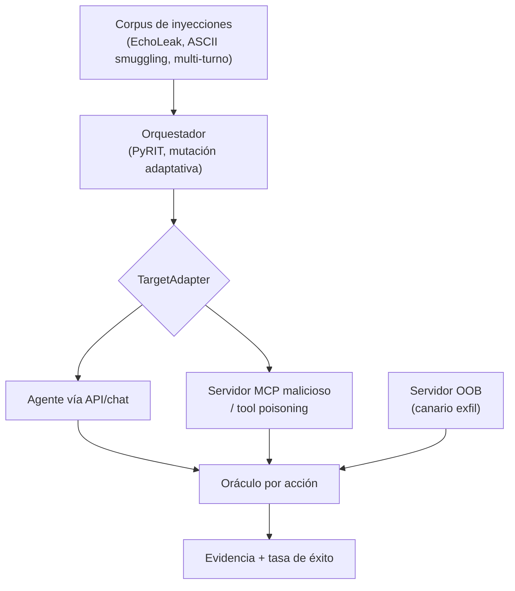

---
tags:
  - Proyectos
  - Python
  - IA/Red-Team
  - IA/LLM
  - Tipo/Proyecto
Descripción: "Prueba la inyección indirecta contra el agente realmente desplegado del cliente —sus herramientas, sus canales de contenido no confiable— en vez de un benchmark sintético como AgentDojo"
Fecha de actualización: 2026-09-21
Nota previa: "[[23 - Verificador de rutas de Active Directory]]"
Nota siguiente: "[[25 - Modelador de máquina de estados OAuth-OIDC]]"
Area: "[[Proyectos ofensivos.base|Proyectos ofensivos]]"
Estado: Idea
Dificultad: 4
Esfuerzo: 3 semanas
Lenguaje: Python
---
---

**Nombre propuesto**: `injectbench`

La inyección indirecta —instrucciones maliciosas escondidas en el contenido que un agente lee (un email, una página, un documento, la descripción de una herramienta MCP)— es el riesgo estrella de los agentes con acceso a datos privados y capacidad de actuar. Los benchmarks académicos (AgentDojo, Agent Security Bench) miden defensas sobre **agentes y tareas sintéticas**. En un engagement real no tienes ese agente: tienes el **agente concreto del cliente**, con sus herramientas específicas, sus fuentes de datos y su lógica de negocio. `injectbench` es el banco de pruebas para *ese* agente: <mark style="background: #FFB86CA6;">le inyectas por sus canales reales de contenido no confiable y mides si consigues que ejecute acciones no autorizadas</mark>.

# El problema que resuelve

Los benchmarks tienen tres límites reconocidos por la propia literatura de 2026: tareas sintéticas simples, métricas de éxito defectuosas y ataques débiles. Y, sobre todo, **no son el sistema del cliente**. Un pentest de un asistente de IA necesita atacar sus herramientas (¿tiene una que envía correo? ¿que hace peticiones HTTP? ¿que escribe en una base de datos?), sus canales de entrada no confiable (RAG sobre documentos del usuario, lectura de web, integraciones MCP) y su patrón de daño concreto (exfiltración, rogue action, envenenamiento de estado). `injectbench` conecta con el agente real, cataloga esos canales y esas herramientas, y lanza un corpus de inyecciones **modernas** contra ellos, capturando evidencia para el informe.

# Alcance del proyecto

Cuatro piezas:

1. **Adaptadores de objetivo.** Conectores al agente real: por su API/chat, o —para agentes con herramientas MCP— actuando como un **servidor MCP malicioso** o inyectando en las descripciones/salidas de herramientas (tool poisoning). El objetivo es el sistema del cliente, no un simulador.
2. **Modelo de canal y capacidad.** Cataloga qué herramientas tiene el agente (qué puede *hacer*) y por dónde entra contenido no confiable (qué puede *leer*). El riesgo real vive en la intersección: leer no confiable + poder actuar/exfiltrar.
3. **Corpus de inyecciones actual.** No la lista de 2024: EchoLeak (exfiltración zero-click), ASCII smuggling / payloads invisibles, jailbreaks multi-turno, tool poisoning vía descripción MCP, rug pull. Con generación adaptativa (usar un LLM atacante para mutar payloads que fallan), al estilo PyRIT.
4. **Oráculo de éxito y captura de evidencia.** Define "éxito" por *rogue action* observable (se llamó a la herramienta prohibida, salió el dato marcado por un canal externo), no por coincidencia de texto. Graba la traza completa: payload, mensajes, llamadas a herramientas, resultado — evidencia reproducible para el reporte.

# Funcionalidades principales

| Funcionalidad | Por qué importa |
| --- | --- |
| Objetivo = agente real del cliente | Ataca el sistema desplegado, no un benchmark sintético: es lo que un engagement necesita y lo que los benchmarks no dan |
| Adaptador MCP (servidor malicioso / tool poisoning) | La superficie que más crece; inyectar por la descripción o la salida de una herramienta MCP es un vector propio y actual |
| Corpus moderno + mutación adaptativa | Los benchmarks fallan por "ataques débiles"; incorporar EchoLeak, ASCII smuggling, multi-turno y mutación con LLM atacante cierra ese hueco |
| Oráculo por acción, no por texto | Éxito = herramienta prohibida invocada o dato exfiltrado por canal marcado; elimina la métrica defectuosa de los benchmarks |
| Captura de evidencia reproducible | La traza completa del ataque exitoso es el entregable del pentest — sin ella, un hallazgo de prompt injection no convence |

# Funcionalidades secundarias

- **Canario de exfiltración**: sembrar datos únicos marcados y detectar su salida por un servidor OOB propio (patrón compartido con el cazador de SSRF del catálogo de Go).
- **Cobertura de defensas**: probar contra el agente con/sin sus guardrails para medir cuánto aportan realmente (spotlighting, jerarquía de instrucciones, filtros).
- **Regresión**: guardar el corpus efectivo y reejecutarlo tras un cambio del agente, para verificar que una mitigación no se rompió (útil en retests).
- **Informe por intersección canal×capacidad**: mostrar qué combinaciones son explotables, que es como se explica el riesgo a un cliente no técnico.

# Casos de uso y actores

- **AI red teamer / pentester** contratado para evaluar un asistente, copiloto o agente con herramientas del cliente.
- **Equipo de plataforma de IA**: integrar `injectbench` en CI contra su propio agente antes de desplegar (según Cisco 2026, la mayoría planea desplegar agentes y pocos se sienten listos).
- **Investigación**: comparar la robustez de agentes reales frente a la de los benchmarks.

# Qué existe ya y dónde se queda corto

- **AgentDojo / Agent Security Bench**: benchmarks con agentes y tareas propias. Excelentes para comparar defensas en abstracto; no atacan el sistema del cliente. La literatura de 2026 documenta sus límites (tareas simples, métricas defectuosas, ataques débiles).
- **PyRIT / garak**: framework y scanner de red teaming de LLM. `injectbench` los usaría (PyRIT para la orquestación multi-turno y la mutación; garak para probes), pero ninguno se centra en **inyección indirecta contra el agente desplegado con herramientas MCP y oráculo por acción**.
- **PI-Hunter y similares**: automatizan red-teaming de prompt injection, pero sobre modelos/apps, no sobre el grafo de herramientas de un agente concreto.

El hueco: **un banco de pruebas para el agente real del cliente, con adaptador MCP, corpus moderno y éxito medido por acción**.

# Por qué Python

Es el idioma de todo el stack de agentes e IA: los SDKs de MCP (incluido FastMCP) son Python, PyRIT y garak son Python, y los clientes de las APIs de LLM viven ahí. Construir un servidor MCP malicioso, orquestar ataques multi-turno y puntuar resultados con un LLM juez es idiomático en Python; en otro lenguaje pelearías con FFI y bindings inmaduros.

# Arquitectura

**Ports & adapters** es aquí obligatorio: el objetivo (el agente del cliente) varía —API de chat, agente con herramientas MCP, copiloto— y el núcleo (corpus, orquestación, oráculo) no debe cambiar cuando cambia el objetivo. Un `TargetAdapter` por tipo de agente; el más rico es el **adaptador MCP que actúa como servidor malicioso**. El oráculo de éxito se define por **acción observable**, no por texto, y eso obliga a instrumentar los canales de salida (herramientas invocadas, canario exfiltrado).

- **Corpus** (`InjectionCorpus`): payloads modernos versionados, cada uno con metadatos (técnica, canal, daño esperado). Extensible.
- **Orquestador**: ejecuta simple o multi-turno, con mutación adaptativa (LLM atacante) sobre `PyRIT`. Registra la traza completa.
- **`TargetAdapter`** (port): API, o servidor MCP malicioso / tool poisoning. Aísla al núcleo del sistema concreto.
- **Oráculo por acción**: éxito = herramienta prohibida invocada ∨ canario salido por el servidor OOB. Señales duras sobre juicio de texto.

Decisión de ingeniería: por el **no determinismo** del LLM, todo se ejecuta **N veces con semilla registrada** y se reporta tasa de éxito con intervalos, nunca un binario; la captura de evidencia (payload, mensajes, tool calls, resultado) es un artefacto de primera clase para el informe y para regresión.

# Stack de implementación (Python)

| Capa | Librería | Por qué (fundamento senior) | Alternativa descartada |
| --- | --- | --- | --- |
| Adaptador MCP | SDK de MCP / `FastMCP` | Los SDK de MCP son Python; montar un servidor malicioso o envenenar descripciones es el vector propio y actual | Simular MCP a mano — no reproduce el protocolo real |
| Orquestación | `PyRIT` | Framework de red teaming de IA con multi-turno y converters de mutación ya resueltos | Bucle de prompts propio — reinventar PyRIT |
| Corpus base | `garak` | Probes de inyección mantenidos como punto de partida del corpus | Payloads sueltos de 2024 — desfasados |
| Canario OOB | servidor HTTP/DNS propio (`aiohttp`/`dnslib`) | Detectar exfiltración por canal marcado = señal dura de éxito | Confiar en un LLM juez — falsos positivos |
| Modelo/CLI | `pydantic` + `Typer` | Modelar objetivo, corpus y resultados con tipos; CLI y CI | `dict`/`argparse` |

> **Transversal**: `uv`, `ruff`, `mypy --strict`, `rich`/`structlog`, `uv tool`/`pipx` (detalle en [[16 - Planificador de presupuesto de cracking]]).

# Plan de implementación por fases

1. **Adaptador API + corpus mínimo + oráculo (semana 1)**: atacar un agente simple vía API con unos pocos payloads y un oráculo por acción (canario OOB). Walking skeleton que prueba el bucle entero contra un objetivo de staging.
2. **Adaptador MCP malicioso**: servidor MCP que inyecta por descripción/salida de herramienta (tool poisoning); el vector diferenciador.
3. **Corpus moderno + orquestación multi-turno**: integrar EchoLeak/ASCII smuggling/multi-turno y la mutación adaptativa con PyRIT; ejecución N-veces con semilla.
4. **Cobertura de defensas + evidencia + regresión**: medir con/sin guardrails, empaquetar la evidencia reproducible, y el modo regresión para retests.

# Cosas a tener en cuenta

> [!danger]+ Estás actuando contra un sistema que puede tomar acciones reales
> Si el agente tiene una herramienta que envía correos, mueve dinero o modifica datos, una inyección exitosa los ejecuta de verdad. Trabajar contra un entorno de staging del cliente siempre que sea posible, con herramientas en modo simulado, y dentro de un alcance firmado que contemple explícitamente las acciones del agente. El guardián de alcance del catálogo de Go aplica también aquí.

- **Prompt injection no tiene parche.** El objetivo no es "romper el modelo" (siempre se puede con esfuerzo) sino medir el **riesgo real**: qué daño concreto se alcanza por qué canal. Reportar impacto, no solo que "se pudo inyectar".
- **La métrica de éxito es el problema difícil.** Un LLM juez tiene falsos positivos; un oráculo por acción observable (llamada a herramienta, dato exfiltrado) es mucho más fiable. Priorizar señales duras sobre juicio de texto.
- **No determinismo.** El mismo payload puede funcionar una vez y no la siguiente. Reportar tasa de éxito sobre N intentos, no un binario — y guardar semilla/traza para reproducir.
- **El desfase de las fuentes es real.** Todo el material de HTB/2024 sobre inyección va corto; contrastar contra el estado del arte (EchoLeak/CVE-2025-32711 y familia, guía Five Eyes de 2026) y no asumir la lista vieja de jailbreaks.

# Fuera de alcance

No es un benchmark comparativo entre modelos (eso es AgentDojo). No ataca el modelo base para extraerlo ni lo evade adversarialmente (eso es otro proyecto). No hace fine-tuning de defensas. Se centra en la inyección indirecta contra un agente concreto y su superficie de herramientas.

# Conexiones en el vault

Es la aplicación operativa de [[05 - Inyección indirecta en RAG, email y web]], [[06 - EchoLeak y la exfiltración zero-click]] y [[07 - ASCII smuggling y payloads invisibles]], con los multi-turno de [[11 - Jailbreaks multi-turno y de contexto]]. El adaptador MCP viene de [[04 - Inyecciones en servidores MCP]] y [[06 - Tool poisoning y prompt injection vía descripción]]; el arsenal, de [[00 - Qué es PyRIT y cuándo usarlo]] y [[00 - Qué es garak y cuándo usarlo]]. Mide contra las defensas de [[13 - Defensas modernas contra prompt injection]] y de [[01 - Guardrails de entrada y salida]]. No repite al [[08 - Escáner de seguridad de servidores MCP]] del catálogo de Go: aquel audita la *postura* estática de un servidor MCP; este ataca el *comportamiento* del agente en ejecución.

> [!info]+ Fuentes
> - Debenedetti et al., [AgentDojo](https://arxiv.org/abs/2406.13352) y la crítica [Indirect Prompt Injections: Are Firewalls All You Need, or Stronger Benchmarks?](https://arxiv.org/abs/2510.05244) — los límites de los benchmarks que este proyecto elude (consultado 2026-09-21).
> - Microsoft / Azure, [PyRIT](https://github.com/Azure/PyRIT) — orquestación de red teaming de IA.
> - CISA/NSA + Five Eyes, guía conjunta sobre prompt injection en agentes (mayo 2026) — estado regulatorio y de amenaza.
