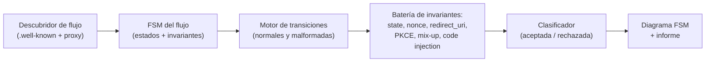

---
tags:
  - Proyectos
  - Python
  - Web/Red-Team
  - OAuth
  - Authentication
  - Tipo/Proyecto
Descripción: "Modela un flujo OAuth 2.0/OIDC real como máquina de estados y prueba sistemáticamente cada transición insegura —redirect_uri laxo, state/nonce ausente, PKCE downgrade, mix-up, code injection—"
Fecha de actualización: 2026-09-21
Nota previa: "[[24 - Banco de pruebas de inyección indirecta]]"
Nota siguiente: "[[26 - Auditor de inferencia de pertenencia]]"
Area: "[[Proyectos ofensivos.base|Proyectos ofensivos]]"
Estado: Idea
Dificultad: 4
Esfuerzo: 3 semanas
Lenguaje: Python
---
---

**Nombre propuesto**: `oauthfsm`

OAuth 2.0 y OIDC son máquinas de estados con muchas transiciones y muchas formas de configurarlas mal: `redirect_uri` validado por prefijo, `state` ausente (CSRF), `nonce` que no se comprueba (replay), PKCE que se puede degradar, confusión de proveedor (mix-up), inyección de `code`/`token`. El pentest de OAuth se hace hoy paso a paso, a mano, con Burp — y es fácil olvidar una transición. `oauthfsm` <mark style="background: #ADCCFFA6;">reconstruye el flujo concreto del objetivo como una máquina de estados</mark> y recorre sistemáticamente cada arista buscando la que rompe una garantía de seguridad.

# El problema que resuelve

La seguridad de OAuth no está en un endpoint sino en las **relaciones entre pasos**: que el `state` que vuelve sea el que enviaste, que el `code` solo se canjee una vez y por el cliente correcto, que el `redirect_uri` del canje coincida exactamente con el de la autorización. Verificar todas esas invariantes a mano es propenso a huecos. Modelar el flujo como FSM permite **enumerar las transiciones y las violaciones posibles** de forma exhaustiva: para cada estado, ¿qué pasa si salto este paso, reutilizo este valor, cambio este parámetro, inyecto un `code` de otra sesión? El proyecto convierte el checklist mental del experto en un recorrido automático y reproducible.

# Alcance del proyecto

Tres piezas:

1. **Descubridor del flujo.** A partir de la navegación real (proxy) y del `.well-known/openid-configuration` cuando existe, identifica el grant en uso (authorization code, con o sin PKCE, implicit legacy…), los endpoints, y los parámetros presentes (`state`, `nonce`, `code_challenge`, `response_mode`).
2. **Constructor de la FSM.** Modela el flujo como estados (petición de autorización → consentimiento → redirect con `code` → canje → token → userinfo) y transiciones, cada una con sus invariantes de seguridad asociadas.
3. **Recorredor de violaciones.** Para cada invariante, ejecuta la transición malformada correspondiente y clasifica el resultado: `redirect_uri` con sufijo/subdominio/`../`, omisión de `state`, `nonce` no verificado, downgrade de PKCE (`S256`→`plain`→ausente), reutilización de `code`, mix-up de proveedor, inyección de `code`/`access_token` de otra sesión. Reporta cuáles se aceptan.

# Funcionalidades principales

| Funcionalidad | Por qué importa |
| --- | --- |
| Reconstrucción de la FSM del flujo real | Adapta las pruebas al grant y parámetros concretos del objetivo, no a un flujo genérico de manual |
| Batería de invariantes por transición | Cubre de forma exhaustiva el catálogo (state, nonce, redirect_uri, PKCE, mix-up, code injection): no se olvida ninguna arista |
| Pruebas de validación de `redirect_uri` | El fallo más común y más grave; probar prefijo, subdominio, path traversal y `userinfo@` de forma sistemática |
| Detección de PKCE downgrade | Verifica si el servidor acepta degradar o prescindir de PKCE — un bypass silencioso que a mano se pasa por alto |
| Prueba de inyección de code/token cross-sesión | Modela el ataque de mix-up e inyección, que exige coordinar dos sesiones y es tedioso manualmente |

# Funcionalidades secundarias

- **Cobertura de OIDC específico**: validación del `id_token` (firma, `aud`, `iss`, `nonce`), no solo el flujo OAuth base.
- **Detección de implicit/legacy**: marcar el uso de grants obsoletos (implicit, ROPC) como hallazgo de configuración.
- **Encadenamiento con robo de token**: si el `redirect_uri` es explotable, enlazar con la exfiltración del `code`/token (open redirect, `Referer` leak).
- **Diagrama de la FSM**: exportar la máquina de estados con las aristas marcadas como seguras/rotas — un entregable visual excelente para el informe.

# Casos de uso y actores

- **Pentester web / bug hunter** ante cualquier "Login with…" o SSO corporativo — omnipresente y con superficie sutil.
- **Equipo de identidad / IAM**: validar su implementación de OAuth/OIDC contra el catálogo de invariantes antes de producción.
- **Formación**: la FSM hace tangible *por qué* cada parámetro existe (qué ataque previene), mejor que la RFC en prosa.

# Qué existe ya y dónde se queda corto

- **Burp + extensiones** (p. ej. las de análisis de OAuth): dan las piezas para probar a mano, pero no modelan el flujo ni recorren las transiciones de forma exhaustiva; dependen del operador para no olvidar ninguna.
- **`authlib` / clientes OAuth**: implementan el flujo correcto, no lo atacan. Sirven de base para hablar el protocolo, no de auditoría.
- **Scanners genéricos**: tratan OAuth como URLs sueltas, sin entender la relación entre pasos donde vive el bug.

El hueco: **modelar el flujo como FSM y recorrer sistemáticamente las violaciones de invariantes**, en vez de un checklist manual.

# Por qué Python

Es orquestación de un flujo HTTP con estado (múltiples redirecciones, dos sesiones coordinadas, parseo de JWT/`id_token`) más modelado de una máquina de estados. `authlib`/`requests-oauthlib` conocen el protocolo al dedillo, `python-jose`/`pyjwt` parsean el `id_token`, y una FSM se expresa limpiamente en Python (`transitions` o a mano). Coordinar dos sesiones para el mix-up es cómodo con clientes async; en Go tendrías el protocolo pero no el ecosistema de análisis.

# Arquitectura

La FSM no es adorno: es el **modelo de dominio** del que se derivan las pruebas. Cada estado tiene invariantes de seguridad asociadas, y cada "ataque" es una **transición malformada** que viola una invariante. Esto convierte la cobertura en algo enumerable —recorrer estados × invariantes— en vez de un checklist que se olvida. El motor que ejecuta transiciones se separa del catálogo de invariantes (datos), de modo que añadir una comprobación nueva es añadir una entrada, no código.

- **Descubridor**: `.well-known/openid-configuration` + navegación (proxy) → grant, endpoints, parámetros presentes.
- **FSM** (`transitions`): estados del flujo con sus invariantes declaradas como datos.
- **Motor de transiciones**: ejecuta la transición malformada correspondiente a cada invariante; coordina las **dos sesiones** necesarias para mix-up e inyección de code.
- **Clasificador**: aceptada (bug) / rechazada (correcto), con el matiz de `TRUSTED_TO_AUTH`-equivalente (protocol transition) que cambia el impacto.

Decisión de ingeniería: el consentimiento humano rompe la automatización pura, así que se modela como un **paso semi-manual pausable** (la FSM se detiene y cede a un navegador dirigido cuando el IdP exige clic), en vez de intentar automatizar el consentimiento de terceros —frágil y contra los términos del IdP—.

# Stack de implementación (Python)

| Capa | Librería | Por qué (fundamento senior) | Alternativa descartada |
| --- | --- | --- | --- |
| Protocolo | `authlib` | Conoce OAuth/OIDC al dedillo; base para construir el flujo correcto y luego malformarlo con precisión | Construir peticiones a mano — se pierden matices del grant |
| JWT/`id_token` | `pyjwt` / `python-jose` | Parsear y manipular el `id_token` (firma, `aud`, `iss`, `nonce`) reutiliza el trabajo JWT del vault | Parseo manual de JWT — propenso a error |
| FSM | `transitions` | Modelar estados/transiciones de forma declarativa hace la cobertura enumerable y el diagrama gratis | FSM a mano con `if` — se olvida alguna arista |
| Ejecución | `httpx` + `mitmproxy` | Dos sesiones coordinadas y captura del flujo real; control de redirecciones | `requests` — coordinar dos sesiones async es tosco |
| Test | `pytest` + IdP de laboratorio (Keycloak en Docker) | Validar cada invariante contra un IdP real configurable reproducible | Mock del IdP — no cubre el comportamiento real |

> **Transversal**: `uv`, `ruff`, `mypy --strict`, `rich`/`structlog`, `uv tool`/`pipx` (detalle en [[16 - Planificador de presupuesto de cracking]]).

# Plan de implementación por fases

1. **Descubridor + FSM del authorization code (semana 1)**: parsear `.well-known`, reconstruir la FSM del grant más común y ejecutar el flujo *correcto* de punta a punta contra Keycloak. Sin ataques aún — se valida el modelo.
2. **Batería de invariantes de una sesión**: `state` ausente, `redirect_uri` por prefijo/subdominio/traversal, PKCE downgrade, validación del `id_token`. Los bugs más comunes.
3. **Ataques de dos sesiones**: mix-up e inyección de code/token cross-sesión; coordinación de sesiones y clasificación.
4. **Consentimiento semi-manual + diagrama + informe**: el paso pausable para IdPs con clic, y la exportación del diagrama FSM con aristas rotas resaltadas.

# Cosas a tener en cuenta

> [!warning]+ El consentimiento humano rompe la automatización
> Muchos flujos exigen un clic de consentimiento en la UI del proveedor. Automatizar eso a ciegas es frágil y puede violar los términos del IdP (Google, Microsoft). Trabajar contra el IdP del cliente o un IdP de laboratorio, y modelar el consentimiento como un paso semi-manual cuando haga falta.

- **No romper cuentas reales.** Probar inyección de `code`/token cross-sesión con cuentas de prueba propias; hacerlo contra usuarios reales es acceso no autorizado. Alcance firmado, siempre.
- **El IdP no es el objetivo (normalmente).** El bug suele estar en el *cliente* (la app que integra OAuth), no en Google/Microsoft. Atacar al IdP de terceros está fuera de alcance y de la ley; el foco es la implementación del cliente.
- **`redirect_uri` tiene mil matices.** Comparación exacta vs. prefijo, `localhost`, esquemas custom de apps móviles, wildcards: modelar bien la política de validación es donde está el 80% del valor.
- **PKCE es hoy obligatorio para public clients.** Su ausencia o su downgrade es un hallazgo por sí mismo; la RFC 9700 (Security BCP) lo formaliza — citar la norma en el informe da peso.

# Fuera de alcance

No ataca la criptografía del `id_token` más allá de las confusiones de firma ya cubiertas por el trabajo JWT del vault (no es un cracker de firmas). No cubre SAML (otra bestia, ya tratada). No explota el IdP de terceros. Se centra en las invariantes del flujo del cliente.

# Criterio de terminado

Presentable cuando: contra un cliente OAuth de laboratorio, reconstruye la FSM del flujo, detecta un `redirect_uri` validado por prefijo, un `state` ausente y un PKCE degradable, y marca correctamente como seguras las transiciones bien implementadas; exporta el diagrama de la FSM con las aristas rotas resaltadas.

# Conexiones en el vault

Es la industrialización del sub-tema OAuth: [[07 - Introducción a OAuth 2.0]], [[08 - Robo de tokens de acceso OAuth]], [[09 - Protección CSRF deficiente en OAuth]] (el caso `state`) y [[10 - Vulnerabilidades adicionales y prevención OAuth]]. La validación del `id_token` conecta con toda la familia JWT ([[02 - Ataques a la verificación de firma JWT]], [[04 - Confusión de algoritmos JWT]]); el encadenamiento por `redirect_uri` con [[00 - Introducción a Open Redirect|Open Redirect]] si existe. Comparte espíritu con el proyecto [[19 - Auditor de predicción de tokens de sesión]] (romper garantías de autenticación) y con el modelado exhaustivo de estados.

> [!info]+ Fuentes
> - IETF, [RFC 9700 — Best Current Practice for OAuth 2.0 Security](https://datatracker.ietf.org/doc/html/rfc9700) — el catálogo autoritativo de invariantes y ataques (consultado 2026-09-21).
> - PortSwigger, [OAuth 2.0 authentication vulnerabilities](https://portswigger.net/web-security/oauth) — taxonomía práctica de los fallos por transición.
> - Authlib, [documentación](https://docs.authlib.org/) — base para hablar el protocolo correctamente.
