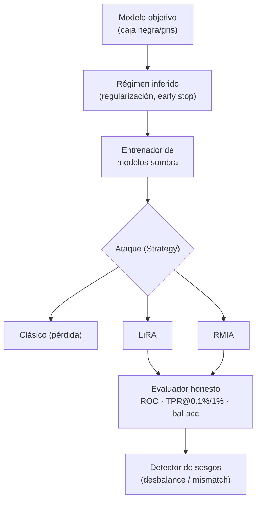

---
tags:
  - Proyectos
  - Python
  - IA/Red-Team
  - IA/Privacidad
  - Tipo/Proyecto
Descripción: "Audita cuánta pertenencia filtra un modelo con ataques MIA modernos (LiRA, RMIA), reportando TPR a bajo FPR y precisión balanceada en vez de la 'ventaja' inflada por el desbalance"
Fecha de actualización: 2026-09-21
Nota previa: "[[25 - Modelador de máquina de estados OAuth-OIDC]]"
Nota siguiente: "[[27 - Cartógrafo de abuso de delegación Kerberos]]"
Area: "[[Proyectos ofensivos.base|Proyectos ofensivos]]"
Estado: Idea
Dificultad: 4
Esfuerzo: 3 semanas
Lenguaje: Python
---
---

**Nombre propuesto**: `memberaudit`

Un *membership inference attack* (MIA) decide si un registro concreto estuvo en el conjunto de entrenamiento de un modelo. Es la prueba de privacidad por excelencia —y con el RGPD y la regulación de IA, un requisito real de auditoría—, pero está plagada de metodología mala: se mide con métricas engañosas (la famosa "ventaja" que el propio material de HTB calcula mal por el desbalance del conjunto), con modelos sombra que no replican al objetivo, y con umbrales que filtran información. `memberaudit` hace un MIA **metodológicamente correcto** y reporta lo que de verdad importa: <mark style="background: #FFB86CA6;">TPR a bajo FPR</mark>, no una accuracy inflada.

# El problema que resuelve

Medir la fuga de pertenencia bien es sorprendentemente difícil, y hacerlo mal lleva a conclusiones falsas en las dos direcciones: infravalorar la fuga (y dar por privado un modelo que no lo es) o sobrevalorarla (y alarmar sin base). Los errores típicos, documentados incluso en material didáctico: calcular la "ventaja" como `accuracy − 0.5` sobre un conjunto desbalanceado 2:1 (donde "siempre miembro" ya acierta el 66,7%), entrenar los modelos sombra con regularización que el objetivo no tiene (rompiendo la premisa del ataque), y comparar umbrales sin ruido que filtran información. `memberaudit` implementa los ataques del estado del arte (LiRA, RMIA) con la metodología correcta y evalúa por **TPR@FPR bajo**, que es la métrica que la comunidad adoptó justamente porque la accuracy media engaña.

# Alcance del proyecto

Tres piezas:

1. **Entrenador de modelos sombra.** Entrena N modelos que replican la arquitectura y el régimen de entrenamiento del objetivo (misma regularización, mismo early stopping o su ausencia) sobre subconjuntos conocidos, para calibrar la distribución de la señal de ataque bajo la hipótesis "miembro" y "no miembro".
2. **Batería de ataques.** Desde el ataque clásico basado en pérdida/confianza hasta LiRA (*Likelihood Ratio Attack*, calibrado por ejemplo) y RMIA (relativo, más eficiente en muestras). Caja negra (solo scores) y caja gris (logits) según el acceso al objetivo.
3. **Evaluador honesto.** Reporta ROC completa, **TPR a FPR = 0.1% / 1%**, precisión balanceada y AUC — no la "ventaja" cruda. Cuantifica la incertidumbre (intervalos por bootstrap) y avisa de los sesgos metodológicos si detecta desbalance o mismatch de régimen.

# Funcionalidades principales

| Funcionalidad | Por qué importa |
| --- | --- |
| Ataques modernos (LiRA, RMIA) | El clásico basado en pérdida subestima la fuga; LiRA/RMIA son el estado del arte y detectan lo que el clásico no ve |
| Métrica TPR@low-FPR | Es la métrica correcta: un modelo que filtra el 0,1% de miembros con altísima confianza es un problema aunque su accuracy media parezca inocua |
| Modelos sombra fieles al régimen del objetivo | Replicar regularización/early stopping del objetivo evita el sesgo que invalida el ataque (el error del material de HTB) |
| Detección de sesgos metodológicos | Avisa de desbalance de clases y mismatch de régimen antes de reportar una cifra falsa — corrige el fallo de raíz |
| Modo caja negra y caja gris | Se adapta al acceso real: solo API de scores, o logits completos si el objetivo lo permite |

# Funcionalidades secundarias

- **Auditoría de defensas**: medir la reducción de fuga que aporta DP-SGD (con su ε) o PATE, para verificar que la privacidad diferencial declarada se traduce en robustez real al MIA.
- **Por-registro**: no solo una cifra global, sino qué registros concretos son más vulnerables (los outliers filtran más) — accionable para un DPO.
- **Coste por consulta**: si el objetivo cobra o limita consultas, RMIA es preferible por eficiencia; modelar el presupuesto de consultas (enlaza con el fuzzer adversarial del catálogo de Go).
- **Informe de cumplimiento**: traducir el resultado a lenguaje de riesgo de privacidad (RGPD/AI Act), el entregable que pide una auditoría formal.

# Casos de uso y actores

- **AI red teamer / auditor de privacidad** evaluando un modelo entrenado con datos sensibles (salud, finanzas).
- **Equipo de ML / DPO**: medir la fuga antes de publicar un modelo o una API, y verificar que su DP-SGD funciona.
- **Investigación / docencia**: un MIA bien hecho como referencia, frente a la abundancia de implementaciones con metodología defectuosa.

# Qué existe ya y dónde se queda corto

- **ML Privacy Meter** (NUS) y partes de la **Adversarial Robustness Toolbox (ART)** implementan MIA. Buenas bases, pero el ecosistema arrastra implementaciones didácticas con los sesgos descritos, y el foco en TPR@low-FPR y la detección automática de sesgos no está integrada de serie.
- El material formativo (incluido el de HTB, con erratas conocidas: "ventaja" mal calculada, modelos sombra con régimen distinto, umbral sin ruido) enseña la versión defectuosa.
- LiRA y RMIA son papers recientes; llevarlos a una **herramienta de auditoría reproducible con reporte de cumplimiento** es el hueco.

# Por qué Python

Es entrenar y consultar modelos de ML: `pytorch`/`scikit-learn` para los modelos sombra, `numpy`/`scipy` para la calibración estadística de LiRA (razón de verosimilitud gaussiana) y las curvas ROC. Todo el tooling de privacidad (ML Privacy Meter, ART, Opacus para DP-SGD) es Python. Es, literalmente, el único ecosistema donde este proyecto es viable sin reimplementar el framework de ML.

# Arquitectura

La arquitectura debe **hacer difícil equivocarse en la metodología**, porque ahí es donde falla el 90% de los MIA. Dos decisiones estructurales: (1) el régimen de entrenamiento de los modelos sombra se **deriva del objetivo** (no se configura aparte), forzando la fidelidad que la premisa del ataque exige; (2) el evaluador solo expone **TPR@low-FPR y precisión balanceada**, y **se niega a reportar** una "ventaja" cruda sobre un conjunto desbalanceado. La métrica correcta está cableada en el diseño, no delegada al usuario.

- **Régimen inferido**: replica arquitectura y regularización del objetivo; sin esto, los shadow models no representan y el ataque miente.
- **Ataques** (Strategy): clásico / LiRA / RMIA bajo una interfaz común; el clásico es la línea base, LiRA/RMIA el estado del arte.
- **Evaluador**: ROC completa y TPR a FPR bajo, con intervalos por bootstrap.
- **Detector de sesgos**: avisa de desbalance y mismatch de régimen *antes* de emitir cifras — la salvaguarda que corrige el error de raíz.

Decisión de ingeniería: LiRA exige entrenar N modelos sombra (caro); el diseño separa el **entrenamiento (cacheable, reutilizable entre corridas)** del ataque, y ofrece RMIA como camino eficiente en muestras cuando el presupuesto de cómputo o de consultas aprieta.

# Stack de implementación (Python)

| Capa | Librería | Por qué (fundamento senior) | Alternativa descartada |
| --- | --- | --- | --- |
| Modelos | `pytorch` / `scikit-learn` | Entrenar objetivo y sombra; PyTorch para redes, sklearn para modelos clásicos — todo el tooling de privacidad es Python | Otro ecosistema — sin librerías de MIA |
| Estadística | `numpy` / `scipy.stats` | La razón de verosimilitud de LiRA es gaussiana; curvas ROC y TPR@FPR con `scipy` | Métricas a ojo — el error que el proyecto corrige |
| Base MIA | `ml_privacy_meter` / ART | Implementaciones a extender, no a reescribir; se añade encima el foco en TPR@low-FPR y el detector de sesgos | Reimplementar el ataque desde cero |
| Defensas | `opacus` | DP-SGD de referencia para el modo "auditar la defensa" y verificar que ε se traduce en robustez | Implementar DP-SGD a mano — contabilidad delicada |
| Reproducibilidad | `pytorch` (seed) + `dvc`/`mlflow` (opcional) | Semillas y versionado de datos/modelos → la auditoría es repetible y defendible | Corridas sin traza — no auditable |

> **Transversal**: `uv`, `ruff`, `mypy --strict`, `rich`/`structlog`, `uv tool`/`pipx` (detalle en [[16 - Planificador de presupuesto de cracking]]).

# Plan de implementación por fases

1. **Ataque clásico + evaluación honesta (semana 1)**: MIA basado en pérdida sobre un modelo de laboratorio sobreajustado, reportando ROC y TPR@1%FPR (no "ventaja"). El esqueleto que fija la métrica correcta desde el día uno.
2. **Modelos sombra fieles + detector de sesgos**: entrenamiento de N sombras con régimen derivado del objetivo, y el aviso de desbalance/mismatch que rechaza cifras falsas.
3. **LiRA + RMIA**: los ataques del estado del arte bajo la interfaz común; RMIA para el caso de presupuesto ajustado.
4. **Auditoría de defensas + reporte de cumplimiento**: medir la caída de fuga bajo DP-SGD/PATE, análisis por-registro (outliers), y el informe en lenguaje de riesgo (RGPD/AI Act).

# Cosas a tener en cuenta

> [!warning]+ La metodología ES el proyecto
> Un MIA con modelos sombra que no replican el régimen del objetivo, o evaluado por "ventaja" sobre un conjunto desbalanceado, produce un número sin sentido. El valor entero de `memberaudit` está en hacerlo bien: régimen fiel, métrica TPR@low-FPR, detección de sesgos. Copiar la implementación defectuosa de un tutorial es exactamente el error a evitar.

- **El acceso al objetivo condiciona el ataque.** Caja negra (solo la etiqueta) es mucho más débil que caja gris (scores/logits). Reportar bajo qué modelo de acceso se midió; no mezclar.
- **Entrenar N modelos sombra es caro.** LiRA necesita varios; RMIA es más eficiente en muestras. Modelar el coste computacional y ofrecer el ataque proporcionado al presupuesto.
- **La fuga es por-ejemplo, no uniforme.** Los outliers y los registros raros filtran mucho más que la media. Una cifra global esconde el riesgo real de los individuos vulnerables — reportar la cola, no solo el promedio.
- **DP no es binario.** Un ε alto "cumple" DP y aun así filtra. Verificar la robustez empírica al MIA, no fiarse del ε declarado.

# Fuera de alcance

No es un ataque de extracción de datos de entrenamiento textual (memorización en LLMs es tema aparte) ni de inversión de modelo. No entrena el modelo objetivo — lo audita. No implementa las defensas, las evalúa (Opacus/PATE ya existen).

# Criterio de terminado

Presentable cuando: sobre un modelo de laboratorio sobreajustado, LiRA/RMIA reportan un TPR@1%FPR significativo con intervalos de confianza; sobre el mismo modelo entrenado con DP-SGD, la fuga cae de forma medible; y la herramienta detecta y avisa de un intento de evaluación sesgada (desbalance / mismatch de régimen) en vez de emitir la cifra inflada.

# Conexiones en el vault

Es la industrialización de todo el sub-tema de privacidad: [[00 - Amenazas de privacidad en modelos de ML]], [[01 - Por qué los modelos filtran pertenencia]], [[02 - El ataque de shadow models]], [[03 - Entrenar los shadow models y el clasificador de ataque]] y [[04 - Ejecución y evaluación del MIA]] (donde vive la errata de la "ventaja" que este proyecto corrige). La auditoría de defensas conecta con [[05 - Privacidad diferencial, épsilon y el mecanismo gaussiano]], [[06 - DP-SGD, clipping, ruido y contabilidad con Opacus]] y [[08 - PATE, ensemble de profesores y agregación con ruido]]; el arsenal, con [[11 - Arsenal para auditoría de privacidad]]. El presupuesto de consultas comparte modelo con el [[12 - Fuzzer adversarial de clasificadores]] del catálogo de Go.

> [!info]+ Fuentes
> - Carlini et al., [*Membership Inference Attacks From First Principles*](https://arxiv.org/abs/2112.03570) (LiRA, IEEE S&P 2022) — TPR@low-FPR como métrica correcta (consultado 2026-09-21).
> - Zarifzadeh et al., [*Low-Cost High-Power Membership Inference Attacks*](https://arxiv.org/abs/2312.03262) (RMIA) — ataque eficiente en muestras.
> - NUS, [ML Privacy Meter](https://github.com/privacytrustlab/ml_privacy_meter) — base de auditoría a extender.
