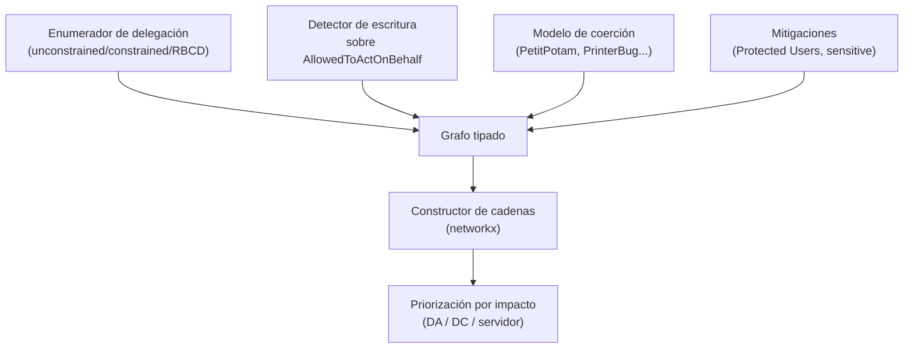

---
tags:
  - Proyectos
  - Python
  - Active-Directory
  - Tipo/Proyecto
Descripción: "Enumera las tres delegaciones Kerberos (unconstrained, constrained, RBCD) y traza las cadenas de abuso completas —incluida la coerción necesaria— que BloodHound modela de forma incompleta"
Fecha de actualización: 2026-09-21
Nota previa: "[[26 - Auditor de inferencia de pertenencia]]"
Nota siguiente: "[[28 - Diferenciador de parseo WAF ↔ aplicación]]"
Area: "[[Proyectos ofensivos.base|Proyectos ofensivos]]"
Estado: Idea
Dificultad: 4
Esfuerzo: 3 semanas
Lenguaje: Python
---
---

**Nombre propuesto**: `delegmap`

La delegación de Kerberos es uno de los caminos más rentables a Domain Admin y uno de los peor mapeados. Hay tres sabores —*unconstrained*, *constrained* (con o sin protocol transition) y *resource-based* (RBCD)— cada uno con su primitiva de abuso (`S4U2Self`/`S4U2Proxy`, robo de TGT, escritura de `msDS-AllowedToActOnBehalfOfOtherIdentity`), y su explotación suele requerir un segundo ingrediente: **coaccionar** a un objetivo para que autentique. BloodHound modela algunas aristas de delegación, pero la cadena completa —"puedo escribir este atributo, y puedo coaccionar a este DC, luego puedo suplantar a este admin"— queda fragmentada. `delegmap` <mark style="background: #ADCCFFA6;">enumera las tres delegaciones y traza la cadena de abuso entera</mark>, coerción incluida.

# El problema que resuelve

El operador que domina AD sabe reconocer una delegación explotable, pero reconstruir a mano todas las cadenas en un dominio grande es lento y se pierden combinaciones. Los datos están repartidos en atributos concretos (`userAccountControl` con `TRUSTED_FOR_DELEGATION`, `msDS-AllowedToDelegateTo`, `msDS-AllowedToActOnBehalfOfOtherIdentity`), y la explotabilidad depende de a) qué delegación existe, b) si controlas o puedes obtener la cuenta origen, c) si puedes escribir el atributo RBCD del destino, y d) si tienes un método de coerción hacia una cuenta interesante. `delegmap` cruza los cuatro y **enumera las cadenas viables ordenadas por impacto**, señalando el eslabón que falta cuando la cadena está incompleta.

# Alcance del proyecto

Tres piezas:

1. **Enumerador de delegación.** Vía LDAP (Impacket/`ldap3`), recoge todas las cuentas con delegación: `TRUSTED_FOR_DELEGATION` (unconstrained) y `TRUSTED_TO_AUTH_FOR_DELEGATION`, los SPN de `msDS-AllowedToDelegateTo` (constrained), y quién figura en `msDS-AllowedToActOnBehalfOfOtherIdentity` (RBCD). También quién tiene permiso de **escritura** sobre ese atributo en cada objeto (la primitiva para *montar* un RBCD).
2. **Modelo de coerción.** Cataloga los métodos de coerción disponibles (PetitPotam, PrinterBug, ShadowCoerce, DFSCoerce…) y qué cuentas de máquina/DC son coaccionables — el ingrediente que convierte una delegación "teórica" en explotable.
3. **Constructor de cadenas.** Con `networkx`, une: principal controlado → (escritura RBCD | control de cuenta con delegación) → coerción de objetivo → suplantación vía S4U → acceso privilegiado. Emite cada cadena con sus pasos, el comando de referencia por paso, y su impacto (¿lleva a DA? ¿a un DC? ¿a un servidor concreto?).

# Funcionalidades principales

| Funcionalidad | Por qué importa |
| --- | --- |
| Enumeración de los tres tipos de delegación | Unconstrained/constrained/RBCD tienen abusos distintos; tratarlos juntos y bien es lo que da el mapa completo |
| Detección de escritura sobre el atributo RBCD | La primitiva ofensiva más rentable de 2020+: si puedes escribir `AllowedToActOnBehalf`, montas tu propia delegación |
| Modelo de coerción integrado | La delegación sin un método de coerción suele ser inerte; unir ambos es lo que BloodHound no hace de forma completa |
| Cadenas con el eslabón que falta señalado | Una cadena incompleta ("tendrías esto si consiguieras coaccionar X") es una guía de próximos pasos, no un descarte |
| Priorización por impacto | Ordena por destino (DA, DC, servidor sensible), no por longitud; una cadena de 2 pasos a DA vale más que una de 5 a un file server |

# Funcionalidades secundarias

- **Unconstrained + coerción de DC**: el camino clásico "coacciona al DC hacia una máquina con unconstrained → captura su TGT → DCSync", modelado explícitamente.
- **Constrained con protocol transition (S4U2Self)**: distinguir la delegación con `TRUSTED_TO_AUTH_FOR_DELEGATION` (peligrosa: suplanta a cualquiera) de la que exige un ticket reenviable.
- **Verificación de mitigaciones**: marcar cuentas `Protected Users` o con `Account is sensitive and cannot be delegated`, que rompen la cadena — evita perseguir fantasmas (enlaza con el verificador de rutas AD).
- **Export a BloodHound**: emitir las cadenas como aristas custom para visualizarlas en el grafo existente.

# Casos de uso y actores

- **Red teamer / pentester de AD** buscando el camino más corto a DA cuando las rutas obvias están mitigadas.
- **Consultor de hardening**: mostrar al cliente sus delegaciones peligrosas y qué cuenta las hace explotables.
- **Investigación de AD**: caracterizar la prevalencia de delegación mal configurada en dominios reales.

# Qué existe ya y dónde se queda corto

- **Impacket** (`findDelegation.py`, `getST.py`, `rbcd.py`) da las primitivas: enumerar, pedir tickets S4U, escribir RBCD. Son piezas sueltas; no construyen la cadena ni integran la coerción.
- **BloodHound** modela `AllowedToDelegate` y algo de RBCD, pero la cadena completa con **coerción** y con la primitiva de *escritura* del atributo queda incompleta o requiere queries Cypher manuales expertas.
- **Coercer / PetitPotam / etc.**: excelentes para coaccionar, pero no saben nada de qué delegación hay al otro lado.

El hueco: **unir enumeración de delegación + primitiva de escritura + coerción en cadenas de abuso completas y priorizadas**.

# Por qué Python

Impacket es la implementación de referencia de Kerberos y de los abusos de delegación (S4U, RBCD) fuera de .NET, y es Python; las herramientas de coerción (Coercer) también. `ldap3` lee los atributos, `networkx` construye las cadenas. Reimplementar S4U2Self/S4U2Proxy y el parseo de tickets en otro lenguaje sería reescribir Impacket; aquí es orquestarlo.

# Arquitectura

El proyecto es un **constructor de cadenas sobre un grafo tipado**, donde los nodos son principales/recursos y las aristas son capacidades (control de cuenta, escritura RBCD, coerción disponible, delegación existente). Una "cadena de abuso" es un camino que combina aristas de tipos distintos. Modelar cada tipo de delegación con su **semántica exacta** —y no mezclarlas— es la decisión que evita cadenas falsas; separar *viabilidad teórica* de *ejecución* es la que mantiene la herramienta del lado seguro (mapea, no dispara).

- **Enumerador**: lee UAC (`TRUSTED_FOR_DELEGATION`, `TRUSTED_TO_AUTH_FOR_DELEGATION`), `msDS-AllowedToDelegateTo`, `msDS-AllowedToActOnBehalfOfOtherIdentity`. Cada tipo, su modelo.
- **Detector de escritura**: quién puede escribir el atributo RBCD (la primitiva de "montar" delegación).
- **Modelo de coerción**: qué métodos existen y qué cuentas son coaccionables — el ingrediente que vuelve explotable una delegación.
- **Constructor de cadenas**: camino `control → (escritura RBCD | cuenta con delegación) → coerción → S4U → acceso`, con el **eslabón que falta señalado** cuando la cadena está incompleta.

Decisión de ingeniería: el grafo comparte formato con el [[23 - Verificador de rutas de Active Directory]] para que la verificación de mitigaciones (Protected Users, `sensitive`) poda cadenas muertas; y cada arista lleva su **comando de referencia y su ruido estimado**, de modo que la salida es un playbook, no una orden automática.

# Stack de implementación (Python)

| Capa | Librería | Por qué (fundamento senior) | Alternativa descartada |
| --- | --- | --- | --- |
| Kerberos/RBCD | `impacket` | Implementación de referencia de S4U2Self/S4U2Proxy, escritura RBCD y parseo de tickets fuera de .NET | Reimplementar Kerberos — reescribir Impacket |
| LDAP | `ldap3` | Lectura de UAC, SPNs, atributos de delegación y permisos de escritura con API cómoda | Solo Impacket — más verboso |
| Grafo | `networkx` | Cadenas como caminos tipados; priorización y "eslabón que falta" como operaciones de grafo | Estructuras ad-hoc — la combinación de tipos se lía |
| Coerción | `Coercer` (referencia) | Catálogo de métodos y su aplicabilidad, sin reimplementarlos | Hardcodear un método — cobertura pobre |
| Test | `pytest` + lab de AD (GOAD/`samba`) | Validar enumeración y construcción de cadenas contra un dominio con las tres delegaciones configuradas | Solo teoría — no valida la semántica |

> **Transversal**: `uv`, `ruff`, `mypy --strict`, `rich`/`structlog`, `uv tool`/`pipx` (detalle en [[16 - Planificador de presupuesto de cracking]]).

# Plan de implementación por fases

1. **Enumerador de los tres tipos (semana 1)**: leer UAC y atributos de delegación por LDAP y clasificar cada cuenta (unconstrained/constrained/RBCD) con su semántica. La base factual del mapa.
2. **Detección de escritura RBCD + grafo tipado**: quién puede escribir `AllowedToActOnBehalf`; volcar todo a un grafo tipado interoperable con el verificador de rutas.
3. **Modelo de coerción + constructor de cadenas**: unir coerción disponible con delegación para construir cadenas completas y señalar el eslabón que falta en las incompletas.
4. **Priorización + mitigaciones + playbook**: ordenar por impacto (DA/DC), podar cadenas rotas por Protected Users/`sensitive`, y emitir el playbook con comando y ruido por paso.

# Cosas a tener en cuenta

> [!warning]+ La coerción es ruidosa y con efectos
> Coaccionar a un DC genera tráfico y eventos, y algunos métodos pueden afectar a la estabilidad del objetivo. El mapa debe distinguir la *viabilidad teórica* de la *ejecución*, y dejar la coerción real como un paso deliberado del operador, no automático. Cruza con la doctrina de detección y evasión en AD.

- **Los tres tipos se confunden fácil.** Unconstrained (captura cualquier TGT que llegue), constrained (limitada a SPNs concretos), RBCD (el recurso decide quién delega en él): mezclarlos produce cadenas falsas. Modelar cada uno con su semántica exacta es el núcleo.
- **`TRUSTED_TO_AUTH_FOR_DELEGATION` es el matiz que más importa.** Con protocol transition, la constrained deja suplantar a *cualquier* usuario (incluido un admin) sin que este autentique. Sin él, necesitas un ticket reenviable. La flag cambia todo el impacto.
- **Las mitigaciones rompen cadenas.** `Protected Users`, `Account is sensitive`, y firmas/hardening recientes invalidan rutas. Verificarlas (como el proyecto vecino de rutas AD) evita reportar cadenas muertas.
- **Requiere credenciales para enumerar.** La lectura de atributos y permisos exige acceso; con credenciales limitadas el mapa es parcial. Reportar cobertura.

# Fuera de alcance

No ejecuta la coerción ni el abuso end-to-end automáticamente (da el mapa y los comandos; la ejecución es del operador, por OPSEC). No recolecta el grafo base de AD desde cero (se apoya en BloodHound.py/SharpHound para el contexto). No cubre delegación en Azure/Entra.

# Criterio de terminado

Presentable cuando: sobre un laboratorio de AD con las tres delegaciones configuradas, `delegmap` enumera cada una, identifica dónde tienes escritura sobre el atributo RBCD, y construye al menos una cadena completa a DA (con coerción incluida) y una incompleta señalando el eslabón que falta; marca correctamente una cuenta `Protected Users` como no delegable.

# Conexiones en el vault

Profundiza en [[11 - Kerberoasting]] y en el [[17 - El problema Double Hop de Kerberos]] (la delegación es la otra cara de la moneda), y en las [[18 - Vulnerabilidades bleeding-edge]] y [[19 - Configuraciones erróneas varias]] donde vive RBCD. La suplantación por ticket enlaza con [[14 - Pass the Ticket (PtT)]] y [[05 - Autenticación de Windows - NTLM y Kerberos]]; el destino final, con [[15 - DCSync]] y [[16 - Acceso privilegiado]]. La coerción y su ruido, con [[06 - Envenenamiento LLMNR y NBT-NS]] (familia de coerción/relay) y [[25 - Detección y evasión en AD]]. Se apoya en el [[23 - Verificador de rutas de Active Directory]] para descartar cadenas mitigadas.

> [!info]+ Fuentes
> - The Hacker Recipes, [Kerberos delegations](https://www.thehacker.recipes/ad/movement/kerberos/delegations) — taxonomía de los tres tipos y sus abusos (consultado 2026-09-21).
> - Elad Shamir, [*Wagging the Dog*](https://shenaniganslabs.io/2019/01/28/Wagging-the-Dog.html) — el paper fundacional de RBCD y S4U abuse.
> - Fortra / Impacket — `findDelegation.py`, `getST.py`, `rbcd.py` como primitivas de referencia.
