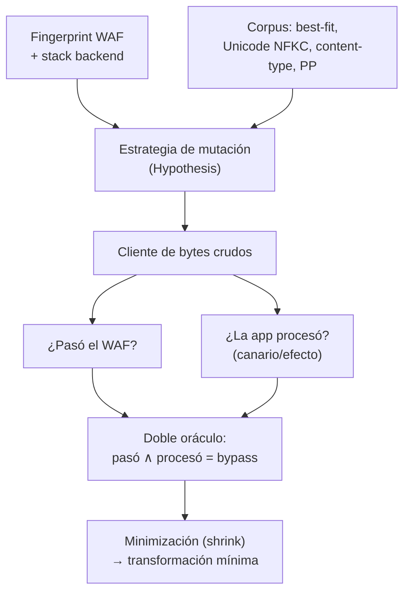

---
tags:
  - Proyectos
  - Python
  - Web/Red-Team
  - Evasion
  - Tipo/Proyecto
Descripción: "Fuzzea las discrepancias de parseo entre el WAF y la aplicación (transformaciones Unicode best-fit, estructura de content-type, codificaciones) para derivar bypasses durables de ese despliegue concreto"
Fecha de actualización: 2026-09-21
Nota previa: "[[27 - Cartógrafo de abuso de delegación Kerberos]]"
Nota siguiente: "[[29 - Cazador de cadenas de gadgets pickle]]"
Area: "[[Proyectos ofensivos.base|Proyectos ofensivos]]"
Estado: Idea
Dificultad: 5
Esfuerzo: 3 semanas
Lenguaje: Python
---
---

**Nombre propuesto**: `parsergap`

Los bypasses de WAF más durables no se basan en ofuscar el payload (eso lo parchea una regla nueva), sino en explotar que <mark style="background: #FFB86CA6;">el WAF y la aplicación parsean la petición de forma distinta</mark>: el WAF ve una cosa inofensiva, la aplicación ve otra maliciosa. Es la clase de vulnerabilidad de WorstFit (transformación Best-Fit de Windows ANSI) y de WAFFLED (discrepancias de parseo de content-type). `parsergap` automatiza el descubrimiento de esas grietas para un despliegue concreto: fuzzea el par (WAF, app) buscando entradas donde su interpretación diverge, y de ahí deriva el bypass.

# El problema que resuelve

Un blocklist de WAF es una carrera perdida a largo plazo; una **discrepancia de parseo** es un fallo estructural que sobrevive a las actualizaciones de reglas. Encontrarlas a mano exige conocer trucos concretos (doble URL-encoding, `%c0%ae`, homoglifos fullwidth `＝＆；`, best-fit mapping, content-type malformado, parámetros duplicados) y probarlos uno a uno. `parsergap` lo trata como lo que es: un problema de **fuzzing diferencial**. Genera transformaciones semánticamente equivalentes o casi-equivalentes de un payload, las envía, y busca el caso donde el WAF **no bloquea** pero la aplicación **sí procesa** el payload — el bypass. La clave es tener dos oráculos: "¿pasó el WAF?" y "¿la app lo interpretó como quería?".

# Alcance del proyecto

Tres piezas:

1. **Generador de transformaciones.** Un corpus de mutaciones basadas en discrepancias conocidas más fuzzing guiado: codificaciones (URL simple/doble, overlong UTF-8, unicode compatibility/NFKC), **best-fit mapping** (los caracteres Unicode que Windows ANSI colapsa a ASCII peligroso), homoglifos fullwidth, estructura de `Content-Type` (boundary malformado, charset, duplicados), parameter pollution, y case/whitespace. `Hypothesis` para explorar el espacio de forma dirigida por propiedades.
2. **Doble oráculo.** Oráculo del WAF: ¿la petición fue bloqueada (403/429/challenge) o pasó? Oráculo de la app: ¿el payload llegó y se interpretó? — idealmente un canario reflejado o un efecto observable (error SQL, reflexión XSS, ejecución). Un bypass es "pasó el WAF" ∧ "la app lo procesó".
3. **Minimizador y clasificador.** Cuando encuentra un bypass, lo reduce a la transformación mínima responsable (qué carácter/estructura exacta causa la divergencia) y lo clasifica por tipo de discrepancia — para el informe y para entender la causa raíz.

# Funcionalidades principales

| Funcionalidad | Por qué importa |
| --- | --- |
| Fuzzing diferencial con doble oráculo | La idea central: un bypass es una divergencia WAF↔app, no "el WAF no bloqueó"; medir ambos lados elimina falsos positivos |
| Corpus best-fit / Unicode compatibility | Reproduce WorstFit y la familia de transformaciones Unicode que colapsan a ASCII peligroso — bypasses durables, no ofuscación |
| Fuzzing de estructura de Content-Type | La línea WAFFLED: el WAF y la app disienten sobre dónde empieza el cuerpo/parámetro; fértil y poco explorada |
| Minimización del bypass | Reduce a la transformación mínima responsable: un informe con "este carácter concreto" vale mucho más que "esta cadena de 200 bytes" |
| Fingerprint del WAF | Adaptar el corpus al WAF detectado (Cloudflare, AWS WAF, ModSecurity/CRS) porque cada uno normaliza distinto |

# Funcionalidades secundarias

- **Payload-agnóstico**: el mismo motor sirve para colar SQLi, XSS, command injection o path traversal — el payload objetivo es un parámetro, la discrepancia es lo que se busca.
- **Diagnóstico del inspector**: como en el bloque de evasión de perímetro del vault, usar las divergencias también para *identificar* qué inspecciona el WAF (dónde normaliza, dónde no), no solo para evadirlo.
- **Regresión de bypass**: guardar el bypass encontrado y reejecutarlo tras un cambio del WAF para ver si sigue vivo (útil en retests y para el cliente).
- **Reproducción con `uTLS`/fingerprint de cliente**: combinar la discrepancia de parseo con imitación del `ClientHello` cuando el WAF también filtra por fingerprint TLS.

# Casos de uso y actores

- **Bug hunter / pentester web** frente a una app protegida por WAF donde el payload directo rebota.
- **Equipo de AppSec / plataforma**: validar que su WAF y su app normalizan igual, antes de confiar en el WAF como control.
- **Investigación**: caracterizar las discrepancias de un WAF concreto es material de charla (la línea WorstFit/WAFFLED sigue dando frutos).

# Qué existe ya y dónde se queda corto

- **WAFFLED** (Akhavani et al., ACSAC 2025) demostró el fuzzing de discrepancias de content-type; es investigación, no una herramienta de operador reutilizable y payload-agnóstica.
- **WorstFit** (Orange Tsai & splitline, DEVCORE, Black Hat EU 2024) documentó el best-fit mapping; hay PoCs, no un fuzzer que lo integre con otras discrepancias y un doble oráculo.
- **Herramientas de bypass de WAF** (payloads de HackTricks, `nuclei` templates, one-liners): son catálogos de trucos conocidos, no descubren la grieta específica de *este* despliegue.

El hueco: **un fuzzer diferencial de propósito general con doble oráculo que descubra la discrepancia de parseo del objetivo concreto**, en vez de reprobar la lista de trucos públicos.

# Por qué Python

Es manipulación byte a byte de codificaciones y Unicode, y fuzzing dirigido por propiedades — el terreno de `codecs`, `unicodedata` e `Hypothesis`. La tabla de best-fit mapping y las normalizaciones Unicode se manejan nativamente; `Hypothesis` da el fuzzing guiado y la minimización (*shrinking*) casi gratis, que es justo lo que hace falta para reducir el bypass. En Go reimplementarías el shrinking de Hypothesis y pelearías con las tablas Unicode.

# Arquitectura

Es un **fuzzer diferencial**, y su arquitectura es la de `Hypothesis`: una *estrategia* que genera transformaciones y un *doble oráculo* que decide si hay divergencia. La minimización (*shrinking*) —reducir un bypass de 200 bytes a "este carácter"— la da `Hypothesis` casi gratis y es media utilidad del proyecto. La pieza que hay que diseñar bien es el **cliente de bytes crudos**: si el cliente HTTP normaliza la petición, se fuzzea el cliente, no el WAF.

- **Estrategia de mutación**: corpus de discrepancias conocidas (best-fit, NFKC, content-type malformado, parameter pollution) + generación dirigida de `Hypothesis`.
- **Cliente de bytes crudos**: envía exactamente lo generado y verifica en el cable; no delega la codificación a la librería.
- **Doble oráculo**: `WafOracle` (¿403/challenge o pasó?) + `AppOracle` (¿canario reflejado/efecto observable?). Bypass = ambos.
- **Minimizador**: `Hypothesis` reduce al carácter/estructura responsable, y el clasificador etiqueta el tipo de discrepancia.

Decisión de ingeniería: el `AppOracle` es la mitad difícil y se diseña como **interfaz pluggable** (canario reflejado, error SQL, ejecución OOB), porque "el WAF no bloqueó" sin confirmar que la app procesó genera falsos positivos. El fingerprint del backend condiciona el corpus (best-fit solo aplica a ANSI de Windows) — se comprueba antes de fuzzear para no perder el tiempo.

# Stack de implementación (Python)

| Capa | Librería | Por qué (fundamento senior) | Alternativa descartada |
| --- | --- | --- | --- |
| Fuzzing diferencial | `Hypothesis` | Generación dirigida por propiedades y *shrinking* automático al caso mínimo — justo lo que se necesita, sin escribirlo | Fuzzer propio — reimplementar el shrinking |
| Unicode/codecs | `codecs` + `unicodedata` | Normalización NFKC y transformaciones Unicode con la semántica real; base para reproducir best-fit | Tablas a mano — incompletas y con errores |
| Corpus best-fit | tablas de Windows (WorstFit) | El conjunto de caracteres que ANSI colapsa a ASCII peligroso; corpus de alto valor | Adivinar caracteres — cobertura pobre |
| Cliente crudo | `httpx` (transport de bajo nivel) / socket | Enviar bytes exactos y leer lo que sale; no dejar que la librería "arregle" la malformación | `requests` — normaliza y destruye el caso |
| Test | `pytest` + WAF en Docker (ModSecurity+CRS) | Validar bypass y minimización contra un WAF real reproducible | Probar contra un WAF de producción — ruidoso, no reproducible |

> **Transversal**: `uv`, `ruff`, `mypy --strict`, `rich`/`structlog`, `uv tool`/`pipx` (detalle en [[16 - Planificador de presupuesto de cracking]]).

# Plan de implementación por fases

1. **Cliente crudo + doble oráculo (semana 1)**: contra ModSecurity+CRS en Docker delante de una app vulnerable, enviar bytes crudos y decidir "pasó WAF ∧ procesó app" con un canario reflejado. El esqueleto que valida la premisa entera.
2. **Corpus + fuzzing con Hypothesis**: integrar codificaciones y estructura de content-type como estrategia, con generación dirigida y minimización automática.
3. **Best-fit / Unicode + fingerprint de backend**: reproducir WorstFit, comprobar el stack antes de aplicar el corpus ANSI; encontrar el primer bypass durable minimizado.
4. **AppOracle pluggable + regresión + informe**: oráculos alternativos (error SQL, OOB), reejecución del bypass tras cambio de regla (durabilidad), y el informe con la transformación responsable.

# Cosas a tener en cuenta

> [!warning]+ El cliente HTTP puede sabotear el fuzzing
> Muchas librerías normalizan o corrigen la petición antes de enviarla (reordenan headers, arreglan el content-type, re-codifican la URL), destruyendo justo la malformación que quieres probar. Hay que enviar bytes crudos y verificar en el cable lo que sale — si el cliente lo "arregla", estás fuzzeando tu propio cliente, no el WAF.

- **Necesitas un oráculo de app fiable.** "El WAF no bloqueó" no basta: quizá la app tampoco lo procesó. Sin un canario reflejado o un efecto observable, generas falsos positivos. Diseñar el oráculo de app es la mitad del trabajo.
- **Best-fit depende del backend.** Las transformaciones best-fit son de la API ANSI de Windows; contra un backend Linux/UTF-8 no aplican igual. Fingerprint del stack para no perder el tiempo con un corpus irrelevante.
- **Ruidoso y potencialmente disruptivo.** Fuzzear un WAF genera muchos 403 y puede disparar bloqueos de IP o rate-limiting. Cruzar con la doctrina de evasión de perímetro (low-and-slow, rotación de origen) y respetar el alcance.
- **La grieta es del despliegue, no universal.** Un bypass contra este WAF+app puede no funcionar contra otro. Es una feature, no un límite: encuentra el de *tu* objetivo, que es lo que un catálogo público no te da.

# Fuera de alcance

No es un escáner de vulnerabilidades (no busca el SQLi/XSS: recibe un payload que ya sabes que la app procesaría sin WAF, y busca cómo colarlo). No ataca el TLS ni la capa de red (eso es el bloque de evasión de perímetro). No hace DoS del WAF.

# Criterio de terminado

Presentable cuando: contra un laboratorio con WAF (p. ej. ModSecurity + CRS) delante de una app vulnerable, `parsergap` descubre al menos un bypass por discrepancia de parseo (Unicode/best-fit o content-type), lo minimiza a la transformación responsable, y verifica con el doble oráculo que el WAF no bloquea pero la app sí procesa; un cambio de regla del WAF que no toque la discrepancia deja el bypass vivo (demostrando su durabilidad).

# Conexiones en el vault

Comparte raíz con el proyecto [[22 - Envenenador de caché por confusión de clave]] (dos parsers que no coinciden) y con [[06 - Introducción a HTTP Request Smuggling]] (la discrepancia de parseo por excelencia entre front y back). La evasión de WAF y el fingerprint conectan con [[27 - Evasión en recon y fuzzing]] y [[28 - Origen real tras WAF, CDN y balanceadores]]; el corpus de codificaciones, con [[05 - Bypass de caracteres comunes]] de SQLi avanzado. La doctrina de "deformar el paquete está muerto, parecerse a lo normal sobrevive" viene de [[08 - Cómo te ve el defensor]].

> [!info]+ Fuentes
> - Orange Tsai & splitline (DEVCORE), [WorstFit: Unveiling Hidden Transformers in Windows ANSI](https://devco.re/blog/2025/01/09/worstfit-unveiling-hidden-transformers-in-windows-ansi/) (Black Hat EU 2024) — best-fit mapping (consultado 2026-09-21).
> - Akhavani et al., *WAFFLED: Exploiting Parsing Discrepancies* (ACSAC 2025) — fuzzing de estructura de content-type.
> - HackTricks, [Proxy / WAF Protections Bypass](https://hacktricks.wiki/en/pentesting-web/proxy-waf-protections-bypass.html) — catálogo de discrepancias conocidas como corpus base.
