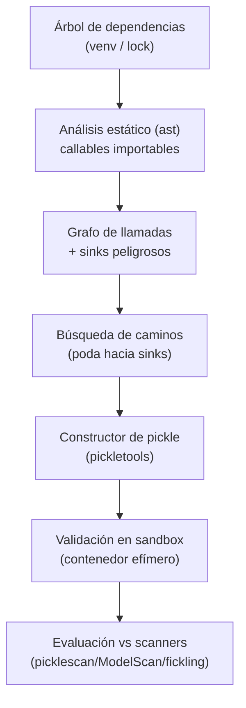

---
tags:
  - Proyectos
  - Python
  - IA/Red-Team
  - Whitebox
  - Tipo/Proyecto
Descripción: "Busca cadenas de gadgets alcanzables para pickle deserialization en el árbol de dependencias real del objetivo mediante análisis estático, descubriendo primitivas que los scanners de firma no ven"
Fecha de actualización: 2026-09-21
Nota previa: "[[28 - Diferenciador de parseo WAF ↔ aplicación]]"
Nota siguiente: "[[30 - Explotador unificado de inyección SQL y NoSQL]]"
Area: "[[Proyectos ofensivos.base|Proyectos ofensivos]]"
Estado: Idea
Dificultad: 5
Esfuerzo: 3 semanas
Lenguaje: Python
---
---

**Nombre propuesto**: `picklechain`

El cierre del catálogo, y el más ambicioso. La deserialización insegura de `pickle` —endémica en el ecosistema de ML, donde los modelos se distribuyen como pickles— permite ejecución arbitraria durante la carga. Los defensores usan scanners de firma (`picklescan`, ModelScan) que buscan opcodes/imports maliciosos *conocidos*. La investigación de 2026 demostró que <mark style="background: #FFB86CA6;">siguen apareciendo cadenas de gadgets nuevas en librerías ya desplegadas</mark> —imports "benignos" que encadenados logran RCE— y que los scanners tienen tasas de bypass altísimas contra ellas. `picklechain` automatiza el lado ofensivo: dado el **árbol de dependencias real** de un objetivo, busca estáticamente qué gadgets son alcanzables y encadenables hasta una primitiva peligrosa.

# El problema que resuelve

Un scanner de firma responde "¿este pickle contiene un patrón malicioso conocido?". La pregunta ofensiva —y la que revela el riesgo real— es la inversa: <mark style="background: #ADCCFFA6;">"dado este conjunto de librerías instaladas, ¿qué cadenas de imports permiten RCE al deserializar, y cuáles esquivan los scanners?"</mark>. Es el análogo Python de la búsqueda automatizada de gadget chains de deserialización en Java (el trabajo de Ian Haken en ysoserial/gadget discovery). Pickle es más directo que Java (el opcode `REDUCE` llama a un callable con argumentos), pero el espacio de gadgets alcanzables en un entorno con cientos de dependencias es enorme, y nadie lo mapea sistemáticamente para un objetivo concreto.

# Alcance del proyecto

Tres piezas:

1. **Inventario del entorno objetivo.** A partir del árbol de dependencias real (un `requirements.txt`/`lock`, un entorno virtual, o la lista de imports de un modelo), enumera los módulos y callables importables — la superficie desde la que `pickle` puede invocar.
2. **Descubridor de gadgets.** Análisis estático con `ast`/`importlib`: identifica callables que, invocados con argumentos controlados (lo que `REDUCE` permite), dan una primitiva peligrosa (ejecución de comando, `eval`/`exec`, escritura de fichero, carga dinámica de código, `pip install`). Modela la alcanzabilidad: qué gadgets son importables sin disparar defensas, y cómo encadenarlos (`REDUCE`/`BUILD`/`GLOBAL`) hacia el objetivo.
3. **Evaluador contra scanners.** Para cada cadena candidata, construye el pickle y lo prueba (en sandbox aislado) contra los scanners de firma (`picklescan`, ModelScan, `fickling` check) para medir cuáles la detectan y cuáles la dejan pasar — el dato clave para un informe de riesgo de supply chain.

# Funcionalidades principales

| Funcionalidad                                 | Por qué importa                                                                                                                      |
| --------------------------------------------- | ------------------------------------------------------------------------------------------------------------------------------------ |
| Descubrimiento de gadgets sobre el árbol real | Encuentra las primitivas alcanzables en *este* entorno, no en una lista de gadgets públicos — cadenas nuevas que nadie ha catalogado |
| Modelado de alcanzabilidad y encadenamiento   | Un gadget aislado no basta; modelar cómo `REDUCE`/`GLOBAL`/`BUILD` los encadenan hasta la primitiva es el núcleo técnico             |
| Evaluación contra scanners de firma           | Medir la tasa de bypass contra picklescan/ModelScan es el hallazgo que importa: cuantifica el hueco de las defensas actuales         |
| Construcción del pickle de prueba             | Genera el pickle explotable (en sandbox) para validar la cadena de verdad, no solo en teoría                                         |
| Priorización por sigilo                       | Entre varias cadenas, prefiere la que menos scanners detectan y menos imports raros usa                                              |

# Funcionalidades secundarias

- **Cobertura de formatos de modelo**: pickle directo, pero también los múltiples *loading paths* que la investigación de 2026 identificó (los frameworks de ML cargan pickle por vías que los scanners no cubren).
- **Esteganografía en tensores**: modelar el ocultamiento de la carga en pesos del modelo (donde un scanner no mira), como técnica de evasión adicional.
- **Modo defensivo (variant analysis)**: darle la vuelta — dado un gadget conocido, buscar variantes equivalentes en el árbol de dependencias que los scanners aún no firman (útil para el equipo azul que quiere adelantarse).
- **Informe de riesgo de supply chain**: qué dependencias introducen gadgets, con qué scanners se detectan, y qué recomendación (pinning, `weights_only`, formatos seguros como safetensors).

# Casos de uso y actores

- **AI red teamer / auditor de MLSecOps** evaluando el riesgo de cargar modelos de terceros (Hugging Face, repos internos).
- **Whitebox / revisor de código** con acceso al entorno de dependencias del objetivo, buscando la vía de RCE por deserialización.
- **Investigación de supply chain de ML**: descubrir y reportar cadenas de gadgets nuevas de forma responsable.

# Qué existe ya y dónde se queda corto

- **fickling** (Trail of Bits) desensambla, decompila y detecta patrones maliciosos en pickle, y construye payloads de prueba — es la mejor herramienta del área, pero opera sobre un pickle *dado*; no **descubre cadenas de gadgets** partiendo del árbol de dependencias.
- **picklescan / ModelScan**: detectores de firma; la investigación de 2026 (ShadowPickle, "The Art of Hide and Seek") documenta tasas de bypass cercanas al 100% contra gadgets nuevos.
- **Gadget discovery en Java** (Haken, Black Hat 2018): existe el precedente conceptual, pero **para pickle/Python nadie lo ha automatizado** sobre el entorno real del objetivo.

El hueco es claro y actual: **la investigación de gadgets nuevos existe (2026), la herramienta ofensiva de descubrimiento sobre el árbol de dependencias del objetivo no**.

# Por qué Python

pickle *es* Python, y descubrir gadgets es introspección estática de módulos Python: `ast` para analizar el código de las dependencias, `importlib`/`inspect` para modelar qué es importable e invocable, `pickletools` para construir y desensamblar el pickle. Toda la investigación y todas las herramientas del área (fickling, picklescan, ModelScan) son Python. Es el único lenguaje donde este proyecto tiene sentido: el sujeto, el analizador y las defensas son el mismo ecosistema.

# Arquitectura

El núcleo es un **problema de alcanzabilidad en un grafo de llamadas** construido por análisis estático: nodos = callables importables del entorno, aristas = "este callable puede invocar a este otro con argumentos controlables". Un gadget chain es un camino desde lo que `pickle` puede invocar (`REDUCE`) hasta una primitiva peligrosa. El reto de ingeniería es la **poda**: el grafo de cientos de dependencias es intratable sin priorizar hacia sinks conocidos (`os.system`, `eval`, `__import__`, cargadores dinámicos) y acotar la profundidad.

- **Inventario**: enumera módulos/callables importables del entorno objetivo (venv, lock, imports del modelo).
- **Grafo de llamadas** (`ast`): construido estáticamente, anotando sinks peligrosos.
- **Búsqueda con poda**: caminos a sinks, priorizando profundidad corta e imports sigilosos.
- **Constructor + validador**: `pickletools` arma el pickle; se valida **solo en sandbox aislado**.
- **Evaluador de scanners**: mide qué detecta cada scanner → la tasa de bypass, el hallazgo que importa.

Decisión de ingeniería (de seguridad, no opcional): la validación deserializa el pickle, que **ejecuta código**; corre siempre en un **contenedor efímero sin red ni credenciales**, orquestado desde el proceso principal, que nunca deserializa nada. El análisis estático evita ejecutar; solo el paso de validación toca el sandbox. Las cadenas halladas son armas → flujo de **divulgación responsable** integrado (no publicar, reportar al mantenedor).

# Stack de implementación (Python)

| Capa | Librería | Por qué (fundamento senior) | Alternativa descartada |
| --- | --- | --- | --- |
| Análisis estático | `ast` + `inspect` + `importlib` | Analizar el código de las dependencias y qué es importable/invocable con la semántica exacta de Python, sin ejecutarlo | Ejecutar para introspeccionar — peligroso e innecesario en el descubrimiento |
| Grafo | `networkx` | Alcanzabilidad y caminos a sinks con poda; algoritmos probados | Búsqueda ad-hoc — explota sin poda |
| Pickle | `pickletools` | Construir y desensamblar opcodes (`REDUCE`/`GLOBAL`/`BUILD`) a bajo nivel | Escribir opcodes a mano — frágil |
| Base ofensiva/defensiva | `fickling` | Decompilación y construcción de payloads como base; se extiende con el descubrimiento que le falta | Reimplementar el desensamblador |
| Scanners a evaluar | `picklescan` / `ModelScan` | Medir la tasa de bypass es el entregable de riesgo; son las defensas reales del ecosistema | Asumir la cobertura — la investigación de 2026 la desmiente |
| Aislamiento | Docker / `nsjail` | Deserializar en un contenedor efímero sin red; contener el RCE de validación | Deserializar en el host — RCE en tu máquina |

> **Transversal**: `uv`, `ruff`, `mypy --strict`, `rich`/`structlog`, `uv tool`/`pipx` (detalle en [[16 - Planificador de presupuesto de cracking]]).

# Plan de implementación por fases

1. **Grafo de llamadas + sinks (semana 1)**: análisis estático de un entorno pequeño con `ast`, grafo de callables importables anotando sinks peligrosos. Sin construir pickles aún — se valida el modelo de alcanzabilidad.
2. **Búsqueda con poda + constructor**: caminos a sinks con poda hacia primitivas peligrosas; `pickletools` arma el pickle candidato.
3. **Sandbox de validación**: contenedor efímero que deserializa y confirma la ejecución; el aislamiento robusto es requisito antes de escalar.
4. **Evaluación de scanners + loading paths + divulgación**: medir bypass contra picklescan/ModelScan, cubrir los múltiples *loading paths* de los frameworks de ML, y el flujo de divulgación responsable + informe de riesgo de supply chain.

# Cosas a tener en cuenta

> [!danger]+ Descubrir gadgets ejecuta y genera código peligroso
> Validar una cadena implica deserializar el pickle construido, que ejecuta la primitiva. Hacerlo SIEMPRE en un sandbox aislado y desechable (contenedor sin red, sin credenciales, efímero). Un fallo aquí ejecuta RCE en tu propia máquina de análisis. Y las cadenas descubiertas son armas: tratarlas con la disciplina de divulgación responsable si afectan a librerías públicas.

- **El espacio de gadgets es enorme.** Con cientos de dependencias, la búsqueda ingenua explota. Necesita poda agresiva: priorizar callables con firmas peligrosas (`os.system`, `subprocess`, `eval`, `__import__`, cargadores dinámicos) y modelar alcanzabilidad, no fuerza bruta.
- **El análisis estático tiene límites.** Callables construidos dinámicamente, `getattr` sobre *strings*, indirección: parte del grafo no se ve estáticamente. Ser honesto sobre la cobertura y complementar con ejecución controlada donde haga falta.
- **`weights_only=True` y safetensors cambian el panorama.** PyTorch y el ecosistema empujan hacia formatos seguros; el proyecto debe distinguir el entorno vulnerable (pickle sin restricción) del endurecido, y reportarlo como parte del riesgo.
- **Divulgación responsable.** Si `picklechain` encuentra una cadena nueva en una librería popular, es una vulnerabilidad de supply chain real. El flujo correcto es reportar al mantenedor, no publicar el arma.

# Fuera de alcance

No entrena ni manipula modelos (no es envenenamiento de datos). No es un scanner defensivo de propósito general (fickling/ModelScan ya existen) — su modo defensivo es *variant analysis*, complementario. No cubre deserialización en otros lenguajes (Java/.NET ya tienen ysoserial). Se centra en el descubrimiento ofensivo de cadenas pickle sobre el entorno del objetivo.

# Criterio de terminado

Presentable cuando: dado un entorno virtual de laboratorio con dependencias conocidas, `picklechain` descubre al menos una cadena de gadgets alcanzable hasta RCE que no está en el corpus público de fickling, construye el pickle en sandbox y lo valida, y reporta qué scanners (picklescan/ModelScan) la detectan y cuáles la dejan pasar.

# Conexiones en el vault

Es la profundización ofensiva de [[11 - Pickle y la deserialización insegura de modelos]] y enlaza con [[12 - Esteganografía en tensores]] (ocultar la carga donde el scanner no mira) y [[00 - El pipeline de datos y su superficie de ataque]]. El arsenal defensivo que evalúa vive en [[00 - Qué es fickling y análisis de pickle]], [[01 - Uso ofensivo y defensivo de fickling]] y [[00 - Qué es ModelScan]]. El análisis estático de código conecta con el whitebox del vault (Semgrep/CodeQL) y con el espíritu del [[07 - Reconstructor de protocolos binarios]] del catálogo de Go (entender una estructura para explotarla). La disciplina de divulgación, con [[01 - Reglas, legalidad y conducta]].

> [!info]+ Fuentes
> - Ian Haken, [*Automated Discovery of Deserialization Gadget Chains*](https://i.blackhat.com/us-18/Thu-August-9/us-18-Haken-Automated-Discovery-of-Deserialization-Gadget-Chains.pdf) (Black Hat US 2018) — el precedente conceptual en Java (consultado 2026-09-21).
> - *The Art of Hide and Seek: Making Pickle-Based Model Supply Chain Poisoning Stealthy Again* (USENIX Security 2026) — gadgets nuevos y tasas de bypass de los scanners actuales.
> - Trail of Bits, [fickling](https://github.com/trailofbits/fickling) — desensamblado, detección y construcción de payloads pickle.
