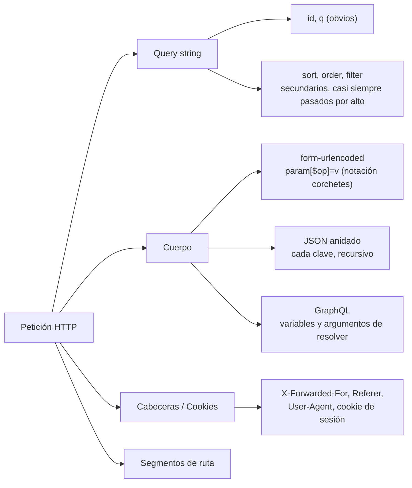
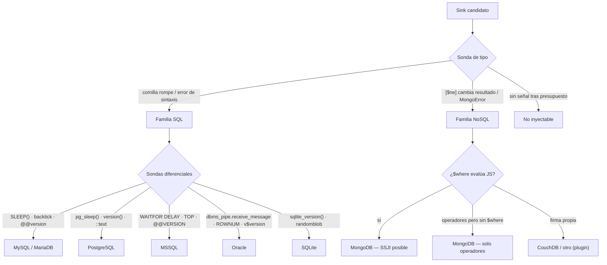
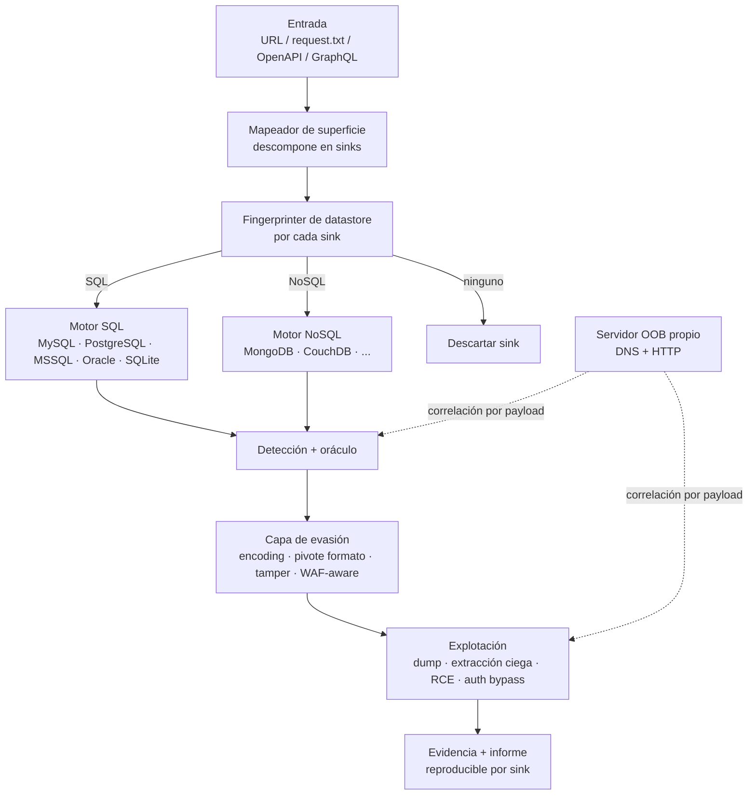
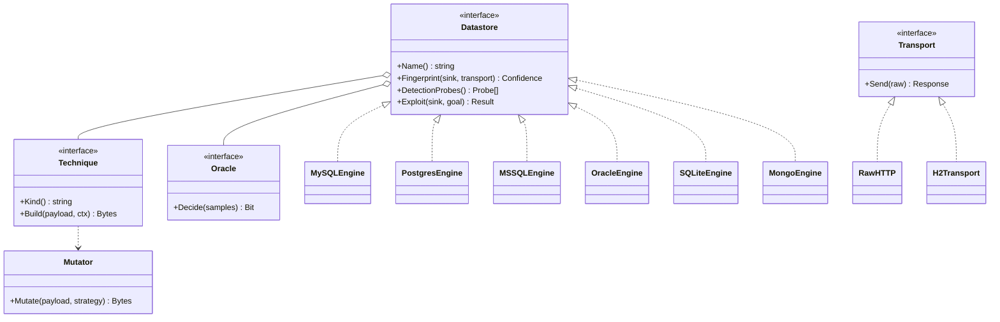

---
tags:
  - Proyectos
  - Go
  - Web/Red-Team
  - SQLi
  - NoSQLi
  - Tipo/Proyecto
Descripción: "Herramienta única que mapea toda la superficie HTTP, fingerprintea el datastore de cada sink y explota inyección SQL y NoSQL con detección, evasión y extracción propias"
Fecha de actualización: 2026-10-10
Nota previa: "[[29 - Cazador de cadenas de gadgets pickle]]"
Nota siguiente: ""
Area: "[[Proyectos ofensivos.base|Proyectos ofensivos]]"
Estado: Idea
Dificultad: 5
Esfuerzo: 5-6 semanas
Lenguaje: Go
---
---

**Nombre propuesto**: `janus`

El proyecto estrella del catálogo. La inyección SQL lleva dos décadas siendo la vulnerabilidad web más dañina, y la NoSQLi es su hermana moderna que casi nadie automatiza bien. Pero el pentester de 2026 no se enfrenta al `?id=1` de un formulario: se enfrenta a una API que recibe JSON anidado, a un `sort=` que acaba sin parametrizar en un `ORDER BY`, a un login contra Mongo, a una capa GraphQL que envuelve vaya-usted-a-saber-qué backend. Y ante cada sink se hace la pregunta que ninguna herramienta responde hoy: <mark style="background: #ADCCFFA6;">¿esto es SQL o NoSQL, y qué motor hay detrás?</mark>. `janus` —el dios de dos caras y de las puertas— es una herramienta que descubre todas esas puertas, mira qué datastore hay detrás de cada una, y entra con la técnica correcta: detección, evasión y explotación, con el mismo mimo para SQL que para NoSQL.

# El problema que resuelve

El tooling de inyección vive partido y desfasado. `sqlmap` es la referencia para SQL —cubre las seis técnicas (boolean, error, UNION, stacked, time, OOB)— pero <mark style="background: #FFB86CA6;">su manejo de la superficie moderna es su talón</mark>: para inyectar en una clave JSON anidada hay que marcarla a mano con `*`, al hacerlo pierde otros parámetros del cuerpo, rompe los cuerpos codificados (base64) por defecto, y flojea en second-order. Es SQL-only y razona petición a petición, no sobre una superficie completa. `ghauri` es más rápido en blind pero su evasión de WAF es su carencia más flagrante y también es SQL-only.

En NoSQL el panorama es tierra quemada: `nosqli` (Go) **solo detecta y solo MongoDB** —su propio README admite que la extracción de datos "está planeada", no implementada—, y `NoSQLMap` sigue anclado a **Python 2.7**. Nadie cubre extracción NoSQL mantenida, SSJI automatizada, el pivote notación-corchetes ↔ JSON, ni la NoSQLi envuelta en GraphQL.

Y el punto que lo ata todo: <mark style="background: #FF5582A6;">la inyección rara vez está donde está el formulario</mark>. Está en el `sort`, en el `filter`, en una clave profunda de un cuerpo JSON, en una variable de GraphQL, en un `X-Forwarded-For`. Los escáneres tradicionales no parsean bien esa superficie, así que el pentester acaba corriendo tres herramientas distintas a ciegas y rematando a mano. `janus` convierte eso en un flujo único y razonado: **mapea la superficie entera → fingerprintea el datastore de cada sink → aplica detección, evasión y explotación SQL o NoSQL según corresponda**.

# Alcance del proyecto

Una herramienta de operador (no un DAST generalista) construida sobre **dos pilares y tres fases**.

Los dos pilares que la hacen distinta:

- **Mapa completo de la superficie de inyección.** Descompone la petición en todos sus puntos inyectables —query (incluidos los secundarios `sort`/`order`/`filter`), cuerpo form y **JSON anidado recursivo**, cabeceras, cookies, segmentos de ruta y variables/argumentos de GraphQL— y descubre parámetros ocultos. Entiende cómo la aplicación recibe y usa cada valor, que es donde viven las inyecciones reales.
- **Fingerprinting del datastore por-sink.** Antes de disparar nada, decide para cada sink si hay un backend SQL (y cuál: MySQL/MariaDB, PostgreSQL, MSSQL, Oracle, SQLite) o NoSQL (MongoDB y otros vía plugin), o ninguno. Es lo que convierte el disparo a ciegas en una elección informada de técnica.

Las tres fases, todas de primera clase:

1. **Detección** — confirmar la inyección con la familia de sondas correcta y reportar la señal (contenido, tiempo, error, canal OOB) con su confianza.
2. **Evasión** — explotar *a pesar de* los filtros: encoding, pivote de formato, librería de mutaciones tipo *tamper*, y selección de payload según el WAF fingerprinteado.
3. **Explotación** — del volcado de datos a la ejecución de comandos, con oráculo de extracción ciega propio para los casos que no devuelven nada por el canal principal.

# Modelo de la superficie de inyección

La tesis central del proyecto. Una herramienta que solo prueba el valor obvio de un parámetro se pierde la mayoría de las inyecciones modernas. `janus` trata la petición como un **árbol de puntos inyectables** y razona sobre cada hoja.

Los puntos que marcan la diferencia:

- **Parámetros secundarios.** Un `sort=name` o un `order=asc` acaban con frecuencia concatenados en un `ORDER BY`, donde <mark style="background: #FFB86CA6;">la columna no se puede parametrizar</mark> — inyección casi por diseño, y un sitio que casi nadie prueba.
- **JSON anidado.** La inyección puede estar en `filters.price.$gt` o en `user.profile.id`, tres niveles dentro de un cuerpo. Hay que recorrer y mutar *cualquier* clave sin romper el resto del documento.
- **Notación de corchetes vs JSON.** El mismo operador NoSQL se puede mandar como `{"user":{"$ne":null}}` o como `user[$ne]=` en form-urlencoded. Probar ambos formatos no es un detalle: es la vía de evasión número uno cuando el filtro solo inspecciona uno de los dos.
- **Cabeceras y GraphQL.** El `User-Agent` inyectable es un clásico; la variable de GraphQL que alimenta un resolver que a su vez llama a Mongo o a SQL, un vector moderno que casi ningún tool cubre.

# Fingerprinting del datastore

El fingerprinting es el cerebro de `janus` y condiciona las tres fases: no se detecta igual MySQL que Mongo, no se evade igual, y no se explota igual. El flujo va de lo general (¿rompe cadenas o confunde tipos?) a lo específico (¿qué motor?).

- **Discriminar la familia** es el salto que ninguna herramienta de un solo lado hace: la SQLi rompe cadenas (una comilla da error de sintaxis); la NoSQLi confunde tipos (una string se convierte en objeto/operador y `param[$ne]=` cambia el resultado). Un `MongoError`/`BSON` o un `$where` que evalúa JavaScript lo confirman.
- **Las sondas diferenciales SQL** explotan las divergencias de dialecto: funciones de tiempo (`SLEEP()` en MySQL, `pg_sleep()` en PostgreSQL, `WAITFOR DELAY` en MSSQL, `dbms_pipe.receive_message` en Oracle), concatenación (`||` vs `+` vs `CONCAT`), paginación (`LIMIT` vs `TOP` vs `ROWNUM`), estilo de comentario y funciones de versión. <mark style="background: #8000E1A6;">Acertar el motor antes de explotar ahorra cientos de peticiones y evita payloads que delatan al operador</mark>.
- **El fingerprint es honesto**: cuando la app oculta errores y normaliza respuestas, el motor reporta "SQL, DBMS indeterminado" con su confianza, en vez de adivinar.

# Las tres fases con mimo

**Detección.** SQL: boolean-blind, error-based, UNION, stacked, time-blind y OOB, cada una con su sonda y su oráculo. NoSQL: inyección de operadores (`$ne`/`$gt`/`$regex`), *type juggling* (string→array/objeto), `$where`/SSJI y blind por comparadores. La señal nunca es un umbral mágico: se calibra la línea base y se decide con confianza.

**Evasión.** El blocklist es finito; las representaciones equivalentes, casi infinitas. `janus` trae encoding (URL, doble, unicode, hex), **pivote de formato** (JSON ↔ corchetes, el truco que salta el sanitizador que solo mira un lado), una librería de mutaciones tipo *tamper* propia, y selección de payload según el WAF fingerprinteado. <mark style="background: #FF5582A6;">Contra un WAF por firmas, cambiar el formato o el encoding bate a ofuscar el operador conocido</mark>.

**Explotación.** SQL: volcado por UNION/error, extracción ciega con oráculo propio (boolean/time/OOB + búsqueda binaria), stacked queries, lectura/escritura de ficheros y RCE donde el motor lo permite (`xp_cmdshell` en MSSQL, `COPY ... PROGRAM`/lenguajes en PostgreSQL, `LOAD_FILE`/`INTO OUTFILE` en MySQL). NoSQL: bypass de autenticación, extracción de documentos por `$regex`/comparadores y SSJI con `$where`. Lo que no devuelve nada por el canal principal se saca por el **canal OOB propio**.

# Requisitos funcionales

- **RF1 — Mapa de superficie.** Descomponer una petición en todos sus sinks: query (incluidos secundarios), cuerpo form y JSON anidado recursivo, cabeceras, cookies, ruta y variables/argumentos GraphQL; descubrir parámetros ocultos.
- **RF2 — Entradas.** Aceptar URL, fichero de petición Burp/ZAP (`-r`), colección OpenAPI/Swagger y documento GraphQL.
- **RF3 — Fingerprint.** Clasificar por-sink la familia (SQL/NoSQL/ninguno) y el motor concreto, con confianza.
- **RF4 — Detección.** Cubrir las clases SQL (boolean, error, UNION, stacked, time, OOB) y NoSQL (operadores, type-juggling, `$where`/SSJI, blind por comparadores).
- **RF5 — Evasión.** Encoding, pivote de formato, mutaciones *tamper* y selección de payload según WAF.
- **RF6 — Explotación.** Enumeración/volcado, extracción ciega con oráculo propio y búsqueda binaria, stacked queries, R/W de ficheros y RCE por motor; en NoSQL, auth bypass, extracción y SSJI.
- **RF7 — OOB.** Servidor DNS+HTTP propio correlacionado por payload para blind y exfiltración.
- **RF8 — Evidencia.** Emitir por hallazgo la petición exacta, el oráculo y la confianza; informe en JSON y markdown.
- **RF9 — Reanudación.** Persistir el estado del escaneo y reanudar un trabajo interrumpido.

# Requisitos no funcionales

- **RNF1 — Rendimiento.** Barrido concurrente de una superficie grande con pool de workers acotado; miles de sondas/min sin tumbar el objetivo.
- **RNF2 — Ruido controlado.** Cadencia, jitter y modo low-and-slow configurables; nunca un barrido a discreción.
- **RNF3 — Medición temporal fiable.** Calibración de línea base y decisión estadística, no umbral fijo; no estresar la conexión en payloads time-based (lección directa del vault).
- **RNF4 — Portabilidad.** Binario estático único, sin runtime externo, multiplataforma.
- **RNF5 — Seguridad de uso.** Payloads no destructivos por defecto; los destructivos (stacked `DELETE`/`DROP`, escritura, RCE) tras flag explícito y confirmación; respeto del alcance.
- **RNF6 — Extensibilidad.** Datastores, técnicas y transportes como interfaces/plugins; añadir un motor sin tocar el núcleo.
- **RNF7 — Determinismo y auditoría.** Semilla, trazas y log estructurado para reproducir cada decisión.
- **RNF8 — Control de bytes en el cable.** El transporte no normaliza la petición; si el cliente la "arregla", se fuzzea el cliente, no el objetivo.
- **RNF9 — Observabilidad.** Progreso, métricas y verbosidad por capas.

# Funcionalidades principales

| Funcionalidad | Por qué importa |
| --- | --- |
| Mapa completo de la superficie | Encuentra la inyección donde de verdad vive (sort/filter, JSON anidado, headers, GraphQL), no solo en el parámetro obvio |
| Fingerprint de datastore por-sink | Decide SQL vs NoSQL y el motor antes de disparar; menos ruido, payloads certeros y un "indeterminado" honesto |
| Motor unificado SQL + NoSQL | Un solo flujo contra un backend desconocido, en vez de correr sqlmap y nosqli a ciegas por separado |
| Pivote de formato (JSON ↔ corchetes) | La evasión NoSQL más rentable: salta el sanitizador/WAF que solo inspecciona un formato |
| Oráculo de extracción ciega propio | Convierte el blind (boolean/time/OOB) en datos extraídos con confianza, sin depender de un umbral frágil |
| Canal OOB autoalojado y correlacionado | Confirma el ciego y la exfiltración sin mandar la prueba del cliente a infraestructura de terceros |
| Arsenal de evasión mantenido | Encoding, tamper y payload WAF-aware al día de 2026, no la lista de trucos de hace tres años |

# Funcionalidades secundarias

- **Descubrimiento de parámetros ocultos** (estilo Arjun) para ampliar la superficie antes de fingerprintear.
- **Inyección dentro de GraphQL**: parsear la query, localizar variables y argumentos de resolver, y probar SQLi/NoSQLi detrás de ellos.
- **Diagnóstico del WAF**: usar las divergencias no solo para evadir, sino para *identificar* qué normaliza el WAF y dónde no.
- **Regresión de hallazgos**: guardar una inyección confirmada y reejecutarla en un retest para ver si sigue viva.
- **Perfiles de sigilo**: `ruidoso` (lab/CTF) vs `cauto` (producción con IDS), que ajustan cadencia, concurrencia y verbosidad de payload.
- **Modo "confirmar, no explotar"**: triage rápido que decide con alta confianza si un sink es inyectable antes de comprometerse a la extracción completa.

# Casos de uso y actores

**Actores:**

- **Pentester web / bug hunter** frente a una app o API moderna donde el payload directo rebota.
- **Auditor de API (REST/GraphQL)** que necesita cubrir JSON anidado y variables de resolver, no formularios.
- **Equipo de AppSec / plataforma** (uso defensivo): validar que su WAF y su app normalizan igual, y que los sinks secundarios están protegidos.
- **CTF / investigación**: backend desconocido donde el fingerprint decide la vía.

**Casos de uso:**

- API donde el form directo es seguro pero un `sort=` o una clave JSON anidada acaban en la consulta sin filtrar.
- Backend desconocido: ¿SQL o Mongo? El fingerprint lo resuelve y elige técnica.
- Login NoSQL: auth bypass por `$ne` y extracción de credenciales por comparadores.
- Blind sobre una red con latencia real, donde el umbral fijo da basura y hace falta decisión estadística + OOB.
- GraphQL que envuelve SQL o Mongo en sus resolvers.
- Retest/regresión de un hallazgo tras un cambio de regla del WAF.

# Arquitectura

El núcleo es un **pipeline de sinks** donde cada etapa es una interfaz pluggable. La pieza que hay que diseñar bien es el **transporte de bytes crudos**: si el cliente HTTP normaliza la petición, se fuzzea el cliente y no el objetivo. La segunda decisión dura es que **datastores, técnicas, transportes y oráculo son ortogonales** — añadir CouchDB o un transporte HTTP/3 no debe tocar la lógica de detección.

Las interfaces del núcleo:

- **Mapeador de superficie**: parsea la entrada y emite una lista de sinks, cada uno con su localizador (dónde va en la petición) y su contexto (formato, codificación).
- **Fingerprinter**: corre sondas de tipo y diferenciales, devuelve familia + motor + confianza.
- **Motor de datastore** (`Datastore`): encapsula las sondas de detección y la lógica de explotación de un motor; MySQL y Mongo son dos implementaciones de la misma interfaz.
- **Oráculo** (`Oracle`): recibe muestras (contenido/tiempo/orden) y devuelve un bit con confianza; puro y testeable con muestras sintéticas sin red.
- **Transporte** (`Transport`): manda bytes exactos; `RawHTTP` para control total, `H2Transport` para HTTP/2.
- **Mutator**: aplica encoding, pivote de formato y tamper sobre el payload antes de enviarlo.

# Stack de implementación (Go)

| Capa | Librería | Por qué (fundamento senior) | Alternativa descartada |
| --- | --- | --- | --- |
| Transporte crudo | `projectdiscovery/rawhttp` + `golang.org/x/net/http2` | Manda bytes exactos sin que la librería "arregle" la malformación; HTTP/2 para control de streams | `net/http` puro — normaliza headers/URL y destruye el caso; `fasthttp` — no habla HTTP/2 bien |
| Recorrido/mutación JSON | `tidwall/gjson` + `tidwall/sjson` | Leer y reescribir **cualquier clave anidada** sin deserializar a tipos — es *el* problema de la superficie | `encoding/json` a structs — exige conocer el esquema, inútil para claves arbitrarias |
| GraphQL | `vektah/gqlparser` | Parsear query y variables para localizar sinks de resolver con la gramática real | Regex sobre la query — frágil y ciega a la estructura |
| Concurrencia y ritmo | goroutines + `x/sync/errgroup` + `x/time/rate` | Barrido masivo de superficie con límite y cancelación limpia | Hilos crudos sin límite — tumba el objetivo y dispara defensas |
| Estadística del oráculo | `gonum.org/v1/gonum/stat` | Mann-Whitney y tests para decidir el bit con confianza; en Go no hay `scipy` | Umbral fijo — falsos positivos/negativos en red con jitter |
| Canal OOB | `miekg/dns` + listener HTTP propio | Servidor DNS+HTTP autoalojado correlacionado por payload | `interactsh` público — manda la prueba del cliente a un tercero |
| Fingerprint TLS (evasión) | `refraction-networking/utls` | Imitar el `ClientHello` de un navegador cuando el WAF filtra por fingerprint TLS | `crypto/tls` — fingerprint de Go, detectable |
| CLI y config | `spf13/cobra` + `spf13/viper` | Estructura de subcomandos y config en capas, estándar del ecosistema Go | Flags a mano — crece mal en una herramienta con muchos modos |
| Evidencia y log | `log/slog` (o `rs/zerolog`) | Log estructurado y auditable, base del informe reproducible | `fmt.Println` — no auditable ni parseable |
| Payloads base | sets curados (sqlmap XML, PayloadsAllTheThings, SecLists) vía `embed` | Corpus probado embebido en el binario, sin dependencias en disco | Hardcode disperso — inmantenible |
| Test | `testing` + `testify` + labs en Docker | Validar contra MySQL/PG/MSSQL/Oracle-XE/SQLite + MongoDB + ModSecurity reproducibles | Probar contra producción — ruidoso y no reproducible |

> **Transversal**: `go test -race`, `golangci-lint`, y `goreleaser` para publicar el binario multiplataforma. La distribución es un único ejecutable estático — nada de `pip`/venv en el jump box.

# Plan de implementación por fases

1. **Núcleo de superficie + transporte crudo (semana 1).** Descomponer la petición (URL con secundarios, JSON anidado con `gjson`/`sjson`, headers, GraphQL) en sinks, y un transporte que manda bytes exactos. Sin detección aún: se valida que *ve* todos los sinks, incluidos los secundarios y anidados.
2. **Fingerprint + detección SQL (semanas 2-3).** Árbol de decisión de datastore y sondas boolean/error/UNION/time sobre los cinco DBMS, con el oráculo estadístico sobre `gonum`.
3. **Detección + explotación NoSQL (semanas 3-4).** Operadores, type-juggling, `$where`/SSJI, auth bypass y extracción Mongo; pivote de formato JSON ↔ corchetes.
4. **Evasión + OOB + explotación avanzada (semanas 4-5).** Arsenal tamper/encoding/WAF-aware, servidor OOB correlacionado, volcado UNION/error, extracción ciega completa y R/W de ficheros + RCE por motor.
5. **GraphQL, reanudación, informe y endurecimiento (semanas 5-6).** Superficie GraphQL, estado persistente y reanudable, evidencia reproducible, perfiles de sigilo y batería de labs.

# Por qué Go

El problema duro y novedoso aquí es de sistemas, no de expresividad: barrer concurrentemente una superficie enorme y anidada, correr una matriz de sondas por-sink en paralelo, y entregar un **binario estático único** para dejar en un jump box sin runtime. Ese es el perfil exacto del ecosistema de escaneo moderno —`nuclei`, `ffuf`, `httpx`, `katana`, y el propio `nosqli` al que `janus` sustituye, todos en Go—. Las goroutines y `errgroup` dan el barrido con cancelación limpia; `gjson`/`sjson` resuelven el recorrido de JSON anidado que a `sqlmap` le cuesta; el binario único elimina el infierno de dependencias en campo.

> [!info]+ El tradeoff, con honestidad
> Go es más verboso que Python para la lógica fiddly de explotación por-DBMS, y no tiene `scipy` — el oráculo estadístico se construye sobre `gonum` o a mano. Es coste asumible: la parte que grita Python (la estadística pura de la extracción ciega más difícil) es un porcentaje pequeño del proyecto, y la ganancia en concurrencia, portabilidad y rendimiento sobre toda la superficie lo compensa de sobra. <mark style="background: #ADCCFFA6;">Para un escáner-explotador de superficie amplia que se despliega como binario, Go es la elección correcta</mark>.

# Cosas a tener en cuenta

> [!danger]+ Payloads destructivos y alcance legal
> Las stacked queries permiten `DROP`/`DELETE`, la escritura de ficheros y el RCE tocan el sistema del cliente, y un barrido de superficie sin control genera miles de peticiones. Por defecto, **solo payloads no destructivos**; los demás, tras flag explícito y confirmación. Y el marco legal manda: interceptar/alterar datos ajenos sin autorización encaja en los arts. 197 bis y 264 del CP español — hace falta alcance escrito y acotado.

> [!warning]+ El cliente HTTP puede sabotear la inyección
> Muchas librerías normalizan la petición antes de enviarla (reordenan headers, re-codifican la URL, arreglan el JSON), destruyendo justo la malformación que se quiere probar. Hay que mandar bytes crudos y verificar en el cable lo que sale; si el cliente lo "arregla", estás fuzzeando tu propio cliente.

- **El fingerprint puede ser ambiguo.** Apps que ocultan errores y normalizan respuestas dejan poca señal. Reportar "indeterminado" con confianza baja es mejor que adivinar y disparar payloads del motor equivocado.
- **No extrapolar tiempos del lab.** El time-based sobre una red real con jitter no se parece al lab local a 1 ms. La varianza manda sobre la media, y por eso el umbral fijo falla.
- **Ruidoso por naturaleza.** La detección por sondas y la extracción ciega son detectables (volumen, picos de latencia). El presupuesto adaptativo mitiga; a veces la exfiltración OOB por DNS es mejor idea que insistir por timing.
- **Las ondas no respetan el perímetro… ni los escaneos.** Un barrido de superficie puede tocar endpoints fuera de alcance si la app enruta a terceros. Acotar el objetivo explícitamente.

# Problemas y limitaciones posibles

- **Second-order.** Que el dato inyectado se ejecute en *otra* petición/pantalla posterior es difícil de automatizar: exige modelar dónde se refleja después. `janus` lo aborda de forma limitada (marcadores + reexploración), no completa.
- **Cuerpos firmados/cifrados.** Un HMAC o un cuerpo cifrado invalidan la mutación; sin la clave, no hay inyección que colar por ahí.
- **Stacked queries dependen del driver.** Muchos conectores no permiten multi-statement; la técnica no siempre está disponible aunque la inyección exista.
- **NoSQL más allá de Mongo.** CouchDB, Redis o Elasticsearch están peor documentados; cada motor nuevo es un plugin que requiere investigación propia.
- **Oráculos no estándar.** Una señal que no sea contenido, tiempo ni OOB (un efecto lateral observable solo indirectamente) puede escaparse del modelo de oráculo.
- **WAF con bloqueo de IP.** El rate-limiting agresivo puede banear el origen; la rotación de IP (estilo API Gateway) queda fuera del core y es responsabilidad de la infraestructura del operador.

# Fuera de alcance

No es un crawler ni un DAST: recibe los puntos de entrada o una colección (OpenAPI/GraphQL/`-r`) y descubre parámetros ocultos, pero no rastrea la app entera —eso se alimenta con un crawler externo—. No hace post-explotación ni pivoting tras un RCE (otro dominio). No busca vulnerabilidades que no sean inyección (XSS, SSRF, deserialización). No es un framework de C2 ni un gestor de la infraestructura de red del operador.

# Criterio de terminado

Presentable cuando, en un laboratorio con (a) una API REST con un SQLi en un parámetro `sort` dentro de una clave JSON anidada y (b) un login MongoDB con NoSQLi, `janus`: mapea la superficie completa y encuentra ambos sinks (incluido el secundario anidado); fingerprintea correctamente MySQL vs MongoDB por-sink; detecta ambas inyecciones con confianza; evade un ModSecurity + CRS por pivote de formato/encoding; extrae datos reales (volcado SQL + bypass y extracción Mongo); y confirma al menos un blind mediante interacción OOB correlacionada con su payload — todo con evidencia reproducible por hallazgo.

# Conexiones en el vault

El proyecto materializa casi todo el conocimiento de inyección del vault. La base SQL está en [[00 - Introducción a SQL Injection]] y [[01 - Detección de SQL Injection]]; el blind y los oráculos, en [[01 - Introducción a Blind SQL Injection]], [[03 - Diseño del oráculo booleano]] y [[07 - Diseño del oráculo temporal]]; la exfiltración alternativa, en [[09 - Exfiltración Out-of-Band por DNS]]; los casos difíciles, en [[07 - SQL Injection de segundo orden]], [[05 - Bypass de caracteres comunes]] y [[11 - Inyección en ORMs]]. La referencia de la herramienta madura es [[SQLMap.base|SQLMap]].

El lado NoSQL viene de [[01 - Introducción a la NoSQL injection]], [[02 - Detección de NoSQL injection]] (la matriz SQLi vs NoSQLi del fingerprint sale de aquí), [[03 - Bypass de autenticación]], [[05 - Extracción de datos ciega y automatización]], [[06 - Server-Side JavaScript Injection]] y [[07 - Evasión de filtros y WAF en NoSQL]].

La superficie moderna conecta con [[03 - Injection Attacks]] de GraphQL, el descubrimiento de parámetros de [[19 - Fuzzing de parámetros y valores]] y [[24 - Fuzzing de APIs]]. Los fundamentos de motor —sintaxis que alimenta el fingerprint— viven en [[Bases de Datos.base|Bases de Datos]] e [[Introducción a las bases de datos]].

> [!info]+ Fuentes
> - PortSwigger Web Security Academy, [SQL injection](https://portswigger.net/web-security/sql-injection) y [NoSQL injection](https://portswigger.net/web-security/nosql-injection) — detección, técnicas y la matriz SQLi/NoSQLi (consultado 2026-10-10).
> - OWASP WSTG, [Testing for SQL Injection](https://owasp.org/www-project-web-security-testing-guide/latest/4-Web_Application_Security_Testing/07-Input_Validation_Testing/05-Testing_for_SQL_Injection) y [Testing for NoSQL Injection](https://owasp.org/www-project-web-security-testing-guide/latest/4-Web_Application_Security_Testing/07-Input_Validation_Testing/05.6-Testing_for_NoSQL_Injection) — metodología de referencia.
> - [sqlmap](https://github.com/sqlmapproject/sqlmap) y su [wiki de uso](https://github.com/sqlmapproject/sqlmap/wiki/Usage) — las seis técnicas, el marcador `*` para JSON y las limitaciones de superficie ([#1826](https://github.com/sqlmapproject/sqlmap/issues/1826), [#2358](https://github.com/sqlmapproject/sqlmap/issues/2358)).
> - [ghauri](https://github.com/r0oth3x49/ghauri) — alternativa blind rápida; referencia de lo que falta en evasión.
> - [`nosqli` (Charlie Belmer)](https://github.com/Charlie-belmer/nosqli) y [NoSQLMap](https://github.com/codingo/NoSQLMap) — el estado (limitado) del tooling NoSQL que `janus` supera (verificado contra los repos, 2026-10-10).
> - PayloadsAllTheThings — [SQL Injection](https://swisskyrepo.github.io/PayloadsAllTheThings/SQL%20Injection/) y [NoSQL Injection](https://swisskyrepo.github.io/PayloadsAllTheThings/NoSQL%20Injection/) — corpus de payloads base.
> - [tidwall/gjson](https://github.com/tidwall/gjson) + [tidwall/sjson](https://github.com/tidwall/sjson), [projectdiscovery/rawhttp](https://github.com/projectdiscovery/rawhttp), [gonum/stat](https://pkg.go.dev/gonum.org/v1/gonum/stat), [refraction-networking/utls](https://github.com/refraction-networking/utls) — las piezas del stack Go.
> - appsecure, [Testing OWASP Injection in modern APIs](https://www.appsecure.security/blog/how-to-test-owasp-a05-injection) — la tesis de la superficie moderna (JSON, GraphQL, `sort`/`filter`) que los escáneres tradicionales no parsean.
